# Data diagram — my_harness

SQLite schema of the local service: Alembic head `0027_profile_proposals`, 54 tables, defined in
`src/my_harness/storage/models.py`. Any change to the models or migrations updates this document in the same task
(parity rule, [D088](DECISIONS.md#d088--unified-documentation-contract)).

Conventions: `PK` primary key, `FK` declared foreign key, `UK` single-column uniqueness; "null" marks optional
columns. Composite uniqueness and partial unique indexes are listed under each diagram. Entities from another
context appear only with the columns that relate them. Heavy artifacts (agent streams, captures, copies) live outside
SQLite and are referenced by path and hash.

## Previous-harness compatibility and simulations

Compatibility tables kept after the previous harness support was retired
([D161](DECISIONS.md#d161--retirement-of-the-previous-harness-support)). There is no active indexer, viewer or
observer; an earlier `watch_enabled` value is inert. `simulations` holds the engine's own synthetic skeleton. The
retirement changed no table or Alembic revision ([compatibility flow](flows/legacy-compatibility.md)).

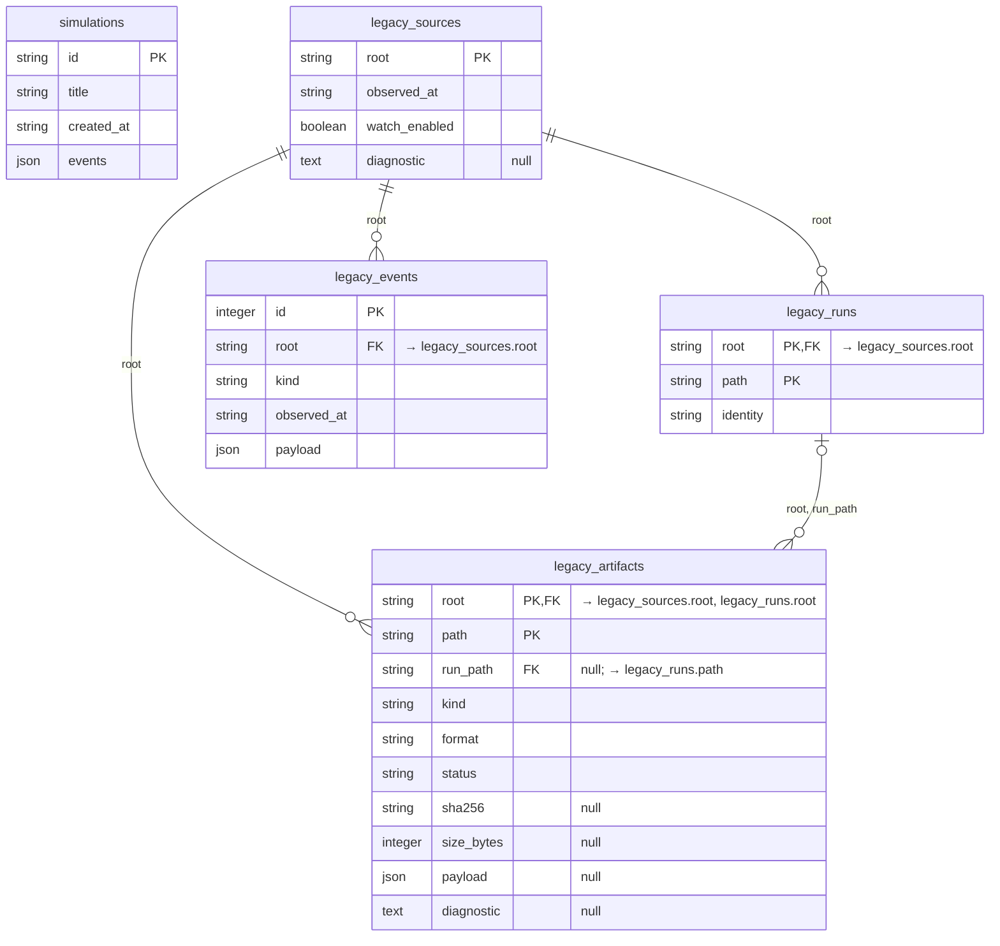

## Managed execution

Operational authority for runs, attempts, the job queue, exclusion per checkout, processes and commits.
`managed_runs.root` is the canonical root of the checkout; there is no project table in this context.

CLI compatibility ([D174](DECISIONS.md#d174--automatic-clients-and-conditional-compatibility)) uses no extra
tables, only the JSON columns: `versions_json` freezes the observed CLI version, `reviewer_cli_launch_sha256` and
`executor_cli_launch_sha256`, the policy hash and, with `local-config-7`/`8`, the automatic provenance or explicit
assertion and the explicit PATH or executable path. `managed_processes.spec.preflight_observed` keeps the diagnostic,
minimum, launch fingerprint and conditional profile of each attempt. A refusal before the target starts has
`launch_permitted=false`, a null process identity and a `refused` capture; if a group was already waiting for GO, its
observed stop is recorded. Fields absent from older histories stay absent and are never back-filled
([flow](flows/cli-compatibility.md)).

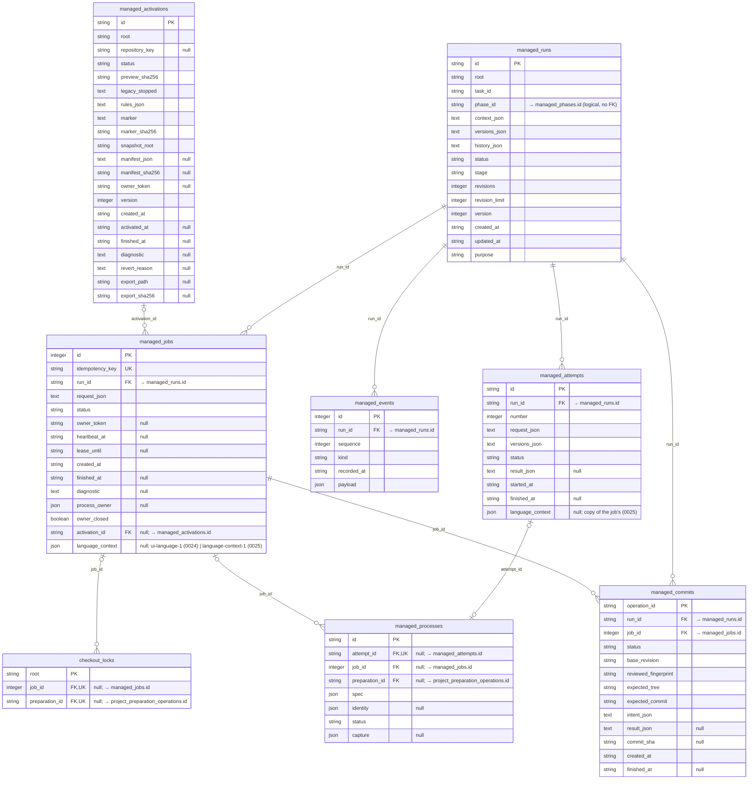

Uniqueness: `managed_attempts` (run_id, number); `managed_events` (run_id, sequence); `uq_managed_commits_live` on `managed_commits` (run_id) where status IN ('INTENT', 'COMMITTED'); `uq_managed_activations_live_root` on `managed_activations` (root) where status IN ('PREPARING', 'ACTIVE', 'REVERTING'); `uq_managed_activations_live_repository` on `managed_activations` (repository_key) where status IN ('PREPARING', 'ACTIVE', 'REVERTING').

## Prompts and permissions

Prompt catalog versioned by scope, and exact permission requests with their consumption.

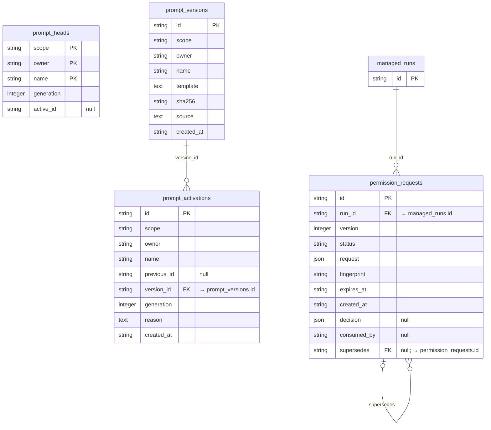

## Phases and creation

Phases with a versioned definition, questions, operations (check, closure, transition, document edit),
authorizations and events ([D032](DECISIONS.md#d032--phases-in-sqlite-and-ready-bound-to-exact-content),
[D034](DECISIONS.md#d034--unattended-batches-versioned-definitions-and-deterministic-annotated-tags),
[D037](DECISIONS.md#d037--root-commit-intent-for-new-projects)). `managed_runs.phase_id` is a logical reference
without a foreign key.

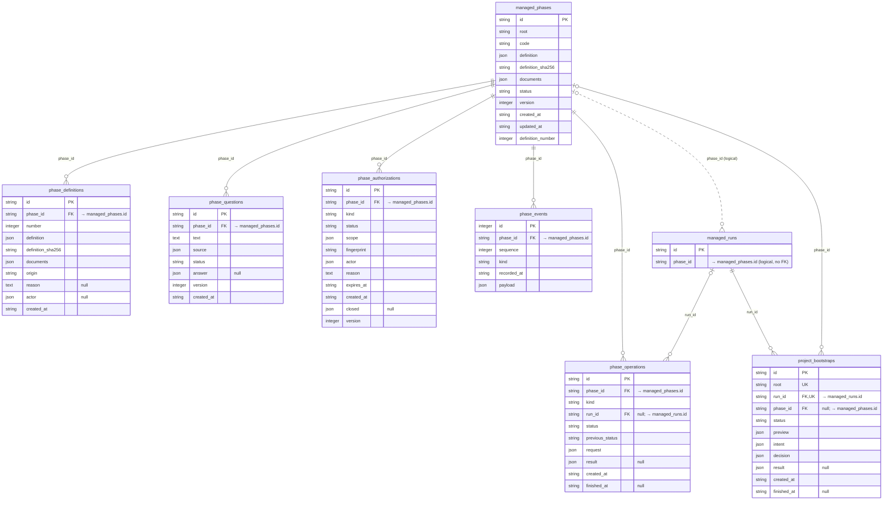

Uniqueness: `managed_phases` (root, code); `uq_managed_phases_open_root` on `managed_phases` (root) where status NOT IN ('CLOSED', 'ABANDONED'); `phase_definitions` (phase_id, number); `phase_events` (phase_id, sequence).

## Chat and conversational planning

Project chat ([D035](DECISIONS.md#d035--chat-as-new-read-only-turns-with-confirmed-proposals),
[D083](DECISIONS.md#d083--chat-over-a-head-snapshot-in-its-own-lane)), definition conversations and phase
planning ([D075](DECISIONS.md#d075--conversational-creation-and-planning-with-drafts-on-disk)). Onboarding
(`kind = 'onboarding'`, [D102](DECISIONS.md#d102--onboarding-by-reverse-engineering-over-head-with-private-drafts))
uses the `source` column to freeze the inventory, HEAD and tree, and `onboarding-drafts/<id>/` next to the database
for its drafts; `managed_runs.purpose = 'onboarding'` links its turns to the planning authority, and the export intent
is recorded in events before the effect. Conversations of the retired import flow (`kind = 'project_import'`) and
their `import-drafts/<id>/` folders are kept only as data: they are neither deleted nor executed again. The downgrade
guard of revision `0019` protects both sources.

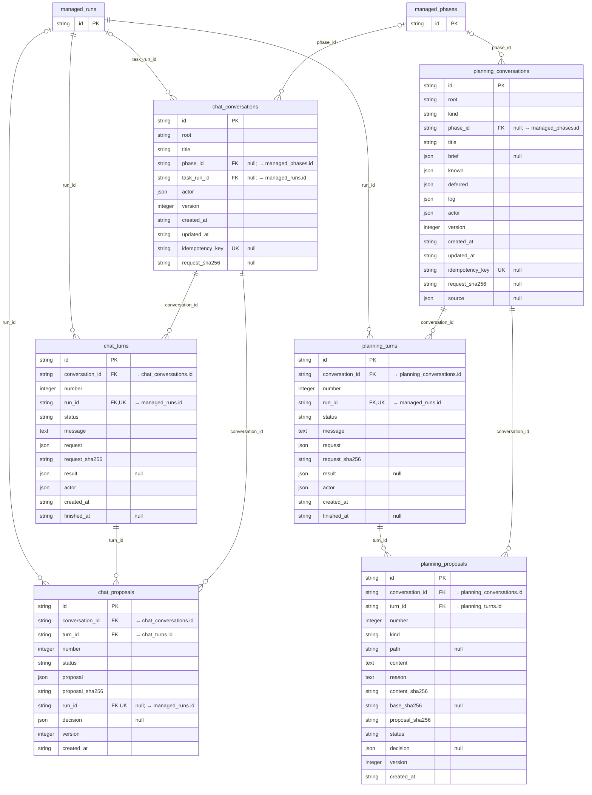

Uniqueness: `uq_chat_conversations_key` on `chat_conversations` (idempotency_key); `chat_turns` (conversation_id, number); `uq_chat_turns_pending` on `chat_turns` (conversation_id) where status = 'QUEUED'; `chat_proposals` (conversation_id, number); `uq_planning_conversations_key` on `planning_conversations` (idempotency_key); `uq_planning_definition` on `planning_conversations` (root) where kind = 'definition'; `planning_turns` (conversation_id, number); `uq_planning_turns_pending` on `planning_turns` (conversation_id) where status = 'QUEUED'; `planning_proposals` (conversation_id, number).

## Confirmed documentation commit of onboarding

`project_imports` keeps one operation per checkout and conversation: the full preview, the commit intent sealed
before the effect, the decision and the result. Onboarding reuses this table without new columns or indexes:
`preview.flow = "onboarding"` identifies the source; `preview.profile` and `profile_sha256` seal the composition
profile, and `decision.profile_sha256` records its confirmation. It keeps the shared purpose
`managed_runs.purpose = 'import_commit'`; the conversation keeps `kind = 'onboarding'`. Job, lock, lease and recovery
are those of `managed_jobs`. Phase `P001` and its document baseline are inserted in the same transaction as the
result and the end of the job. An `INTERRUPTED` status keeps the intent and blocks new work until it is reconciled.

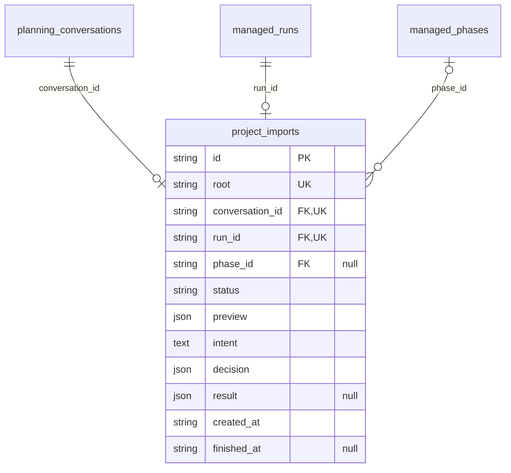

## Metrics and project registry

Per-attempt metrics with provenance ([D074](DECISIONS.md#d074--per-attempt-metrics-with-provenance-and-no-double-counting))
and project registration from the UI ([D078](DECISIONS.md#d078--local-config-3-and-registration-from-the-ui)).
With `local-config-5` and later, the JSON `row` of the registry row and its events can carry `agent_selection`:
`reviewer = {preset_id, model, effort}` and `executor = {preset_id}`; the executor catalog and mode stay in
`row.policy`. A new registry version, its event and the invalidation of proposed phase plans are atomic; only the
proposal's status, version and decision change, never the turn's request or result nor the run snapshots. A row
without a selection keeps the reviewer/executor pair of the TOML ([agents flow](flows/project-agents.md)).

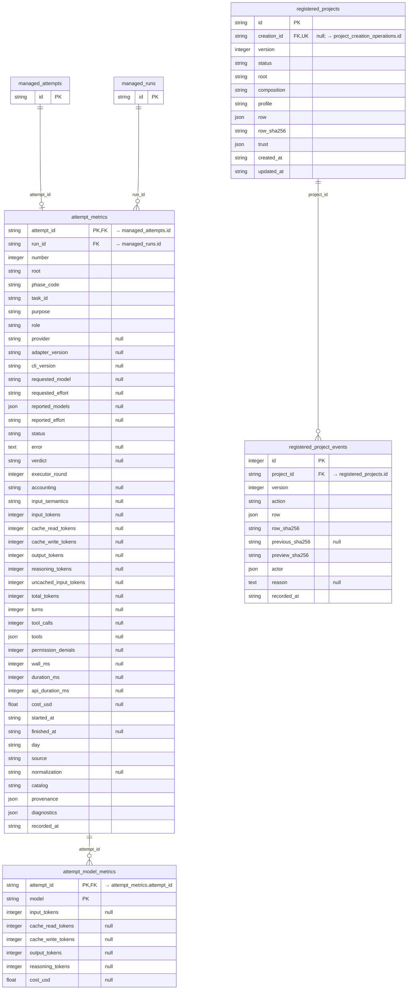

Uniqueness: `ix_attempt_metrics_run` on `attempt_metrics` (run_id, number); `uq_registered_projects_active_root` on `registered_projects` (root) where status = 'ACTIVE'; `registered_project_events` (project_id, version).

## Projects folder and creation of new projects

The projects folder chosen in the UI ([D116](DECISIONS.md#d116--creation-authority-per-project-presets-and-separate-preparation))
authorizes new direct children; it does not widen the TOML registration roots. The singleton row does not exist
until the first selection. Root events keep a snapshot of each revision, without a foreign key to a mutable row as
proof of authority. The intent is sealed before `mkdir`; the child's identity is recorded only after the parent is
synced. Registration, its event, `creation_id` and the `REGISTERED` result are committed together. Creation
operations have no jobs, agents or processes; recipe preparation is recorded separately (below).

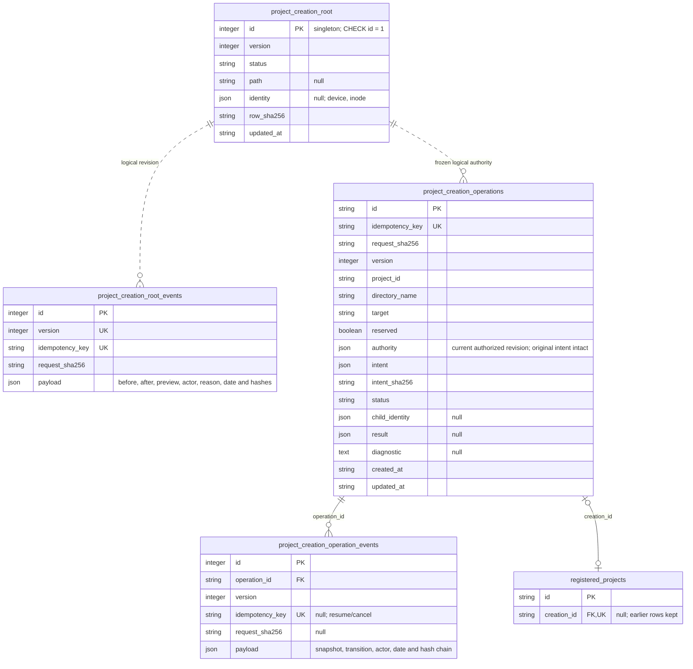

Uniqueness: `uq_creation_reserved_id` on (project_id) and `uq_creation_reserved_target` on (target) where
reserved = 1; `project_creation_operation_events` (operation_id, version); `uq_registered_creation` on
registered_projects (creation_id). Reservations are checked transactionally against registry rows and nested
targets, including case-insensitive physical aliases; the textual indexes do not replace that check. `REGISTERED`
releases the operation's reservation and the registry row takes over; `CANCELLED` releases it only when the
absence of the folder is proven. Reservations do not expire by timeout. Authority changes, withdrawal and short
effects share the SQLite write exclusion ([creation flow](flows/project-creation.md)).

## Recipe preparation

[D119](DECISIONS.md#d119--django-recipe-preparation) and [D143](DECISIONS.md#d143--typescript-web-recipe-1). A
prior intent and a single reservation per checkout; confirmation and job admission or registration share the
SQLite transaction. No fictitious run or attempt is created. Captures and prepared bytes stay inside SQLite, with no
new external artifacts for backup or retention. The receipt is adopted only together with `COMPLETED` and the
release of the lock; its SHA-256 is frozen in later jobs as `project_environment_sha256`.

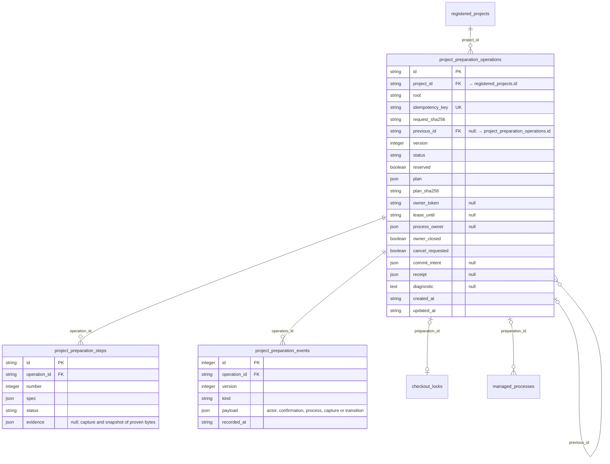

Uniqueness: `uq_preparation_reserved` on (root) where reserved = 1; steps (operation_id, number), events
(operation_id, version). A retry creates another linked operation and copies only the proven `DONE` prefix; the
rows and payloads of earlier attempts keep their bytes. The succession is audited and transfers the reservation.
Cancelling without effects releases the reservation; uncertain effects stay reserved, even without a live lock.
CAS controls store their key and hash in the event payload under the same SQLite exclusion, for replay.

`checkout_locks` keeps `root` as its primary key and requires exactly one owner (`job_id` or `preparation_id`). In
`managed_processes`, `id` replaced `attempt_id` as primary key: older rows keep `id = attempt_id`, its foreign key
and their job; for a preparation, `attempt_id` and `job_id` are null and `preparation_id` is required. A CHECK
constraint forbids empty or mixed owners. Downgrading past this revision is possible only without preparation
history; otherwise a query-only backup is used, without deleting evidence.

## Run projection

`run-projection-1` ([D144](DECISIONS.md#d144--run-projection-run-projection-1)): tables derived from
`managed_runs.history_json`, which remains the authority. They are written in the same transaction as the history,
and revision `0023_run_projection` filled them once by decoding each existing history (formats 1–8) without
modifying it. Run views only read these tables, and metrics and the export preview read them together with
`managed_attempts`; the engine, recovery, checks, chat and permissions keep reading the history. The `*_json`
columns hold the exact text of the history or frozen JSON. The reviewed diff is stored in fixed 64 KiB chunks
(`chunk` from 0). A backup recomputes every run and compares rows and counts; it never rebuilds them.

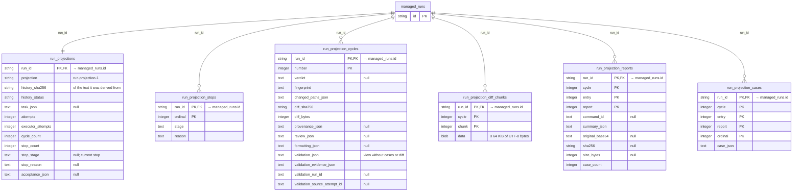

Composite primary keys fix a stable read order: stops by ordinal, cycles by number, chunks, reports and cases by
their indexes. The `cycle` of chunks, reports and cases is the cycle's `number`, without a declared foreign key.
Downgrade removes only these tables.

## Language preferences

One row per installation and database ([D166](DECISIONS.md#d166--global-language-preferences-and-catalogs)).
Revision `0024_product_preferences` creates it with `en`/`en` and version 1; reading it never creates or repairs it.
No foreign key: the rest of the schema only reads it when admitting a job.

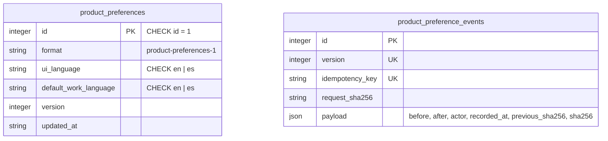

Each `PUT /api/managed/preferences` with the expected version increments `version` and appends an event chained by
hash; the same key with the same request returns the recorded result. `managed_jobs.language_context` seals
`{format: ui-language-1, ui_language, preferences_version}` in the transaction that admits the job; resuming a run
(retry, revalidation, bootstrap, import commit, export or document edit) copies the value of the run's first job,
null included. Jobs older than `0024` keep null ("not recorded"). Downgrade is refused when events exist; without
them every capture is the factory `en` and is dropped with the column ([flow](flows/language-preferences.md)).

## Work language per project

One row per canonical root ([D167](DECISIONS.md#d167--immutable-work-language-per-root-language-pair-per-job-and-attempt)),
written once and never updated or deleted. Revision `0025_project_work_languages` creates the table empty: earlier
projects have no confirmed work language and none is inferred. No foreign key: the root identifies the checkout even
if its registration is removed, changes id or the project comes from the TOML.

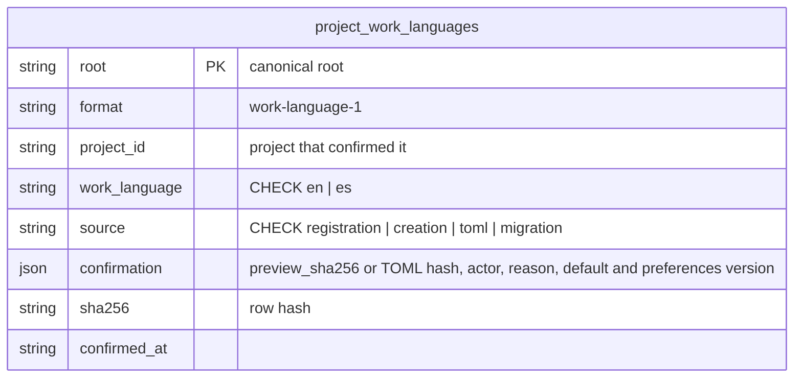

It is written in the transaction that confirms a registration (including the registration of a newly created
project), at startup from a `local-config-6`–`8` TOML that declares it, or by the explicit confirmation from absent to
a value. Another value for the same root is refused. Since `0025`, `managed_jobs.language_context` seals
`language-context-1` (`ui_language`, `preferences_version`, `work_language`, `work_language_source`,
`work_language_sha256`) when admitting each new job; without a row no new work is admitted.
`managed_attempts.language_context` copies the job's value when each attempt starts (null before `0025`). Downgrade
is refused when any row exists (an explicit confirmation cannot be represented earlier); without rows it drops the
table and the column ([flow](flows/project-work-language.md)).

## Versioned configuration

Alembic `0026_configuration` adds the three tables below; `0027_profile_proposals` makes registered-project
`composition` and `profile` nullable for documentary intake. Current head: `0027_profile_proposals`, **54 tables**.
References to saved/active/pending revisions are checked transactionally by the service; revision numbers are
scoped composite keys. The content authority is immutable private TOML, while SQLite owns executable references.

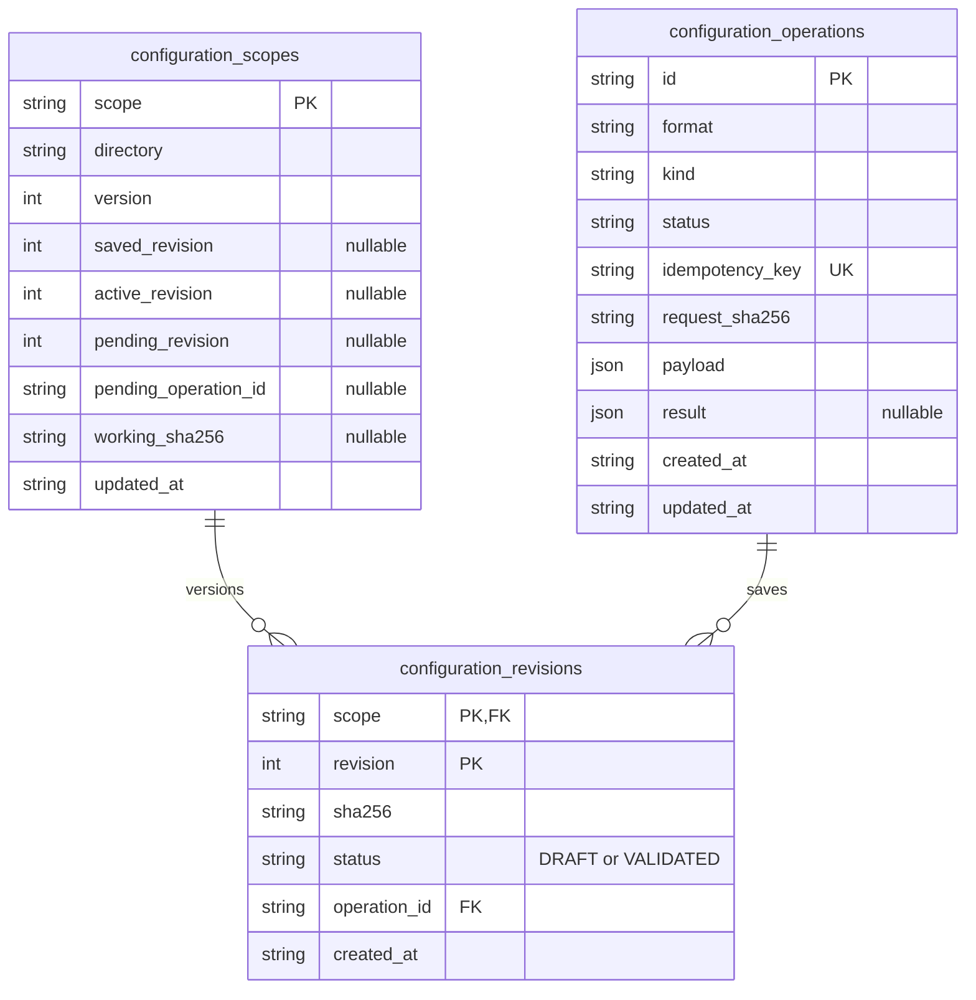

Operation states: INTENDED, FILES_WRITTEN, SAVED, RECOVERY_REQUIRED, CONFLICT, APPLIED. Kinds include SAVE,
ACTIVATE, PROMOTE, CANCEL, RECOVER and ASSIST. Intent records and exact request hashes precede file effects;
idempotent replay does not repeat commands or model calls. Assistance has its own process journal without a
fictitious managed run. Global SAVE can include derived project copies or a legacy-import provenance snapshot.
Activation records exact receipt evidence; it never rebuilds historical receipts.

Profile proposals reuse planning proposals (`kind=profile`) with frozen binding/document evidence. Generic
preparation reuses project preparation operations/steps/receipts with a contract discriminator, not a task run.
Own configuration authority is in scope references, while nullable registry composition/profile marks intake.
Jobs seal project revision/hash and environment receipt in `versions_json`; earlier snapshots retain their bytes.
A backup inventory covers all three tables plus referenced configuration/evidence. Restore keeps the existing
query-only mark and execution disabled, without interpreting original paths as writable destinations.
