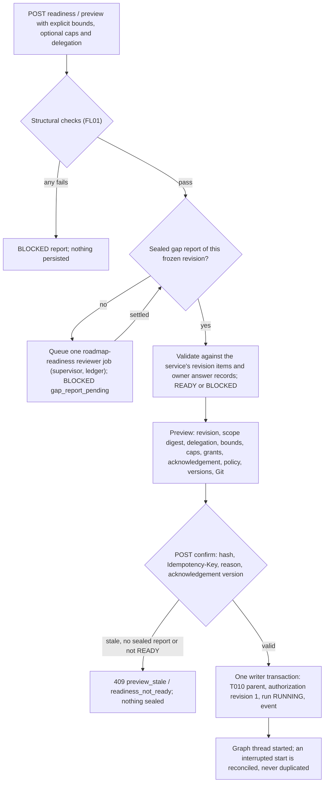
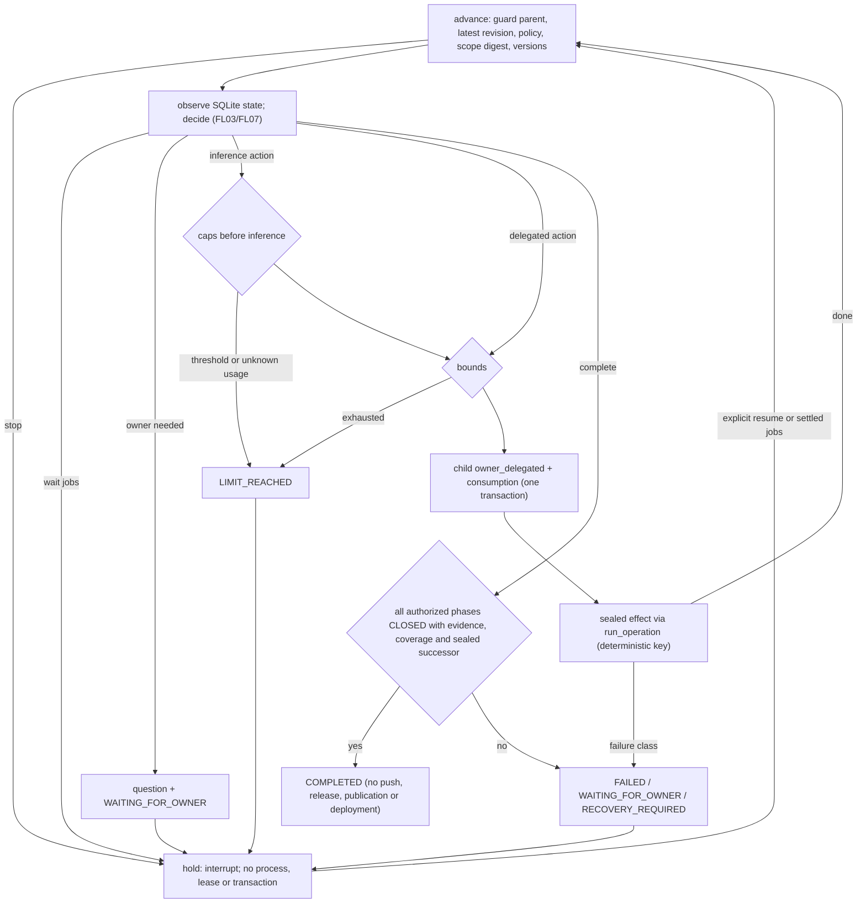

# Flow — autonomous roadmap runs

P002-T016, [D276](../DECISIONS.md#d276--autonomous-roadmap-runs-local-bounds-and-stops) and
[D299](../DECISIONS.md#d299--autonomous-run-authority-children-and-persistent-bounds),
[D300](../DECISIONS.md#d300--g11-g12-and-g17-accepted-with-conditions) and
[D301](../DECISIONS.md#d301--delegated-task-contracts-and-effect-boundary-verification); target design in
[FL01–FL03](../phase/P002-T001-flows.md#fl01--admission-and-autonomous-authorization). Implemented in source with
synthetic evidence, including a managed journey over the production effects
([record](../phase/P002-T016-autonomous-roadmap.md)).

## Admission

| Step | Guard | Effect owner | Failure / recovery |
|---|---|---|---|
| Readiness | Accepted revision, roadmap order, criteria, one open first phase, preparation, clients, clean Git, no uncertain writer or pending effect, no other run or manual batch, explicit finite bounds | Service | Report only |
| Gap report | Only after the twelve checks pass; one job per frozen revision; closed schema, citations to items of that revision | Supervisor/Reviewer, Service | Malformed output sealed and not retried; operational failure is an event, never requeued |
| Gap answer | Owner record bound to the revision and an `owner_answer_required` gap of the sealed report | Owner → Service | A revision change makes the answer not current |
| Confirm | Acknowledgement `autonomy-ack-1`; preview recomputed without generating a report, equal hash; READY | Owner → Service | Duplicate key returns the same run; conflicting key 409 |
| Run creation | Partial unique index and in-transaction check: one non-terminal run per root; no active manual batch | Service | `reconcile` starts a sealed run whose graph never started |

## Run states

States, transitions and stop classes follow [FL02](../phase/P002-T001-flows.md#fl02--autonomous-run-states).
Every stop is a compare-and-set on the run with its reason, evidence and a deduplicated event in one transaction.
Revocation is also allowed from `RECOVERY_REQUIRED`. `LIMIT_REACHED` and a scope amendment continue only through a
new authorization revision (raised bounds, current preview); `RECOVERY_REQUIRED` continues only through recovery.

## Roadmap step

Production effects reuse T015 `propose`, `stage`/`preview`/`adopt` (delegated), a `roadmap-task-plan` reviewer job
for the exact task contract, T014 `submit` with the task child and `submit_commit`, T015 `submit_check` and
`submit_close` (delegated). Delegated adoption and closure verify the child inside their own writer transaction;
closure repeats it under the writer fence of each Git reference effect. The supervisor calls `advance_all` before
each claim: only RUNNING runs whose graph waits on settled harness jobs continue, at most once per wait.

Review corrections (D301): an adoption child binds the staged proposal, draft, coverage, exact preview, accepted
revision and phase version, compared inside the adoption transaction. Every delegated inference is admitted inside
the attempt-sealing transaction (also inside one job): current child authority and T010 parent, a RUNNING run, then
the caps. A refusal launches no process; authority refusals stop `FAILED`, cap refusals `LIMIT_REACHED`, and a
pause-held job continues after the explicit resume. A failed task-contract job is a durable stop; contracts and
acceptances are bound to the identity of the accepted task, criteria and relations. Only this run's own delegated acceptances of the current phase/task version are committed; failed
delegated runs stop durably and are readmitted only after an explicit owner resume. Completion uses each closure's
sealed READY check and requires coverage of every active requirement.

Third review corrections: T014's own transactions are the authoritative boundary for delegated task effects. `submit`,
`resume` and `submit_commit` accept an optional `delegated` check that runs inside their writer transaction after
the idempotent replay (a recorded key and request return their job without a new check or effect) and before
anything is created. Admission verifies the sealed `task_admission` child, phase and task, live authority, the
task-child permission, the digest of the contract T014 freezes and the contract identity read from the accepted
knowledge in that transaction; commit verifies that the acceptance comes from a run this autonomous run admitted for
the phase and task, with its frozen contract, active task-child authority and the current identity. A stale
identity or contract refuses with a typed code (`task_contract_stale`, `task_contract_mismatch`,
`acceptance_not_delegated`, `acceptance_identity_stale`) recorded in the journal outcome and the run's
WAITING_FOR_OWNER stop, with no job and no commit effect; authority refusals stop FAILED. Manual T014/T015 paths and
T010-delegated submissions pass no check and keep their contracts.

A pause that holds the reviewer after the executor finished is a `held_review`: the T014 run STOPPED at the reviewer
by a `state` admission refusal (`autonomy_admission_refused` with `role`) of its latest job, settled attempts and the
executor's content evidence frozen in the last review cycle. The explicit owner resume accepts a non-clean checkout
only when it equals that evidence and the run, its child, authority, frozen contract, identity and settled writer
verify; otherwise it is refused (`held_review_checkout_mismatch`, `held_review_stale`, …). After the resume the step
routes `resume_review`: one journaled effect, keyed by the persisted refusal, queues T014's revalidation (no
`retry_executor`) of the same run under its existing admission child, verified again inside T014's resume
transaction with a RUNNING run. It seals no child and consumes no task attempt or progress unit; caps stay at the
reviewer's admission. The queued job carries the executor evidence (`expected_evidence`). When it runs, even after
a restart, T014 compares its first effective capture with that evidence before validation or the reviewer. A
difference stops the T014 run at stage `continuation`, leaves the files and ends the autonomous run `FAILED
held_review_evidence_changed`, with no review, commit or automatic readmission. A pause held before the executor ran
still readmits the task after the resume.

Bounds: task admissions per D296 family, judge reconsiderations per equivalent subject, replacement plans per phase,
remediation proposals per cause, and delegated actions per equivalent progress fingerprint. Consumption is
insert-only per root. Caps: deadline, invocations, observed tokens and valuation on one basis, checked before each
inference; unknown usage stops only when its cap is set.

## Owner controls

| Control | Guard | Effect |
|---|---|---|
| Answer | Question OPEN, expected version, same authorization revision and accepted revision, Idempotency-Key | ANSWERED with `owner_confirmed`; a moved revision supersedes the question; never resumes |
| Pause | RUNNING, expected version | PAUSED; the graph holds at the next node |
| Resume | Resumable state, expected version, no open question, clean Git (or exactly the evidence of one verified `held_review`), no uncertain writer, current authority/scope/policy/versions, caps | RUNNING; the graph resumes, continues a recovered thread, or starts a continuation thread when the old one failed without pending operations; a held review continues in its own T014 run once |
| Revoke | Non-terminal, expected version, reason | T010 parent ended (children cease), delegated writers cancelled by the existing poll, thread revoked, REVOKED |
| Recover | RECOVERY_REQUIRED or REVOKED, current version, explicit stopped-writer confirmation, settled writers | Journal classification and abandonment, graph continuation stamp and RECOVERY_REQUIRED → PAUSED commit together |
| Revise | Stopped run of the lineage, current preview, bounds not lowered | New authorization revision and parent; previous parent superseded; open questions superseded; RUNNING |

## Source

`core/engine/autonomy.py`, `storage/autonomous_runs.py`, `services/autonomous_roadmap.py`,
`services/autonomous_effects.py`, `orchestration/roadmap.py`, `services/permission_lifecycle.py`
(`roadmap_parent`, `task_child`, `end_roadmap`, `delegated_inactive`), `api/autonomous.py`; tests in
`tests/product/test_autonomous_roadmap.py`.

Accounting's `autonomous_run_id` projects historical parent execution ownership from the sealed child and
the inference-bearing managed job. The immediate workflow thread remains a separate identity. The read
projection groups the delegated invocations without reapplying live authority or computing admission caps.
[Accounting flow](metrics-accounting.md).
