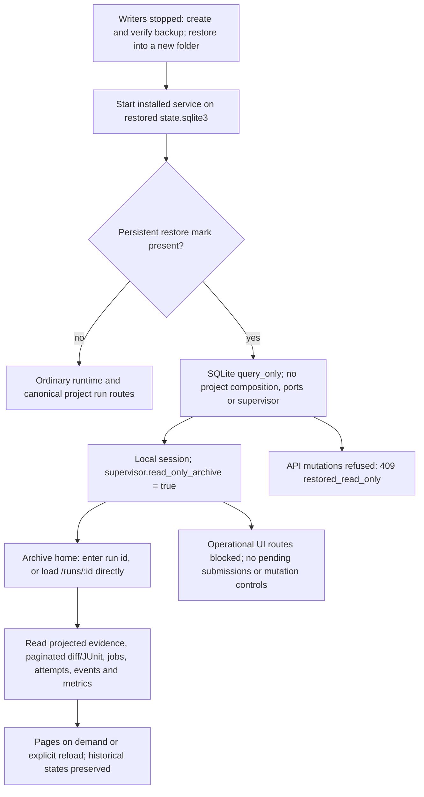

# Flow — query-only backup consultation

A verified restore keeps recorded states and evidence without configuring projects or reading their checkouts.
The persistent archive mark grants consultation only; it never grants executable authority.

- `read_only_archive` comes from `PRAGMA user_version=0x483532`, never from absent agents, an unconfigured project,
  `ports_configured=false` or `supervisor=false`. Configuration and environment-based composition are skipped.
- The UI resolves this signal before mounting operational pages or `ProjectWorkspace`, or reading stored pending
  submissions. Archive navigation offers the home and global statistics; run links use `/runs/:id` and survive a
  reload. Unknown ids show a missing resource; the browser does not scan the manifest or invent a project.
- Root, phase and task are historical context. The run shows its state, commit, cycles and evidence from the bounded
  projection, with diff hashes/pages and JUnit cases plus the original XML. Jobs, attempts and events are paginated;
  recorded active events are a bounded snapshot. Metrics preserve provenance and distinguish absent from zero or
  incomplete data. Read failures show errors, not invented empty results.
- Recorded QUEUED, ACTIVE and RECOVERY_REQUIRED states trigger no execution polling. Session/authentication checks
  remain separate. No permissions, recovery, execution, commit, chat or configuration controls are mounted, even
  when a response advertises actions. Direct API mutations retain the query-only guard.
- Reads share the ordinary projection-based components without selecting or decoding the full history, rebuilding
  projections or accessing the checkout. In ordinary mode `/runs/:id` keeps its canonical project redirect and its
  existing empty state when no project is configured.
- Backup format 3 (schema 0028) also records the accounting inventory and recomputes reference, capture, binding,
  valuation and cohort digests in the same snapshot; any mismatch refuses verification. Accounting values, reasons
  and cohorts are read from SQLite without original roots, clients or network; nothing is recalculated or backfilled.
  A bundle of an older schema is refused with a pointer to `backup-upgrade`, which migrates a private copy into a new
  query-only format-3 bundle and leaves the original bundle byte-identical.
- Consultation does not resume jobs, release locks or certify that historical writers stopped. Stop the service
  normally; its ephemeral access key is removed. Uncertain historical process identity remains uncertain.

## Source

- `storage/backup.py`, `storage/database.py`, `services/managed_runtime.py`, `api/schemas.py`.
- `frontend/src/ServiceMode.tsx`, `frontend/src/Page.tsx`, `frontend/src/router.ts`, `frontend/src/pages/Archive.tsx` and shared run components.
- [Run evidence](task-run.md), [architecture](../ARCHITECTURE.md#5-persistence),
  [backup commands](../../README.md#operation).
