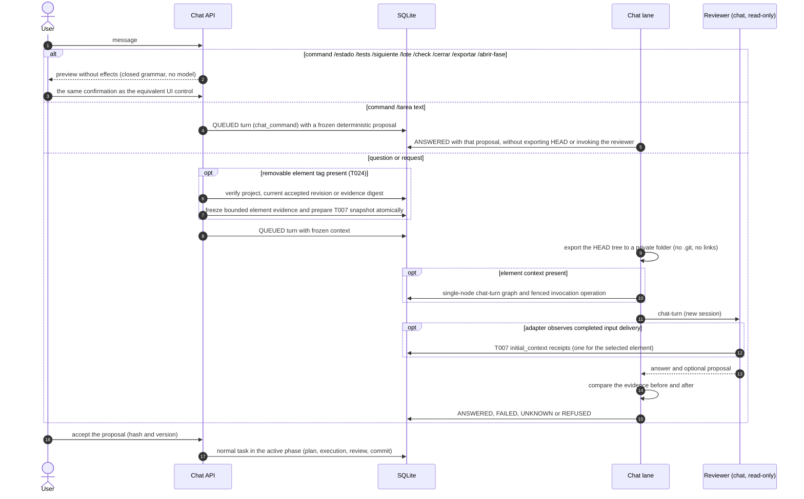

# Flow — project chat

Questions over a HEAD snapshot without waiting for the executor, deterministic commands and proposals that become
tasks only after confirmation ([D035](../DECISIONS.md#d035--chat-as-new-read-only-turns-with-confirmed-proposals),
[D083](../DECISIONS.md#d083--chat-over-a-head-snapshot-in-its-own-lane)).

Questions do not take the checkout lock; accepted tasks follow the [task flow](task-run.md). The side panel of a conversation follows
its latest turn's run live ([reading a run](task-run.md#reading-a-run)). Command names are
protocol tokens with historical Spanish names (`/estado` status, `/siguiente` next task, `/lote` batch, `/cerrar`
close, `/exportar` export, `/abrir-fase` open phase, `/tarea` task) and are not translated; the `/tarea` answer follows the interface language and the proposed task
text follows the work language ([D169](../DECISIONS.md#d169--sealed-language-directive-generated-documents-in-the-work-language)).
A turn whose writer is confirmed stopped becomes `UNKNOWN`, and one refused before effects `REFUSED`; neither is
retried automatically. Each turn seals the interface language current at admission
([language preferences](language-preferences.md)).

## Source

- `core/engine/chat.py`, `core/engine/chat_commands.py`, `storage/chat.py`, `adapters/chat_snapshot.py`.
- Template `chat-turn.md`.

## Contextual map entry (P002-T024, D307, D317)

Local source is complete; independent technical review, owner visual acceptance and integration remain pending
([evidence](../phase/P002-T024-contextual-chat.md)). The separate reviewer talk button resolves the selected phase,
task, run or stable L3 step through authenticated `GET projects/{project}/chat-context`. Knowledge references use
the persisted knowledge project, stable ID and current accepted revision; run/step references use the project,
run ID, step key when applicable and a digest of bounded T020 projection evidence. Labels/content are never
admission inputs. Foreign, absent and incoherent selections are refused; `409 element_stale` keeps the message
unsent until the owner explicitly refreshes or removes the tag. Late responses cannot restore a removed selection.

Map conversations have no implicit phase/task-run binding. Removing the tag clears both its reference and refresh
locator, omits `element` entirely, and returns focus to the composer. It does not copy a locator into documents,
run IDs, title or other request fields. Legacy projects open untagged and explain why. Existing untagged/manual
conversations retain their prior context/defaults. Commands require tag removal before their existing preview and
confirmation path; proposals still execute only through the confirmed normal task path. Judge escalations and
permissions remain outside chat authority. Archives show no button and mutations retain `409 restored_read_only`.

Admission freezes the selection and ordinary T007 accepted snapshot in the enqueue transaction. A tagged turn
uses `chat-turn@1` on the existing managed scheduler. Fenced attempt start seals the operation/context with the
existing accounting row. Exporting HEAD changes only the physical execution directory, preserving the original
project/root attribution and the absence of a checkout lock. The canonical phase/task renderer is shared with
document rendering; run/step summaries select T020 projection fields without full histories or native originals.
The reference, label and evidence frame are part of the 16 KiB UTF-8 limit; ranges, source/exposure hashes, byte budget and truncation are
recorded. Element content has capture authority and an explicit evidence-only frame.

Only the adapter's completed-input observation persists ordinary initial receipts plus exactly one element
receipt. Knowledge kinds keep v2; `run_evidence` uses additive v3. A known pre-GO refusal records failure without a
delivery digest, partial input stays unknown, persistence failure cannot claim successful delivery, and recovery
does not rerun inference. Receipt readers and backup/restore verify the saved selection and prompt against the
frozen accepted snapshot. Queries work without checkout or writes in an archive. See
[frozen context](frozen-context.md) and [work map](work-map.md).
