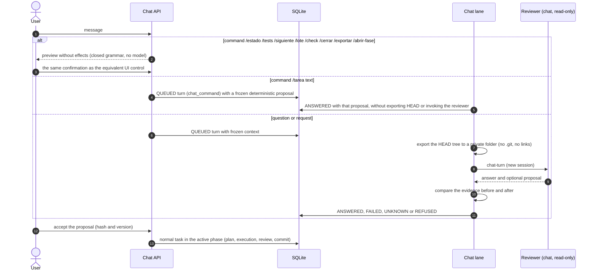

# Flow — project chat

Questions over a HEAD snapshot without waiting for the executor, deterministic commands and proposals that become
tasks only after confirmation ([D035](../DECISIONS.md#d035--chat-as-new-read-only-turns-with-confirmed-proposals),
[D083](../DECISIONS.md#d083--chat-over-a-head-snapshot-in-its-own-lane)).

Questions do not take the checkout lock; accepted tasks follow the [task flow](task-run.md). Command names are
protocol tokens with historical Spanish names (`/estado` status, `/siguiente` next task, `/lote` batch, `/cerrar`
close, `/exportar` export, `/abrir-fase` open phase, `/tarea` task) and are not translated; the `/tarea` answer follows the interface language and the proposed task
text follows the work language ([D169](../DECISIONS.md#d169--sealed-language-directive-generated-documents-in-the-work-language)).
A turn whose writer is confirmed stopped becomes `UNKNOWN`, and one refused before effects `REFUSED`; neither is
retried automatically. Each turn seals the interface language current at admission
([language preferences](language-preferences.md)).

## Source

- `core/engine/chat.py`, `core/engine/chat_commands.py`, `storage/chat.py`, `adapters/chat_snapshot.py`.
- Template `chat-turn.md`.
