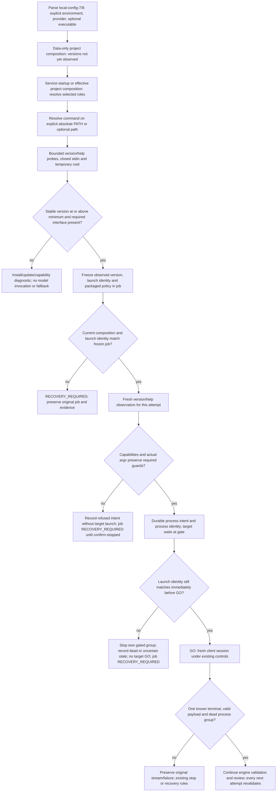

# Flow — automatic CLI discovery and compatibility

Agent CLIs are discovered automatically and admitted by minimum version and capabilities
([D173](../DECISIONS.md#d173--automatic-cli-discovery-minimums-and-capability-contract),
[D174](../DECISIONS.md#d174--automatic-clients-and-conditional-compatibility)). No version pin, candidate acceptance
or operator evidence file is required in `local-config-7`/`8`.

A refusal at binding or at an attempt raises a journal error: the supervisor quarantines the job without a result,
and confirming the writer stopped marks any unfinished attempt `INTERRUPTED` without retry
([task run](task-run.md#run-states)). Admission of new work already rejects unresolved or below-minimum clients with
`CompatibilityError`, before any run exists.

Minimums are Codex 0.163.0 and Claude Code 2.1.304 for both roles. Historical configurations and evidence remain
readable; a below-minimum client cannot start new work. Only effective provider roles are detected during normal
operation; `check-config --preflight` explicitly diagnoses the defaults and every preset role. No auth, status or
login command, test prompt, network lookup, installation or global configuration change is part of discovery.

Each mutation observes the client again and reuses that project resolution only inside the same request. Each
attempt also observes version and help again. Content-hash caching restats inode, size, mtime and ctime; it is not a
cached compatibility verdict. A fresh job can detect an updated client automatically; a queued job never adopts it.
Explicit capability lists wrapped across help lines stay scoped to their own option; a missing required value
still blocks. Source and profile hashes bind the packaged policy; symlink, script and interpreter hashes bind
explicit local launch files. Hashing does not certify transitive runtime dependencies or prevent adversarial concurrent
replacement. Public reports expose hashes and structured diagnostics, not raw help, environment values or executable
paths.

Later releases matching the known interface are admitted with **conditional compatibility**. The packaged policy
keeps explicit sandbox, trust, memory and configuration controls; it does not claim observation of undocumented
startup persistence or of effective permissions in every new release. Missing or changed local controls block. No
per-release approval or audit is transferred to the user. Provider-internal retries remain unknown; the harness adds
no fallback or retry. Read-only project and history views do not trigger discovery.

## Source

- `adapters/cli_compatibility.py` (minimums, policy, discovery and identity), `adapters/cli_agents.py` (adapter
  `cli-14`, argv and preflight), `adapters/cli_diagnostics.py`, `adapters/process_gate.py`.
- `services/local_config.py` (`local-config-7`/`8`), `services/managed_runtime.py`, `cli.py` (`check-config`,
  `diagnose-cli`).
