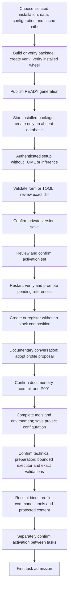

# Guided installation and configuration

Implemented in the starting baseline ([D216–D228](../DECISIONS.md#d216--isolated-installation-and-setup-session)).
User commands and options are in the [README](../../README.md#install).

Installation is offline by default; network downloads require `--allow-network`. Paths may contain spaces; local
Python/uv are selected explicitly. A package entry needs no Node or checkout. Failed generations are retained and
never advertised as READY. Matching repetition checks the current receipt, artifact bytes and venv without
reinstalling. Updates preserve previous generations and require stopped writers; schema migration is separate.
Start checks locks, receipt and loopback port, preserves signals, and never silently migrates an existing database.
The port precheck permits recently closed connections; an active listener still blocks.

Global content is private immutable TOML outside checkouts. SQLite owns saved/active/pending revision references.
CAS, exact preview hashes and idempotency keys guard intentions before atomic file publication. External edits do
not change active authority. Global activation covers derived private project copies and takes effect on restart;
project activation takes effect between tasks after the work barrier and receipt checks. Saving alone does neither.

Empty failed definition/onboarding turns do not count as pending adoptable work
([D236](../DECISIONS.md#d236--empty-failed-intake-turns-are-not-pending-configuration-work)):
every turn must be FAILED with no result, unchanged observations and no observed drafts,
and the conversation must have no known drafts, edit log, deferrals or proposals.
Existing jobs, uncertain writers and all other work barriers still block. Historical
turns stay immutable; a later explicit message uses newly frozen active clients.
Activation still requires its exact preview/confirmation and restart; no failed turn retries automatically.

A new project talks from a brief; onboarding inventories a committed tree without executing it. The reviewer
proposes tools, meaningful validations, command evidence and a technical plan after documentation/architecture.
Adopting a proposal does not save or activate TOML. The application makes the confirmed documentary commit,
adopts P001, saves the completed profile, and presents a separate preparation plan with files, exact argv,
dependencies, network and write scope. The executor prepares only that scope; the application validates, records
fresh JUnit and makes a reconcilable technical commit when content changes. Failed/interrupted work cannot issue
a valid receipt. Activation independently verifies the saved configuration, tools/environment, documents, clean
HEAD, receipt and absence of pending/uncertain work. P001 alone cannot admit tasks. Recipes remain optional.

Later editing uses the same gates. Technical changes need current committed documents and a new receipt;
nontechnical changes may retain an exact compatible receipt after current verification. Optional assistance
freezes active clients and authorized context. The reviewer returns a proposal in read-only mode; the executor
can inspect a private scope without global file writes, commands, installs or network. Applying a result changes
only the draft. Job/client snapshots admitted earlier are never rewritten or silently replaced.

Formats 1–8 retain entry and hashes. Explicit import previews source/hash/effective registry, saves a v9 global
and project drafts together, and retains legacy authority until every converted profile is newly prepared,
confirmed and promoted on restart. Old recipe receipts are not converted. This converts product configuration,
separately from onboarding source code. Conflicts and incomplete permissions block, preserving originals.

Recovery compares journaled bytes and requires explicit stopped-writer confirmation where applicable; no timeout,
GET or reload certifies death or retries effects. Browser drafts and exact request envelopes survive conflicts in
the tab; retries are explicit. Backup format 2 inventories TOML versions, working copies, intents and referenced
evidence under explicitly authorized roots. Restore reads its own verified bundle without original paths or
clients; mutations, assistance, preparation and activation remain disabled. Format 1 without new configuration
remains readable. Consultation does not certify that historical writers stopped.
