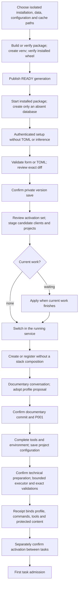

# Guided installation and configuration

P002-T011's integrated structured intake adopts knowledge independently of configuration. Its accepted revision
is not a profile adoption, preparation receipt or activation. Export/commit remains pending T013 and
the profile proposal and its exact owner confirmation bind staged structured knowledge and sources.
No gate is inferred from canonical adoption. Invalid profile output refuses the whole turn.
A profileless intake cannot adopt knowledge until a valid current profile proposal is available;
confirmation of that profile remains a separate operation, allowed before or after knowledge adoption.
See [T011 evidence](../phase/P002-T011-db-intake.md).

Implemented in the starting baseline ([D216–D228](../DECISIONS.md#d216--isolated-installation-and-setup-session)).
User commands and options are in the [README](../../README.md#install).

Installation is offline by default; network downloads require `--allow-network`. Paths may contain spaces; local
Python/uv are selected explicitly. A package entry needs no Node or checkout. Failed generations are retained and
never advertised as READY. Matching repetition checks the current receipt, artifact bytes and venv without
reinstalling. Updates preserve previous generations and require stopped writers; schema migration is separate.
Start checks locks, receipt and loopback port, preserves signals, and never silently migrates an existing database.
The port precheck permits recently closed connections; an active listener still blocks.

Global content is private immutable TOML outside checkouts. SQLite owns saved/active/pending revision references.
CAS, exact preview hashes and idempotency keys guard intentions before atomic file publication. External edits do
not change active authority. Global activation covers derived private project copies and applies in the running
service ([D238](../DECISIONS.md#d238--live-configuration-switch-at-an-idle-boundary)); project activation takes effect between tasks after its documentary barrier and
receipt checks. Saving alone does neither.

The activation preview stages the whole candidate without installing it: global composer, preflight of both roles
with the exact executable/PATH/environment, and every ACTIVE registered project with the set's own revisions and
selected receipts. A refusal lists project or role, setting, code and diagnostic and changes nothing. After
confirmation, an idle installation switches at once. Otherwise the set waits (APPLY_PENDING) for jobs of both lanes,
checkout locks, preparations, phase operations, project creation, documentary commits, acceptances, commit intents
and configuration assistance; documentary conversations and proposals do not hold a global set. Waiting work and
new admissions use the active set; nothing is cancelled, retried or rebound. The idle writer lane, a configuration
read or a confirmation restages and promotes the set; if the candidate no longer composes it is withdrawn (PROMOTE
FAILED) and the previous set stays active. A restart before the boundary loads the previous set and the same
boundary applies the pending one. Worker-loop service fields under a running supervisor and legacy import
promotion still need restart; the preview names them. Cancelling uses the same exact CAS confirmation.

Empty failed definition/onboarding turns do not count as pending adoptable work
([D236](../DECISIONS.md#d236--empty-failed-intake-turns-are-not-pending-configuration-work)):
every turn must be FAILED with no result, unchanged observations and no observed drafts,
and the conversation must have no known drafts, edit log, deferrals or proposals.
Existing jobs, uncertain writers and all other work barriers still block. Historical
turns stay immutable; a later explicit message uses newly frozen active clients.
Activation still requires its exact preview/confirmation; no failed turn retries automatically.

A new project talks from a brief; onboarding inventories a committed tree without executing it. The reviewer
proposes tools, meaningful validations, command evidence and a technical plan after documentation/architecture.
Before profile adoption, the operator reviews/applies the exact document proposals to drafts. Missing or changed
documents are named as blockers. Informational pending notices do not block this adoption; unresolved nondeferred
blocking questions do. Candidate revalidation waits for the exact applied documentary base and confirmation repeats
all context/version/HEAD guards (D244). Saving another profile draft is only necessary for edits.
Adopting a proposal does not save or activate TOML. The application makes the confirmed documentary commit,
adopts P001, saves the completed profile, and presents a separate preparation plan with files, exact argv,
dependencies, network and write scope. The executor prepares only that scope; the application validates, records
fresh JUnit and makes a reconcilable technical commit when content changes. Failed/interrupted work cannot issue
a valid receipt. Activation independently verifies the saved configuration, tools/environment, documents, clean
HEAD, receipt and absence of pending/uncertain work. P001 alone cannot admit tasks. Recipes remain optional.

For new generic previews, existing file aliases outside `local_paths` can be read-only inputs only when their bounded
chain resolves to an explicitly declared executable with frozen resolved path/hash (D247/D248). Preview records exact
chain paths, link text and modes; confirmation binds that evidence. Execution and post-step snapshots preserve it
and recheck tool bytes, so changes fail without a receipt. D248's `external-directories-1` policy explicitly binds
external directory aliases only along that tool chain; the 40-link ceiling includes them. Protected aliases, directory
links inside the checkout, unrelated targets, broken links and loops are refused. Tool-link resolution failures have
a link diagnostic instead of the generic folder-identity error. The receipt carries the same evidence for activation/
admission verification; recovery does not rediscover or refresh it. Old operations/receipts retain their original
policy, including D247 without external-directory support. This does not expand write/local/environment paths or
certify undeclared environment contents.

The generic review displays authorized write paths as possible effects, private process directories, the executor's
selection/instructions/write scope, exact nested command argv plus cwd/timeouts/environment, network/scripts and
technical commit (D249). It does not show invented fixed content/hashes. Recipe v1/v2 keeps its fixed-file review.
Full evidence, reason and explicit consent still bind the exact preview/configuration; confirmation and activation
remain separate. Changing this display never launches preparation.

Guided forms ([D250](../DECISIONS.md#d250--guided-profile-and-agent-forms-over-the-existing-configuration-contract))
edit the same global/project tables as TOML. The global editor covers agents (other environment variables, version
pin, tool capabilities), reusable profiles, compositions and agent presets; recipes stay TOML-only. The project
editor, in the project's Settings and overview, edits profile commands (argv, cwd, timeout, environment, JUnit),
prefixes, protected/sensitive/allowed/data-model paths, executor instructions, the formatter pair, installed paths,
command environment, authorization/limits and the project's agent copies, as far as the stage allows: before the
first activation only paths, environment, authorization and limits; later commands and agents, and the profile once
the editing base is loaded. Tool lists exist only for a Claude Code executor; unsupported ones stay visible until
removed explicitly. Client checks name the field to correct, the server stays authoritative, and save reviews state
per project whether a new preparation is required, which derived copies change only their global reference and that
admitted work keeps its frozen settings. Values without a control are carried over unchanged; editing calls nothing.

Later editing uses the same gates. Technical changes need current committed documents and a new receipt;
nontechnical changes may retain an exact compatible receipt after current verification. Optional assistance
freezes active clients and authorized context. The reviewer returns a proposal in read-only mode; the executor
can inspect a private scope without global file writes, commands, installs or network. Applying a result changes
only the draft. Job/client snapshots admitted earlier are never rewritten or silently replaced.

Billing metadata (P001-T003, [D259](../DECISIONS.md#d259--native-accounting-capture-frozen-revision-binding-and-format-3-archives))
is an explicit new-format save: global `local-config-10` adds `billing.profiles` and `billing.defaults` by configured
role, project `project-config-2` adds `billing` selections. v9/v1 documents are never converted on load. Billing is
validated separately, removed before the runtime is composed and excluded from the technical receipt binding, so a
billing-only edit keeps a compatible receipt; it never selects authentication. Queued work keeps the revision frozen at
its admission; assistance binds the active revision of its confirmed preview. The guided editors (P001-T005b,
[D265](../DECISIONS.md#d265--billing-controls-reference-listing-and-save-time-billing-review)) convert only through an
explicit button shown in the save diff. A validated save preview refuses (`billing_configuration_refused`, naming
setting and project) a profile pinning an unavailable bundle and an explicit project selection its global revision —
or the global candidate of the same save, including derived copies — lacks or gives another provider; roles whose
inherited default would resolve as unknown are listed in `effects.billing_unknown`. Reference bundles are listed and
imported through `/api/managed/configuration/references*` with an exact preview; an import writes immutable reference
rows, not a configuration revision, and a profile adopts a bundle only through a confirmed save.

Formats 1–8 retain entry and hashes. Explicit import previews source/hash/effective registry, saves a v9 global
and project drafts together, and retains legacy authority until every converted profile is newly prepared,
confirmed and promoted on restart. Old recipe receipts are not converted. This converts product configuration,
separately from onboarding source code. Conflicts and incomplete permissions block, preserving originals.

Recovery compares journaled bytes and requires explicit stopped-writer confirmation where applicable; no timeout,
GET or reload certifies death or retries effects. Browser drafts and exact request envelopes survive conflicts in
the tab; retries are explicit. Backup format 2 (format 3 since schema 0028) inventories TOML versions, working
copies, intents and referenced evidence under explicitly authorized roots. Restore reads its own verified bundle without original paths or
clients; mutations, assistance, preparation and activation remain disabled. Format 1 without new configuration
remains readable. Consultation does not certify that historical writers stopped.

T009 ([D290](../DECISIONS.md#d290--judge-duty-contracts-g16-and-optional-profile-formats)) adds explicit
`local-config-11` / `project-config-3`: optional `agents.judge` provider/model/effort and a fixed read-only CLI
configuration. The guided checkbox opts into the new format in the reviewed save diff; removing it never selects
another role as fallback. Project-owned copies select independently, with the same stage/edit/activation gates.
Existing reviewer/executor billing metadata remains supported. Saving or compatibility probing never invokes a
model or qualifies judge capability; exact native judge-role qualification remains absent and blocks invocation.
Legacy formats/hashes are unchanged and manual projects may continue without a judge. [Judge lifecycle](judge.md).
