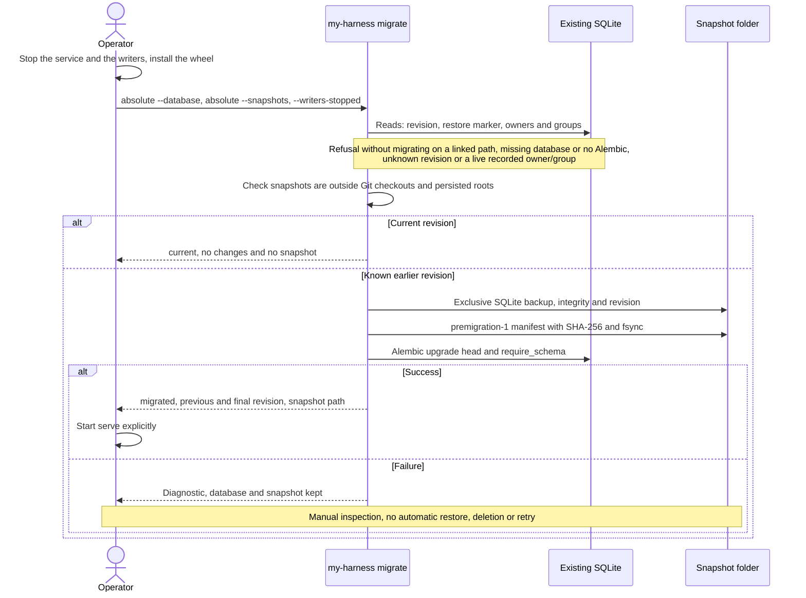

# Flow — explicit SQLite migration

The installed `my-harness migrate` command upgrades an existing database after a verified snapshot
([D150](../DECISIONS.md#d150--explicit-migration-from-the-installed-cli)). `init-db` creates a database; `serve`
checks the revision and never migrates ([D043](../DECISIONS.md#d043--local-distribution-with-assets-and-migrations-explicit-start-on-loopback)).

`--writers-stopped` also declares that no idle service without a persisted owner remains: there is no global process
discovery. The liveness check uses the same cooperative identities as backup; it does not kill processes or infer
their death from a lease. Global configurations are not explored and checkouts are not touched. The folder is created
only when a copy is needed; snapshot names are exclusive, with mode 0600. Paths are absolute and without links,
including auxiliary files and components. The snapshot contains SQLite only, not agent streams or other artifacts; it
does not replace `backup-create` and is not a query-only restore. Restored query-only databases are refused.

If the copy or its seal fails, Alembic is not called; partial files are kept. If the migration fails, the resulting
state and the earlier copy are kept, without hiding changes through an automatic restore. The operator keeps writers
stopped during the whole operation. Earlier histories and snapshots are preserved; revision `0023` fills the derived
run projection by reading history formats 1–8. Revision `0028` only creates the P001 accounting tables: it never
backfills, reprices or reads streams, and its downgrade refuses while accounting rows exist. Accounting backfill and
repricing are separate explicit, previewed CLI operations ([accounting flow](metrics-accounting.md)).

`scripts/dev` uses the same preparation for its development database: it may create it and keeps its own snapshot
location. It shares the extended owner and group checks and the verified snapshot, without the installed CLI's
arguments.

## Source

- `storage/migrate.py`, `cli.py` (`migrate`), `scripts/dev`.
