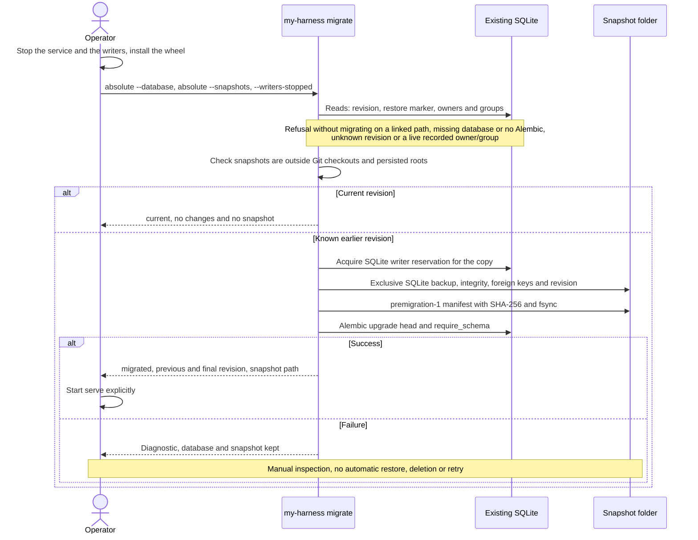

# Flow — explicit SQLite migration

The installed `my-harness migrate` command upgrades an existing database after a verified snapshot
([D150](../DECISIONS.md#d150--explicit-migration-from-the-installed-cli)). `init-db` creates a database; `serve`
checks the revision and never migrates ([D043](../DECISIONS.md#d043--local-distribution-with-assets-and-migrations-explicit-start-on-loopback)).



`--writers-stopped` also declares that no idle service without a persisted owner remains: there is no global process
discovery. The liveness check uses the same cooperative identities as backup; it does not kill processes or infer
their death from a lease. Global configurations are not explored and checkouts are not touched. The folder is created
only when a copy is needed; snapshot names are exclusive, with mode 0600. Paths are absolute and without links,
including auxiliary files and components. The snapshot contains SQLite only, not agent streams or other artifacts; it
does not replace `backup-create` and is not a query-only restore. Restored query-only databases are refused.

If the copy or its seal fails, Alembic is not called; partial files are kept. If the migration fails, the resulting
state and the earlier copy are kept, without hiding changes through an automatic restore. The operator keeps writers
stopped during the whole operation. The snapshot holds a SQLite writer reservation while copying.
Earlier histories and snapshots are preserved; revision `0023` fills the derived
run projection by reading history formats 1–8. Revision `0028` only creates the P001 accounting tables: it never
backfills, reprices or reads streams, and its downgrade refuses while accounting rows exist. Accounting backfill and
repricing are separate explicit, previewed CLI operations ([accounting flow](metrics-accounting.md)).

`scripts/dev` uses the same preparation for its development database: it may create it and keeps its own snapshot
location. It shares the extended owner and group checks and the verified snapshot, without the installed CLI's
arguments.

## Source

- `storage/migrate.py`, `cli.py` (`migrate`, `knowledge-convert`),
  `services/installed_knowledge.py`, `scripts/dev`.

## Convert installed project knowledge

Once the installed database reaches head, the owner may run a separate `knowledge-convert` for each checkout.
This local CLI operation uses `DomainOperations` for preview and adoption. The second invocation confirms
the preview digest with a reason.

```sh
my-harness knowledge-convert --database /path/data/harness.sqlite3 --root /path/project --plan /path/conversion.json
my-harness knowledge-convert --database /path/data/harness.sqlite3 --root /path/project --plan /path/conversion.json \
  --preview-sha256 <digest-from-preview> --reason "Reviewed the installed sources and mappings"
```

The JSON plan selects sources and records owner choices.

```json
{
  "format": "harness-installed-knowledge-1",
  "files": [
    {"path": "docs/SPECIFICATION.md", "role": "specification", "adoption_id": "<adoption-id>"},
    {"path": "docs/DECISIONS.md", "role": "decisions", "adoption_id": "<adoption-id>"}
  ],
  "codes": {},
  "decisions": {},
  "links": []
}
```

- Start with empty selections to inspect the current frozen definitions, phase and definition IDs, and adopted
  paths and digests. Select documents with the appropriate phase ID, frozen definition ID, completed bootstrap ID
  or completed project-import ID. The selected bytes at the checkout path must match that record. The current
  phase baseline can differ from a historical definition's adoption baseline.
- File roles are `specification`, `architecture`, `data_model`, `flows`, `instructions`, `roadmap`, `plan` and
  `decisions`. The specification preserves its prose and extracts explicit level-two `RNNN` headings. Roadmap,
  plan and decision entries use their installed heading syntax. Instruction sections use D285. The receipt keeps
  selected originals, including source prose that has no typed equivalent.
- Current persisted phase definitions supply objectives, ordered criteria and task membership. Selected plans supply
  task text, and the preview marks unavailable fields as unknown. Omitted documents and differences from the frozen
  phase definition appear in the report. Use optional `codes` to map legacy phase or task codes to canonical ones.
  The conversion joins definitions, roadmap titles and plan text by their original codes before assigning
  canonical identities. It keeps the original source references and task membership, including when the roadmap
  is omitted. A canonical code claimed by distinct source identities appears as a blocking collision in the preview.
  Supply explicit `depends_on` or `addresses` links as objects with `kind`, `source` and `target`, where each
  endpoint is `[kind, document-or-null, code]`. For phases and tasks an endpoint resolves by original code first
  and then by canonical code. Arbitrary references in prose require owner interpretation.
- For blocking decision choices, set `decisions[code].status` to `accepted`, `rejected`, `retired` or `proposed`
  for an unrecognized or missing line. Set `decisions[code].extents[superseder]` to `full` or `partial` where
  the report requires an extent. The original status line and source digest remain in the evidence. Proposed
  decisions stay in an owner draft for ordinary later review and adoption.
- Review the selected sources, canonical identities, links and every report entry before confirming. A stale digest,
  a selected file that no longer matches, an unresolved choice, an existing knowledge revision or a checkout writer
  blocks adoption. Confirmation is atomic and repeatable under the same plan, digest and reason. Archives refuse
  the conversion command.
- Conversion preserves legacy state and creates knowledge only. Ownership, delivery and subsequent operational
  activation retain their existing explicit boundaries.

[Decision and qualification](../phase/P002-T026-installed-recovery.md).
