# Flow — managed documents

The P002 [knowledge exchange lane](knowledge-documents.md) has explicit whole-file ownership and separate
revision-bound import/export receipts (D294). This page describes the retained documentary lane, which refuses
projects after that new ownership is adopted; T014/T015 own productive task/closure integration.

Three paths write documentation in a project under the unified contract, and all of them end in a harness commit
([D036](../DECISIONS.md#d036--managed-document-blocks-and-reconcilable-document-writes),
[D081](../DECISIONS.md#d081--profile-protected-paths-limit-the-executor-not-confirmed-document-writes),
[D088](../DECISIONS.md#d088--unified-documentation-contract)).

```mermaid
flowchart TD
    subgraph T["Task commit"]
        T1["Accepted task"] --> T2["Regenerate the STATE, NEXT_STEPS, ROADMAP and DECISIONS blocks"]
        T2 --> T3["MechanicalUpdate in the same commit"]
        T3 --> T4["Hash adopted if the baseline matched"]
    end
    subgraph E["Confirmed edit (document_edit)"]
        E1["Content from the API or editor changes"] --> E2{"Managed blocks intact?"}
        E2 -- "no" --> E3["Refusal or regenerate: local prose with the baseline blocks"]
        E2 -- "yes" --> E4["Preview with diff and CAS on the base hash"]
        E3 --> E4
        E4 --> E5["Hash confirmation"]
        E4 --> E7["If DECISIONS changes: index regenerated from its headings; repeated numbers refused"]
        E7 --> E5
        E5 --> E6["Job under the lock: sealed intent and commit"]
    end
    subgraph X["Manual export"]
        X1["Preview of the blocks from the run projection"] --> X2["Confirmation of the exact diff"]
        X2 --> X4["Submission: the same snapshot recomputed from the history"]
        X4 --> X3["Reconcilable commit and adoption of the hashes"]
    end
```

Language ([D169](../DECISIONS.md#d169--sealed-language-directive-generated-documents-in-the-work-language)): the three
paths generate the blocks in the work language of the frozen context; a context without a work language (older than
the per-project work language) keeps the historical Spanish bytes. The parsers read English and Spanish labels.

Common rules: only the harness writes the `harness-local:managed-*` blocks; `docs/archive/**` is read-only; with
unconfirmed documents no task, check, export or transition starts; an external change after the preview invalidates
the job without overwriting.

## Export preview

The preview computes the blocks from the `run-projection-1` projection and `managed_attempts`, without decoding
histories. The confirmed submission, the job request and the intent recompute the snapshot from the history and
require the same one that was reviewed; if it differs, they answer `Conflict` without queueing or writing. The task
commit and the transition keep regenerating the blocks from the history.

The DECISIONS index ([D089](../DECISIONS.md#d089--mandatory-layout-and-template)) comes from the file's own
`## DNNN — title` headings and the first `Status:` line of each section; the block is never read as a source. The
phase reconciliation may add decisions to the DECISIONS prose; normal tasks may not.

## Paths of the unified contract

[D090](../DECISIONS.md#d090--executor-paths-diagram-parity-and-decision-proposals):

- Executors may edit `docs/flows/**`, `docs/DDBB-DIAGRAM.md`, `docs/ARCHITECTURE.md`, `docs/SPECIFICATION.md` and
  `docs/phase/**` when their contract includes them; the control documents stay protected.
- `AGENTS.md`, `CLAUDE.md` and `GEMINI.md` accept confirmed edits; they are also written by project creation and by
  the confirmed onboarding commit. Intents of the retired import flow are never executed
  ([compatibility](legacy-compatibility.md)).

## Source

- `core/engine/documents.py` (layout, blocks, rendering), `core/engine/document_ops.py` (edits and transitions),
  `core/engine/document_export.py`, `storage/documents.py`, `storage/document_export.py`.
