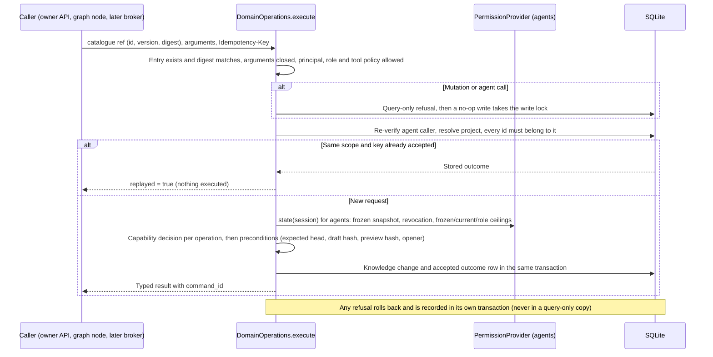

# Flow — typed domain operations

P002-T005 shared pipeline for knowledge commands and queries
([D286](../DECISIONS.md#d286--typed-domain-operation-service-capability-policy-and-command-outcome-record);
[T005 record](../phase/P002-T005-domain-operations.md)). Callers today: the owner API under `/api/managed` and
synthetic graphs through [`domain_command`](graph-continuation.md). No UI, product graph or agent uses it yet: agent
calls and delegated adoption are refused until their infrastructure exists (T006–T010, T016). Table in
[DDBB-DIAGRAM](../DDBB-DIAGRAM.md#p002-domain-command-outcomes).

- **Caller binding.** The API binds the owner from the local session: reads by the persisted knowledge project id,
  mutations by the registered project. Graph nodes bind a harness caller from the thread. No argument can carry a
  project, role, origin or actor; a foreign identifier answers `not_found` like a missing one.
- **Adoption.** Only the owner adopts, as `owner_confirmed`, the exact draft and base of its preview, with a reason when
  a change is sensitive. Agents cannot preview or adopt; the harness is refused `delegation_unavailable`.
- **Idempotency.** Keys are scoped by knowledge project and principal (`owner`, `harness:<thread>`,
  `invocation:<id>`). The same request returns the stored result; another request under the same key is
  `idempotency_conflict`. Refusals do not reserve keys.
- **Agents.** They see only their frozen revision (`head`, `list`, `get`, draft base); queries need receipts (T007).
- **Archives.** On a restored query-only copy the reads work from persisted rows; every mutation route answers 409
  `restored_read_only`, and the service refuses `query_only` before writing.
- **Errors.** `{code, diagnostic}` with the diagnostic in the interface language: 404 for missing or foreign ids and
  unregistered projects, 422 for schema, argument, key and invalid-knowledge refusals, 403 for caller and capability
  refusals, 409 for stale or conflicting state.
