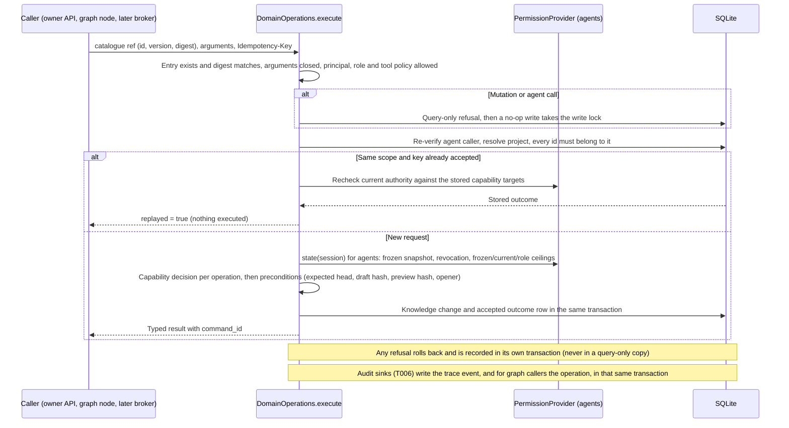

# Flow — typed domain operations

P002-T005 shared pipeline for knowledge commands and queries
([D286](../DECISIONS.md#d286--typed-domain-operation-service-capability-policy-and-command-outcome-record);
[T005 record](../phase/P002-T005-domain-operations.md)). Callers today: the owner API under `/api/managed` and
synthetic graphs through [`domain_command`](graph-continuation.md). T008 adds the explicit invocation-bound
[tool bridge](tool-bridge.md), exercised by fake clients and synthetic permissions; no product graph launches agents.
Product permissions and delegated adoption still deny by default (T010/T016). Table in
[DDBB-DIAGRAM](../DDBB-DIAGRAM.md#p002-domain-command-outcomes).

- **Caller binding.** The API binds the owner from the local session: reads by the persisted knowledge project id,
  mutations by the registered project. Graph nodes bind a harness caller from the thread. No argument can carry a
  project, role, origin or actor; a foreign identifier answers `not_found` like a missing one.
- **Adoption.** Only the owner adopts, as `owner_confirmed`, the exact draft and base of its preview, with a reason when
  a change is sensitive. Agents cannot preview or adopt; the harness is refused `delegation_unavailable`.
- **Idempotency.** Keys are scoped by knowledge project and principal (`owner`, `harness:<thread>`,
  `invocation:<id>`). The same request returns the stored result; another request under the same key is
  `idempotency_conflict`. Refusals do not reserve keys.
- **Agents.** They see only their frozen revision (`head`, `list`, `get`, draft base); queries need receipts (T007).
  T007 supplies `ReceiptSink`, `knowledge.lookup` and `knowledge.search` through this same pipeline, with exact
  response/exposure bytes and journal envelopes committed before return. Keys deduplicate invocation/channel
  deliveries, rechecking caller and current capabilities first. A later adoption of an invocation's own draft
  cannot expose accepted metadata through `draft.get`. Agent reads of their own open proposals are labelled
  noncanonical captures. The product composition still refuses agent binding and permissions until T008/T010.
  See [frozen context](frozen-context.md) for limits, failure, revision-bound cursors and archive readers.
- **Archives.** On a restored query-only copy the reads work from persisted rows; every mutation route answers 409
  `restored_read_only`, and the service refuses `query_only` before writing.
- **Trace (T006, D287).** The product composition adds the operation-journal sink: every accepted outcome and every
  recorded refusal writes its `trace_events` row in its own transaction, and a graph caller's accepted command also
  writes its `domain_command` operation (COMPLETED) under the node's key. If the sink fails, the outcome or the
  refusal rolls back with it and the call reports an error ([operation journal](operation-journal.md)).
- **Errors.** `{code, diagnostic}` with the diagnostic in the interface language: 404 for missing or foreign ids and
  unregistered projects, 422 for schema, argument, key and invalid-knowledge refusals, 403 for caller and capability
  refusals, 409 for stale or conflicting state.

## Owner knowledge editing (T012 integrated into develop)

1. Open `/knowledge` for persisted consultation, including restored/unconfigured copies; page persisted projects,
   accepted history and drafts, search a selected accepted revision, inspect content/provenance/adoption metadata.
   The checkout documentation viewer retains its existing authority lane and drift behavior.
2. A registered project's knowledge page opens a draft against the current head (explicitly null before first
   adoption). Edit typed entities, rich document/instruction sections and ordered relationships through shared
   draft commands. Local unsaved inputs and pending request envelopes survive reload in the browser session.
3. Save the input to the draft before preview. The service validates the complete revision and compares the
   exact manifests in the same transaction: before/after content/root order and added/removed typed links,
   classification, sensitivity and context associations. The historical seal formats are unchanged.
4. Explicit owner adoption sends that preview hash and exact expected base, with reason where required. Changing
   input invalidates the visible preview. Stale draft/head/preview returns an actionable refusal; no automatic
   rebase or automatic approval regeneration occurs. Response loss keeps the exact pending body/key for an explicit
   retry. The command's stored outcome deduplicates adoption.
5. Consult the new revision and immutable previous revisions. Context links follow only persisted snapshot,
   invocation, attempt and run records. A later revision changes neither an old invocation nor its evidence.
   No READY association is asserted when absent; T014–T016 own final operational readiness. Operational rulings
   remain separately labelled audit records, never implicitly adopted product decisions.

T013 owns renderer/export/import and portable format; T017/T018 own global inbox and graph layout; T020 owns
installed conversion. No new migration or agent authority is part of this flow.

T012 review corrections keep the project editor available with either null or READY configuration mode; archives
and blocking setup modes retain consultation only. Reload repeats project discovery/resolution and dependent
reads while preserving local input and pending mutations. Read generations fence late selections; search results
and cursors are invalidated on project/revision/query changes. Consultation, forms and comparisons use typed
presentation labels and localized timestamps. Both inspection and adoption preview announce context truncation.

## Document exchange commands (T013)

D294 adds owner-only `documents.*` commands for deterministic download, input staging, exact import
preview/adoption, ownership preview/adoption and export intent preparation. The envelope contains a bounded
codec-validated payload; no SQL or filesystem execution command is exposed. External delivery uses the
[document exchange service](knowledge-documents.md) under a persistent checkout lock. New import drafts are
sealed to their source/mapping/report consent and cannot use the ordinary draft adopter.
