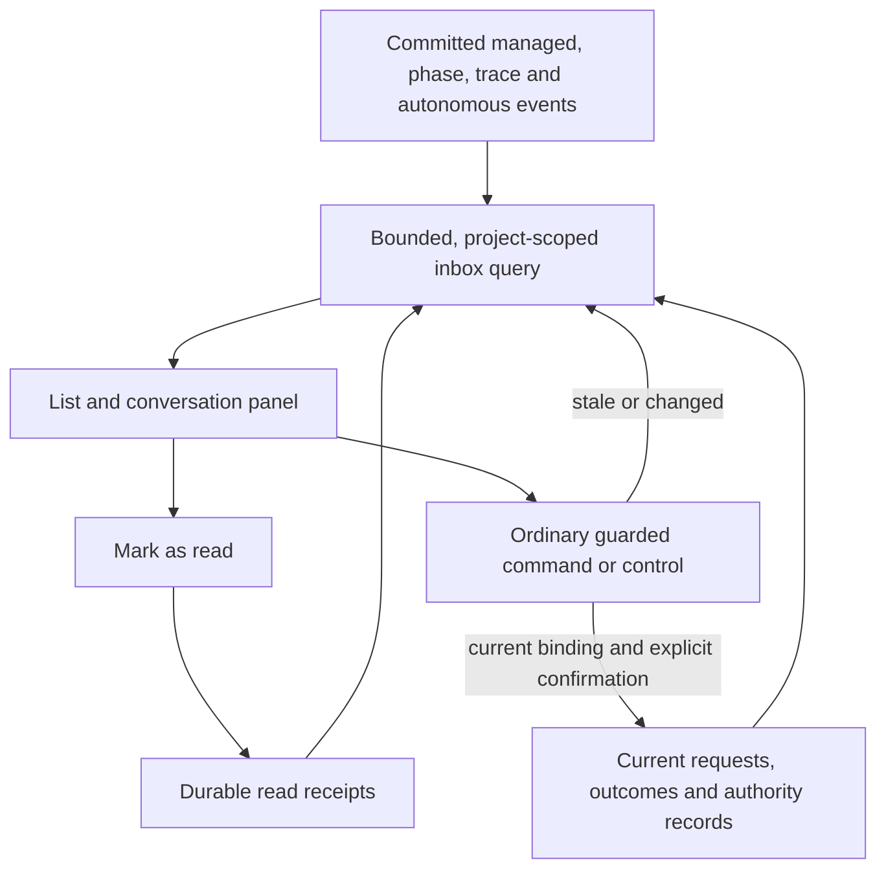

# Global inbox

P002-T017 implements [D278](../DECISIONS.md#d278--global-inbox-and-task-instance-graph) and the accepted
[G13 shortcuts](../DECISIONS.md#d302--g13-inbox-notifications-and-guarded-shortcuts).
The inbox and its conversation panel are reachable from global and project navigation. The project reviewer
chat has a separate link.

## Origins and resolution

| Item | Committed origin | Current outcome and shortcut |
|---|---|---|
| Task completion | Managed `commit_recorded` joined to the matching committed task acceptance | Terminal notification, opens run evidence |
| Phase closure | `phase_closed` joined to the closed phase and closure operation | Terminal notification, opens phase closure evidence |
| Task permission | Managed `permission_requested` joined to the exact run and request | Decision, supersession, expiry or committed task ends the request. Grant or deny uses the run's version and request fingerprint. |
| Standing permission | Trace `permission.request` joined to the exact ledger request and its project | Grant, denial or ended/expired ancestry settles the request. The ordinary preview and confirmed response bind the ledger revision and canonical scope. |
| Task gap | Managed `task_decision_requested` for blocking questions, keyed to its first matching frozen request | The same request's effective clarification or recorded application resolves it. A later different gap supersedes it. The answer and the next attempt use the ordinary task controls. |
| Phase question | `question_raised` or a question created by a settled `phase_checked` | Phase and question versions guard the existing answer command. |
| Autonomous question | `question_opened` joined to the same run and question | Answer or supersession resolves the question. The answer checks the current authorization and accepted revision under the writer lock. Resume is separate. |
| Phase lifecycle | `phase_checked` entering `READY_TO_CLOSE` | Show current phase state and link to the normal check/close panel. The check binding, version and confirmation are still required by close. |
| Autonomous lifecycle | Confirmed stop in `LIMIT_REACHED`, `RECOVERY_REQUIRED` or `FAILED` | A later transition supersedes the stop. Open the exact run's current controls for authorization revision, stopped-writer recovery or resume. |
| Judge escalation | `judge.ruled` with `ESCALATED` and owner continuation | Open the exact request and ruling in consultation. Resolution follows the blocker the escalation came from: a recorded grant or denial of a correlated permission escalation; its linked phase check (`evidence.check_operation_id`) no longer being the phase's latest check, or that phase `CLOSED`/`ABANDONED`; or every autonomous stop whose detail carries this `judge_request_id` closed, meaning its question is no longer open or its run is `REVOKED`/`COMPLETED`. A linked product decision is evidence only. Neither it, a read receipt nor opening the item resolves the escalation. Without a derivable blocker it stays unresolved. Direct judge response is deferred. |

Each branch selects one source representation, so a phase's trace mirror, a repeated commit delivery, or the
autonomous wait event that accompanies question creation adds no duplicate. A phase answer and a separate
autonomous request to acknowledge the stop retain their distinct domain identities. Delegated managed events
can link to their autonomous parent using the sealed job's operation key.

A recorded task clarification exposes a separate retry confirmation while the response is effective and
unconsumed. That retry calls the ordinary run command with the current run version and the exact resolution ID.

## Read and command boundaries

- `GET /api/managed/inbox` returns at most 100 entries with optional project, kind, mode, read/resolution filters,
  and a scope-checked keyset cursor. Individual reads require the item and project references.
- Opening, reading and navigating are observation. The idempotent `POST /api/managed/inbox/{item_id}/read`
  stores the first read timestamp only. The domain determines resolution independently.
- The list carries only bounded metadata and references. The selected panel loads allowlisted context with
  credential-shaped strings masked. It composes ordinary command inputs from the displayed identity, version and
  proof. Explicit confirmation and the ordinary endpoint's replay, conflict and authority rules still apply.
  The focused standing-permission control reads only the selected request's targets, duration and ledger revision.
- A stopped-writer recovery classifies and settles the scoped journal records, updates the graph thread and
  moves the run to paused in one transaction. Starting it again remains a separate owner action.
- The authenticated service keeps Host, Origin and CSRF protection. Query-only files serve the same projection
  from their own persisted data, with no write controls. Mutations return HTTP 409. Reads perform no replay
  writes, source reconstruction or checkout access.

P002-T020's work-map bubbles reuse this projection unchanged (unresolved, non-notification items) and only attach each
item to an actor circle; they carry item identities and counts ([work-map reads](work-map.md#statuses-actors-and-counters)).
P002-T022 (local source, pending review) opens this conversation panel from those bubbles over the map, without
leaving the view: the bubble carries item identities only and the panel re-reads the item. Aggregates without
identities and truncated lists read the element's items with T020's attribution from the work-map request list
(`map/projects/{p}/bubbles`, exact scope and circle; notifications excluded), not this list API, whose items carry no
circle. Archives open it read-only
([work-map client](work-map.md#product-map-navigation-and-refresh-client-p002-t022)).

The [task record](../phase/P002-T017-global-inbox.md) contains the evidence and delivery state.
