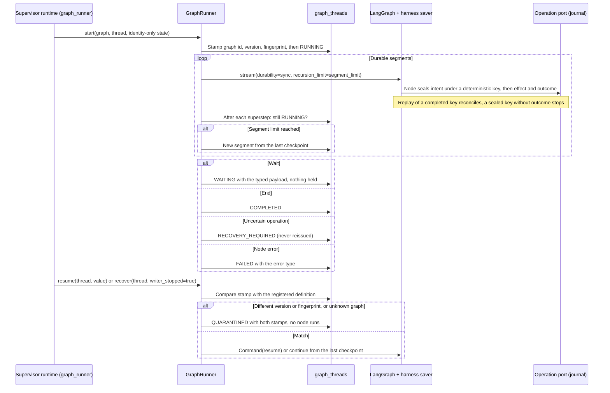

# Flow — graph continuation runtime

P002-T003 foundation for LangGraph orchestration
([D280](../DECISIONS.md#d280--langgraph-1218-dependency-set-placement-and-runtime-hygiene),
[D282](../DECISIONS.md#d282--harness-checkpoint-saver-and-continuationjournal-consistency-contract),
[D283](../DECISIONS.md#d283--durable-segments-graph-version-stamping-and-quarantine)). Only synthetic graphs use it:
no product graph, API route or UI exists yet, and nothing here launches agents, touches Git or exports. Tables in
[DDBB-DIAGRAM](../DDBB-DIAGRAM.md#p002-graph-continuations).

- **Waits.** A node waits through `wait_for(kind, payload)`; the node re-executes from its start on resume, so any
  effect before the wait goes through the operation port. The resume value is primitive data only.
- **Crash.** A `RUNNING` thread without a live segment is not resumed automatically: `recover` requires the explicit
  confirmation that the previous writer stopped, then replays from the last synchronous checkpoint.
- **Stops.** `cancel`/`revoke` move `RUNNING` or `WAITING` to `CANCELLED`/`REVOKED` before anything else; a waiting
  thread runs no node and an active segment stops at its next superstep boundary. Terminal statuses do not change.
- **Hygiene.** Importing the package removes inherited `LANGSMITH_*`/`LANGCHAIN_*` variables, and every graph call
  runs in a disabled LangSmith tracing context. A query-only restore refuses every runner write.
- **Domain commands.** A node calls a typed domain command through `domain_command(config, operations, root,
  operation, arguments)` ([domain operations](domain-operations.md), D286): the harness caller is bound from the thread
  and the idempotency key is the node's deterministic `operation_key`, so a replayed node receives the stored outcome
  instead of a second effect. The command is committed or absent in one transaction, so it never leaves a sealed
  intent without outcome; nothing is atomic with the checkpoint. A harness caller cannot adopt knowledge.
- **Later tasks.** The production journal and uncertain-operation reconciliation (T006/T020), quarantine release
  and autonomous bounds (T016), and real graphs (T014–T016) are not part of this flow yet.
