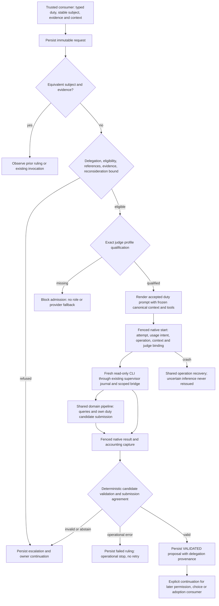

# Judge requests and candidate rulings

Implemented T009 foundation ([record](../phase/P002-T009-judge.md),
[D290](../DECISIONS.md#d290--judge-duty-contracts-g16-and-optional-profile-formats)), applying
[T001 FL05/FL13](../phase/P002-T001-flows.md). No product graph invokes it yet.

The owner selects judge provider/model/effort in explicit new configuration formats. Existing project paths may
omit it. Compatibility probes do not qualify a judge: T002's native cells are reviewer-only. Tests alone inject
exact simulated judge cells; the productive permission and delegation providers remain unavailable/denying.

`JudgeService.create` freezes a canonical context snapshot, stable trusted equivalence subject, evidence/context digest,
inputs, accepted requirement/criterion references, configured profile, prompt version/template digest and delegation
identity/revision/policy. Consumers must derive the subject across equivalent/broadened requests; model arguments
cannot supply it. T010 owns productive normalization and owner-only/compound capability classification. Service
eligibility excludes owner-only powers, undelegated scope and ineligible blocked checks before inference. Missing
evidence/referrals yield an auditable escalation. No prior request or history is rewritten.

`assemble` admits exact client/version/role/evidence and renders a single duty prompt with the language pair from
`managed.job_language(claim)`, never current preferences. `start` calls the existing
managed repository with a judge service, canonical context, scoped-tool policy and invocation operation. In its
fenced transaction it rechecks current delegation, exact qualification, frozen selection/languages and exact
prompt/schema/context, then seals the
judge binding alongside the native intent. The adapter retains fixed read tools and fresh sessions. Every tool
call re-verifies the persisted caller, current permission layers and scope through the shared domain service.
Only lookup/search v2 and that duty's submission are exposed; discovery never grants authority.

Tool submission records a candidate through the normal command/idempotency/audit pipeline. It has no terminal
approval or permission/adoption effect. `record_result` uses the existing fenced checkpoint: native outcome,
accounting capture, journal settlement and terminal ruling share a transaction. Submitted candidates must agree
with the final result. Raw results remain in the native attempt/captures, linked by digest/reference. A valid
result carries `proposal_only`, judge actor and `owner_delegated` parent/policy provenance. Later consumers must
revalidate their own authority, revisions, exact-content acceptance and READY. Free-text semantic interpretation
is not a deterministic proof and never becomes adopted knowledge in T009.

Malformed/invalid candidate output, refusal, missing evidence, abstention and escalation return `owner`.
For the real adapter's `invalid` status, settlement requires its explicit `malformed_output` evidence: payload
parse/shape failure after one normal terminal, exit 0, no protocol/provider failure, timeout/cancellation override,
input-write failure, unavailable bridge or unsettled process group. The original result and stdout artifacts stay
referenced; absent or contradictory evidence remains an operational stop. Protocol corruption is not assumed to be
a malformed final candidate. [Review correction](../phase/P002-T009-judge.md#6-technical-review-correction--malformed-native-judge-output).
Provider, quota, authentication and timeout errors return `operational_stop`. These are persisted continuation points, not T017 inbox records.
Equivalent subject/evidence returns the same request/ruling with no inference. New evidence requires an explicit
reconsideration within the saved supplied bound (abstentions consume it too); unresolved/uncertain prior inference blocks it. No T016 values
are defaulted. Lost acknowledgements reconcile native outcomes; otherwise shared journal recovery marks uncertainty.
An expired lease does not prove a stopped process, and T009 never schedules or retries an inference.

An explicit owner `judge.decision.link` command links an existing canonical decision/revision to a ruling through
DomainOperations, idempotency, membership validation and trace. It cannot create or adopt a decision. Read-only
request/list routes under `/api/managed/knowledge/projects/{id}/judge/requests` also serve query-only archives,
without runtime registration or checkout. Backups preserve and verify all four immutable evidence tables.
