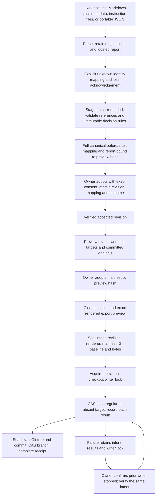

# Flow — knowledge document exchange

P002-T013 / [D294](../DECISIONS.md#d294--versioned-knowledge-documents-explicit-ownership-and-project-transfer)
implements the owner boundaries of T001 FL10. The [legacy document lane](documents.md) retains its rules;
explicit new ownership refuses that lane rather than allowing both authorities on the same files.

- Rendering uses accepted knowledge and the adopted manifest only. Disk bytes supply safety baselines/original
  preservation; they never supply generated content. Committed IDE edits may be superseded; uncommitted changes
  refuse a fresh export. There is no polling, watcher, drift warning or automatic import.
- Ownership is whole-file, exact and explicit. Existing unowned files require a reviewed takeover; arbitrary docs,
  README, archive/phase files and unrelated flows remain unowned. D285 wrappers are independently selected and
  over-budget instructions block export without truncation.
- Imports retain raw bytes and reports, even malformed input. Unknown/foreign identities require choices; mapping
  does not match by code or similarity. Partial selection retains omitted knowledge and outgoing links of omitted entities.
  Only relationships whose source entity is selected are staged; targets outside the selection are resolved
  as references against the destination, without replaying their own relationships. Canonical invariants and
  unresolved references block adoption; missing files never imply deletion. A stale head/draft/preview refuses.
  New roots and ordered children append in source order after existing entries. Selected existing entries may
  reorder only their own slots; unselected entries retain their positions. The resulting root/link order is part
  of the canonical preview and sealed consent.
- Domain commands are owner-only, versioned, project-scoped and subject to local session/CSRF and query-only guards.
  Stored outcomes recover the identical request after response loss. An import draft cannot bypass its source/map
  consent through the ordinary editor/adopter. Sensitive content is shown explicitly in the preview.
- Delivery uses the existing checkout lock with an exchange owner. Knowledge/ownership mutation refuses while
  that writer is pending. Recovery recognizes only baseline/absence or sealed output, checks HEAD/index/ref and
  unrelated edits, and repeats deterministic effects. A lost commit response reconciles the sealed commit. Exact
  scratch paths from the same intent can be cleaned only when their bytes are a prefix of that sealed output.
- Empty-root definition seals absence, then initializes local Git under the writer lock; onboarding binds the
  frozen original HEAD/inventory and preserves replaced files in the adopted ownership receipt and Git history.
  Export receipts record the accepted revision, renderer/manifest, originals, per-target results and final commit.
  Current delivery additionally verifies the referenced export intent against the current accepted revision/hash,
  exact adopted ownership ID, full manifest (including renderer) and required target set. Adopting another manifest
  leaves delivery pending until that generation completes; old receipts remain available as historical evidence.
  Continuation `status=export_committed` and effect `effect_status=COMPLETED` are distinct.
- Profile confirmation may occur before or after knowledge adoption/export. A known documentary commit can
  continue the structured intake profile/preparation boundary without creating an operational phase. Profile,
  private configuration, preparation, activation and READY remain independent; no export certifies readiness.
- Markdown download and portable download have independent availability/error results (`documents.bundle@2`);
  client-specific instructions or an over-budget generated view cannot suppress a valid portable snapshot.
  Portable download does not acquire checkout targets. Disk generation retains all ownership/wrapper/budget gates.
- `harness-project-1` carries a project knowledge snapshot with source version IDs/hashes and a payload digest.
  New import allocates fresh local identities and seals the full map; update uses scoped existing mappings.
  Imported attribution remains source-claimed. Runs, historical approvals, grants/rulings, usage/costs and
  execution/phase/READY states are forbidden. This is distinct from evidence-bearing backup/restore.

T014/T015 consume the revision/manifest/renderer and exact delivery receipts for task acceptance and closure.
Their productive workflows, T016 final readiness/delegation and T020 installed conversion and integral recovery
remain pending. Old task/document/closure writers are refused after new target ownership is adopted.

Sources: `core/engine/knowledge_documents.py`, `services/knowledge_exchange.py`, `services/knowledge_delivery.py`,
`storage/knowledge_exchange.py`, `api/knowledge_documents.py`, `pages/KnowledgeDocuments.tsx`.
