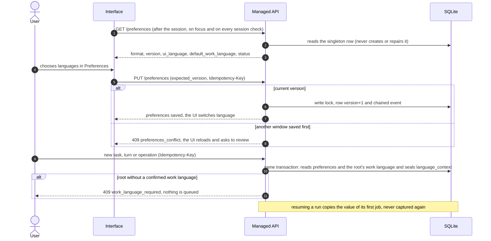

# Flow — language preferences

Global settings of the installation ([D166](../DECISIONS.md#d166--global-language-preferences-and-catalogs)): a
mutable interface language and the default work language for future projects. The interface language is frozen in
each job when it is admitted; changing it governs only later admissions. Each job seals the `language-context-1`
pair with the project's immutable work language ([flow](project-work-language.md)).

- Invalid row (edited outside the service): the read returns `en` with status `invalid`, the UI warns and every new
  admission answers 409 `preferences_invalid` until the preferences are saved again. No GET repairs it.
- `default_work_language` initializes the work language selection when registering or creating a project; it never
  changes existing projects. The job's frozen pair reaches the agent as a sealed directive in its prompt
  ([flow](project-work-language.md#sealed-directive-and-generated-documents)).
- CLI: `--ui-language en|es` applies only to that invocation; without it, the preferences of the existing database
  (read in read-only mode) or `en`. Nothing is stored.
- Query-only restore: preferences are read; the middleware refuses the PUT like any other write.
- Interface ([D170](../DECISIONS.md#d170--interface-in-english-and-spanish-through-typed-catalogs)): every own text
  comes from the catalogs in the provider's interface language; changing the language repaints texts, dates and
  numbers without reloading. HTTP diagnostics of `api/*` (local guard, managed router) are emitted in the language
  saved when answering; codes and states do not change. Content from the service, the agent or third parties is shown
  as is. The access key line printed at startup is technical and always English.
- Service and CLI ([D171](../DECISIONS.md#d171--service-and-cli-texts-in-the-language-of-each-emission)): `i18n.tr()`
  emits in the language of the emission, resolved once per emission. Each HTTP request reads the saved preferences
  (middleware); a worker uses its job's frozen interface language (`language_context`; for a job without it, the
  saved one at emission time) and a preparation the saved one; the CLI uses `--ui-language`, the database or `en`
  (help: `--ui-language` or `en`). What is persisted stays in the emitted language and is never retranslated.
  Fingerprints do not depend on the language: the retention preview seals each own diagnostic in English; the
  registration and creation previews seal the shown declaration, so changing the language between preview and
  confirmation requires reviewing it again.
- Service texts ([D172](../DECISIONS.md#d172--service-texts-in-both-languages-rejections-distinguished-by-code)): the
  visible diagnostics of core, adapters, storage and services (refusals, stop and acceptance reasons, blockers,
  authorization closures and Git writer results) follow the same emission. Internal invariants and what enters an
  agent's input stay in technical English, listed in `tests/fixtures/service_texts/english.json`. Metrics group stops
  by the emitted text, so one cause in English and in Spanish forms two groups. The client tells two refusals apart
  by code, never by text: `managed_blocks_generated` (an edit that touches managed blocks) and `draft_changed` (a
  draft changed since it was read).

## Source

- `storage/preferences.py`, `storage/managed.py::_language`, `api/managed.py` (`/preferences`), `api/session.py`.
- `i18n/` (service catalogs), `cli.py::cli_language`, `launcher.py`.
- `frontend/src/{i18n.ts,i18n/*.json,Language.tsx,pages/Preferences.tsx}`; formats in `metrics.ts`/`charts.tsx`.
- `api/security.py::_say`, `api/managed.py::say` (own HTTP diagnostics).
- `i18n/__init__.py::{emission,tr,Localized}`, `api/app.py::emission_language`, `services/managed.py::run_once`,
  `storage/managed.py::job_visual`, `services/project_preparation.py::run_once`, `cli.py::build_parser`.
- `api/managed.py::call` (codes per cause), `core/engine/document_ops.py::ManagedBlocksEdited`,
  `adapters/bootstrap.py::DraftChanged`, `frontend/src/pages/{Docs,Planning}.tsx`.
