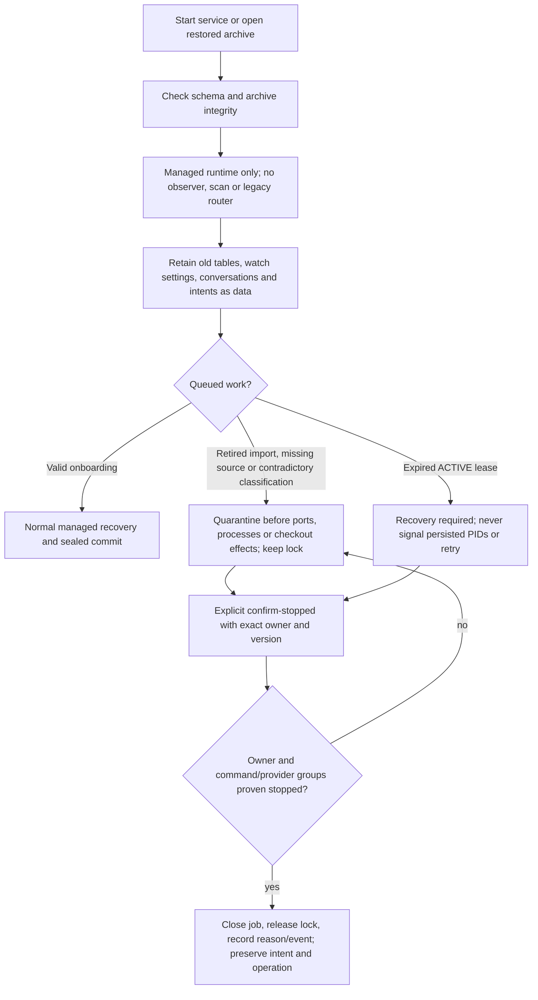
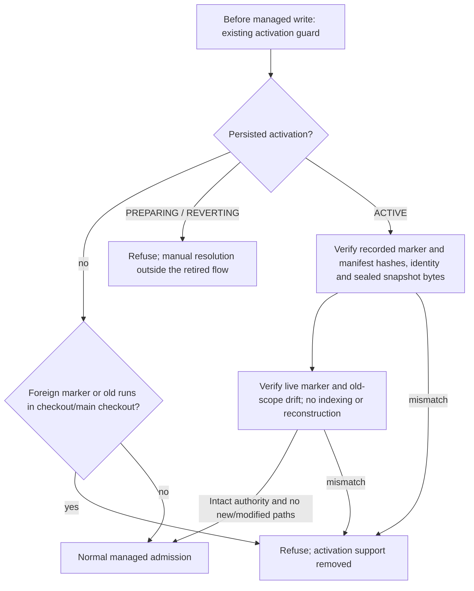

# Flow — compatibility after retiring the previous harness support

My Harness once observed, indexed and imported projects run by an earlier harness format, and could activate a
managed mode on them. That support was retired
([D161](../DECISIONS.md#d161--retirement-of-the-previous-harness-support)); the product has two entries only:
[defining a new project](project-definition.md) and [onboarding a repository without a harness](project-onboarding.md).
This document describes what the code still does with data from the retired support, for databases and checkouts
that contain it.

The API paths `/api/legacy/**`, activation/reversion and managed `/import` paths are absent from the router and
OpenAPI. Unknown API paths return 404 after the session and local request guards; restored archives still reject
mutations uniformly. `/legacy` and `/projects/:p/import` resolve to the UI's not-found page, without a redirect. The
`legacy-import` and `legacy-summary` commands fail argument parsing before opening a database; no flag reactivates
them. The current prompt catalog excludes `import-project`. Frozen catalogs remain readable with that record;
rendering it fails, and persisted active heads cannot add it to a current catalog.

An already ACTIVE job keeps its lease and lock until the existing recovery rules apply. Queued retired or ambiguous
work is claimed solely to establish a quarantined owner and lock, then stops before factories or filesystem checks.
`confirm-stopped` requires the exact owner and version, a reason, and a dead or closed owner and groups. It never
executes an old intent. It records `retired_work_resolved` and preserves the old conversation, request, drafts and
operation verbatim. A retained unresolved import intent keeps blocking a new writer; resolving or moving old data is
manual. Completed managed history remains available through the run views.

`core/managed_mode.py`, `adapters/managed_mode.py`, `adapters/safe_files.py` and `storage/managed_mode.py` contain
only compatibility reads and admission checks; they cannot create, finish, abandon or revert activations. A foreign
marker, a missing or corrupt snapshot or an old writer keeps blocking managed work. The marker is excluded from Git
only when it is validated against this installation's intact ACTIVE authority
([D099](../DECISIONS.md#d099--managed-mode-marker-stays-untracked)).

`legacy_sources`, `legacy_runs`, `legacy_artifacts`, `legacy_events`, `managed_activations`, `activation_id`,
`project_imports`, conversations, histories and migrations stay unchanged ([data](../DDBB-DIAGRAM.md#previous-harness-compatibility-and-simulations)).
A `watch_enabled=true` value is inert; startup does not change it or traverse its external source. Backup reads
sealed manifests and already referenced snapshot and export paths, verifies hashes and copies evidence without
importing an external checkout. A restore stays query-only and starts no observer or retired job. An older schema
requires the explicit [migration command](database-migration.md); migrating does not activate a project or normalize
its documentation. The synthetic `simulations` skeleton is independent from onboarding and from this compatibility.

## Source

- `storage/retired_work.py` (quarantine and resolution), `core/managed_mode.py`, `adapters/managed_mode.py`,
  `adapters/safe_files.py`, `storage/managed_mode.py`.
