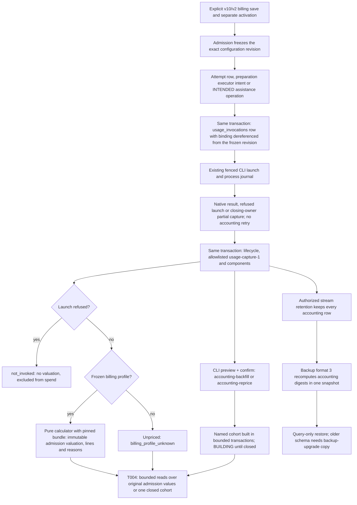

# Flow — P001 invocation accounting

**Capture, storage, binding, explicit operations and archives implemented (P001-T003); bounded queries/API (T004)
and billing/reference controls/UI (T005) pending.** [D254–D257](../DECISIONS.md#d254--native-invocation-accounting-and-immutable-evidence),
the [T001 contract](../phase/P001-T001-accounting-contract.md), T002's pure calculator
([D258](../DECISIONS.md#d258--pinned-reference-cases-and-the-pure-valuation-boundary)) and
[D259](../DECISIONS.md#d259--native-accounting-capture-frozen-revision-binding-and-format-3-archives) govern it.
`terminal-2`/`metrics-1`, existing metrics endpoints and their UI are unchanged ([evidence](../phase/P001-T003-capture-storage.md)).

- **Sources.** Managed attempts (task/phase/chat/definition/onboarding), generic preparation executor steps and
  configuration assistance. Deterministic jobs, native commands, closure, bootstrap commits and other local work
  create no invocation. A missing process row is `unknown_execution`, never zero; only a refused launch is
  `not_invoked`. Replaying a settlement with identical evidence appends nothing; changed evidence is a new capture.
- **Evidence.** Prompts, argv, environment and paths never enter a capture. The selected view prefers a reconciled
  request partition, then a reconciled per-model partition, then a single response model. Terminal and constituent
  views are never added; requested selections never become reported models. Missing terminal, conflicting request
  ids, unknown delegation boundaries and server-tool charges stay explicit reasons with a known subtotal at most.
- **Binding.** Jobs, preparation plans and assistance previews already freeze exact immutable revisions; the intent
  dereferences them into `billing-binding-1`. Activation of a later revision never rebinds queued or settled work.
  Reference bundles are packaged or explicitly imported (`accounting-references`), content-addressed and immutable.
- **Operations.** `accounting-backfill` materializes settled native sources without an invocation (legacy
  metrics-only attempts as `legacy-metrics-1` evidence); its valuations are `backfill`, never admission-bound.
  `accounting-reprice` applies a stated profile as a retrospective or contemporaneous scenario. Both preview a frozen
  selection (at most 10,000), need the exact preview digest and an idempotency key, resume from the frozen selection
  and close only when complete. `metrics-backfill` keeps its separate meaning. Neither runs on read, startup,
  migration or restore, and neither launches clients or rewrites native sources, metrics or earlier valuations.
- **Archives.** Retention removes authorized stream bytes only. Format-3 backups verify every accounting digest and
  the exact line sums; restored consultation is query-only and refuses accounting operations.

## Source

- `core/engine/metrics.py` (`usage-stream-1`), `core/engine/usage_capture.py`, `core/engine/valuation.py`,
  `core/engine/metric_references.py`.
- `storage/accounting.py`, `storage/billing.py`, `storage/accounting_operations.py`, `storage/accounting_backup.py`,
  `storage/managed.py`, `storage/preparation.py`, `services/configuration_assistance.py`, `services/configuration.py`,
  `storage/backup.py`, `cli.py`, `migrations/versions/0028_usage_accounting.py`.
- [Data](../DDBB-DIAGRAM.md#p001-accounting-records), [task run](task-run.md), [configuration](configuration-setup.md),
  [migration](database-migration.md), [archive consultation](backup-consultation.md).
