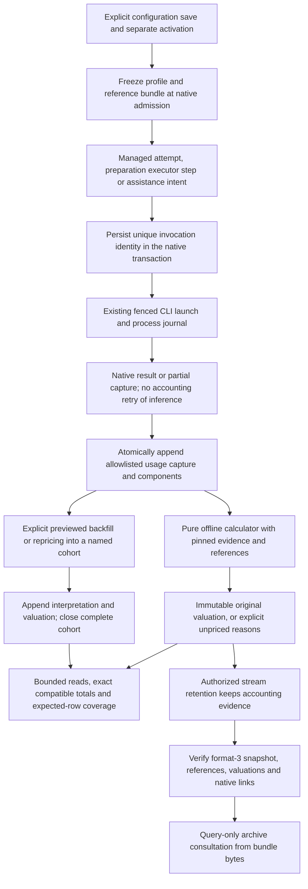

# Planned flow — P001 invocation accounting

**Accepted design, not implemented.** [D254–D257](../DECISIONS.md#d254--native-invocation-accounting-and-immutable-evidence)
and the [T001 contract](../phase/P001-T001-accounting-contract.md) govern T002–T005. Current production behavior
remains `terminal-2` / `metrics-1` and schema 0027; this diagram introduces no running workflow.
T002 implements only the isolated pure calculator/reference library ([evidence](../phase/P001-T002-reference-calculator.md),
D258). The diagram's native capture, frozen binding, persistence and reads are still pending; it has no operational caller yet.

- Model-free jobs/steps do not create invocations. Missing result/terminal data stays visible, independently of
  whether the native source is successful, failed, interrupted, pending or positively proved not invoked.
- Billing profiles use the existing [configuration flow](configuration-setup.md), with new global/project formats
  and separately frozen billing metadata. Save never activates; new activation does not rebind old jobs/plans.
  Reference import is explicit, offline, bounded and digest-checked. There is no price fetch during an ordinary read.
- Final totals replace cumulative/message views for accounting; model/request/child components are never added to
  their inclusive total. Unsupported partitions, TTLs, request tiers, charges or reference applicability produce
  reasons and covered subtotals. Accounting cannot certify liveness or release the checkout lock.
- T003 adds the [planned tables](../DDBB-DIAGRAM.md#planned-p001-accounting-records-not-implemented) through the
  [explicit migration flow](database-migration.md), after a verified snapshot. Migration/read/startup never backfills
  or reprices usage. Repeated source/capture/valuation keys are idempotent; ownership loss still fences writes.
- Backfill/repricing append evidence/scenarios into an explicit cohort; they do not change native sources, earlier
  valuations, `metrics-1`, histories, old configuration, phase summaries or recipe fingerprints. Reads select the
  original admission-bound view or one named closed cohort, never a sum of alternatives.
- [Archive consultation](backup-consultation.md) uses retained bytes/references/line items without original paths,
  provider access, configuration mutation, execution polling or recalculation. Legacy bundles retain their
  matching-schema support; explicit archive upgrade uses a new copy/bundle and preserves the original.

T002 implements the calculator/references, T003 the capture/configuration/persistence/operations, T004 queries/API,
T005 controls/UI and T006 end-to-end qualification. The existing task, configuration, migration and backup flows
describe implemented behavior until their respective implementation tasks update them.
