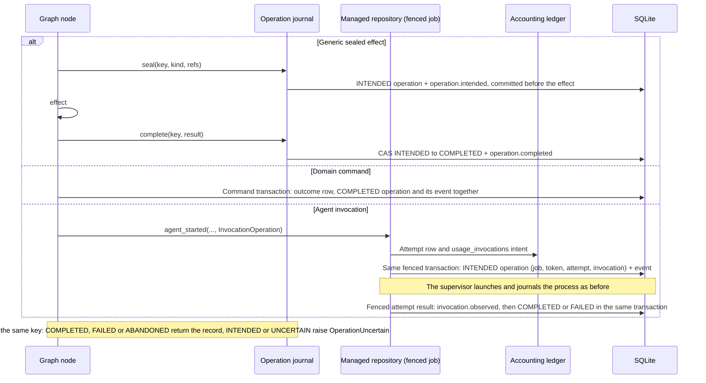
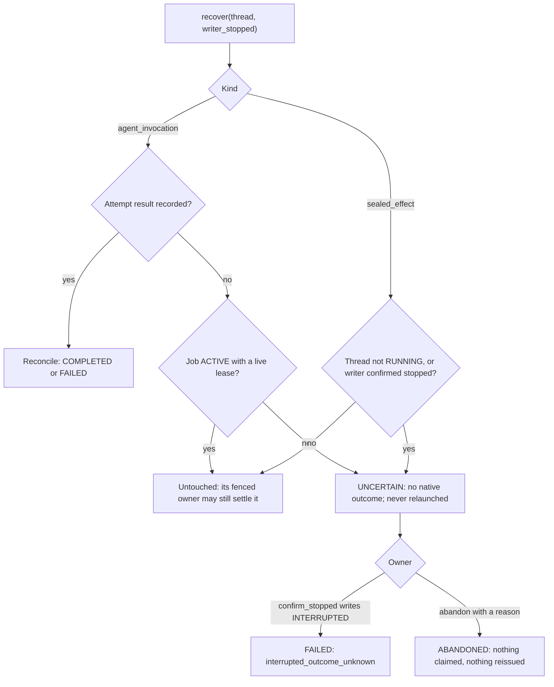

# Flow — operation journal and correlated trace

P002-T006 production journal behind `OperationPort`
([D287](../DECISIONS.md#d287--operation-journal-granularity-and-recovery-contract);
[T006 record](../phase/P002-T006-operations-tracing.md)). Callers today: synthetic graphs through `JournalPort` and
`run_operation`, graph domain commands through the audit sink, and `agent_started` when a caller supplies an
`InvocationOperation`. No product graph launches agents yet (T014–T016); 0.1.9 runs keep their own journals and get
no operations. Tables in [DDBB-DIAGRAM](../DDBB-DIAGRAM.md#p002-operation-journal-and-trace-events).

- **Statuses.** INTENDED, COMPLETED, FAILED, UNCERTAIN, ABANDONED; every change is a compare-and-set with its
  `operation.<status>` event in the same transaction, chained by `parent_event_id`. The status is a projection that
  the events rebuild. A different kind or reference set under an existing key is refused.
- **Fencing.** An agent invocation is sealed and settled only inside the job owner's fenced writes (token, live lease,
  checkout lock). A stale owner fails before writing; an expired lease makes the operation UNCERTAIN on recovery, never
  COMPLETED, and does not prove a stopped writer. Cancellation is classified from the supervisor's record (Codex exits
  0 after SIGTERM, D281).
- **Events.** Ordered by a global sequence, deduplicated by key (the same content is a no-op, other content is
  refused), insert-only by trigger, labelled `supplied`, `reported`, `derived`, `measured` or `absent`. Payloads are
  `trace-payload-1`: credentials, environments, argv and prompts never stay; secret-looking values are masked
  without digests; strings over 1 KiB and payloads over 8 KiB become references with digest and size whose masked
  bytes are stored with the event in `trace_artifacts` (at most 1 MiB per event, otherwise the event is refused) and
  read back, verified, by digest; references inside an offloaded JSON payload are checked like those of the event,
  at write and by backups. `knowledge-delivery-1` and `tool-discovery-1` envelopes remain validated and reconstructible from stored bytes.
  T007 emits additive v2 knowledge receipts; T008 emits discovery/schema envelopes and separate broker/logical
  call/results through the [scoped bridge](tool-bridge.md), plus registered/disconnected/stopped process evidence.
- **Generic port.** `JournalPort` seals and completes `sealed_effect` operations only; an `agent_invocation` or
  `domain_command` settles from its fenced native outcome or by evidence-based reconciliation. Every replay,
  reconciliation and completion checks the operation's project root; another root is refused before reading.
- **Inputs and results.** `refs` (≤ 32 lowercase keys, printable string values ≤ 200 characters) and `origin`
  (`{kind, id}` with a known kind) are validated before any write and never coerced. Results and errors are stored
  verbatim within 16 KiB, since a replayed node continues from them; credentials and secret-looking values are
  refused, never masked, and a refused completion leaves the operation INTENDED.
- **Turns.** `trace-observation-1` counts native turn delimiters (`StreamMetrics.terminals`, an additive counter of
  the stream summary) whatever the validity of the final answer; `metrics-1` keeps its historical counters.
- **Context receipts (T007).** An explicit canonical snapshot is sealed with `agent_started` and its
  `context.intended` event in that same transaction. The completed input-write observation and agent query/tool
  returns persist exact exposures with `knowledge.receipt` events (`knowledge-delivery-2`). Only locators, hashes,
  bounds and failure codes enter trace envelopes; content stays in scoped evidence storage. Historical
  `knowledge-delivery-1` remains unchanged. [FL08 implementation](frozen-context.md).
- **Domain commands.** Accepted outcomes and recorded refusals write `domain.command_accepted`/`refused` events in
  their own transactions; graph commands write the `domain_command` operation instead of the accepted event.
- **Queries.** `GET /api/managed/knowledge/projects/{id}/traces/{thread}` (thread), `/operations` (offset, at most 100
  per page), `/events` (after a sequence, at most 100 per page; the service caps at 200) and `/artifacts/{sha256}`
  (offloaded content of one of the thread's events). A thread whose operations
  belong to another project answers 404 `trace_unknown`. They read persisted rows only, so a restored query-only copy
  serves them without checkout, registry or providers; every journal write there is refused.

## Source

- `core/engine/observation.py`, `core/engine/trace_payload.py`, `core/engine/trace_envelopes.py`.
- `storage/operation_journal.py`, `orchestration/operations.py` (`JournalPort`, `run_operation`),
  `storage/managed.py` (`agent_started`, `_history`, `confirm_stopped`), `services/domain_operations.py`,
  `services/managed_runtime.py`, `api/traces.py`, `migrations/versions/0032_operation_journal.py`.
- [Graph continuation](graph-continuation.md), [domain operations](domain-operations.md),
  [accounting](metrics-accounting.md), [archive consultation](backup-consultation.md).
