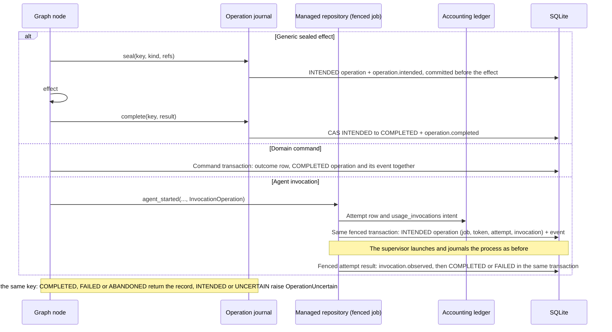
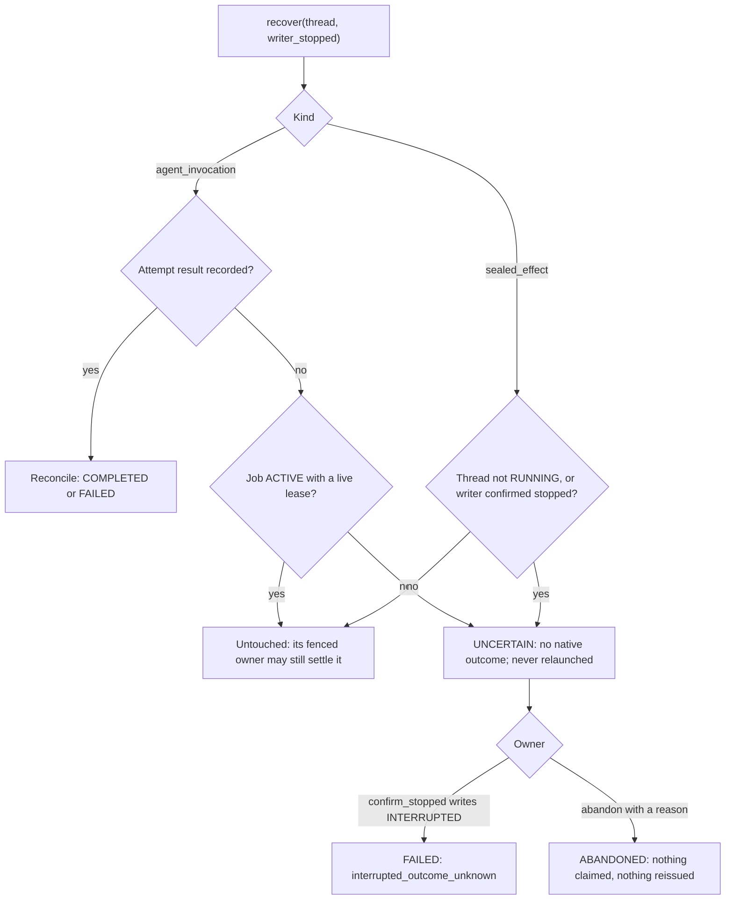

# Flow — operation journal and correlated trace

P002-T006 production journal behind `OperationPort`
([D287](../DECISIONS.md#d287--operation-journal-granularity-and-recovery-contract);
[T006 record](../phase/P002-T006-operations-tracing.md)). Callers today: synthetic graphs through `JournalPort` and
`run_operation`, graph domain commands through the audit sink, and `agent_started` when a caller supplies an
`InvocationOperation`. No product graph launches agents yet (T014–T016); 0.1.9 runs keep their own journals and get
no operations. Tables in [DDBB-DIAGRAM](../DDBB-DIAGRAM.md#p002-operation-journal-and-trace-events).





- **Statuses.** INTENDED, COMPLETED, FAILED, UNCERTAIN, ABANDONED; every change is a compare-and-set with its
  `operation.<status>` event in the same transaction, chained by `parent_event_id`. The status is a projection that
  the events rebuild. A different kind or reference set under an existing key is refused.
- **Fencing.** An agent invocation is sealed and settled only inside the job owner's fenced writes (token, live lease,
  checkout lock). A stale owner fails before writing; an expired lease makes the operation UNCERTAIN on recovery, never
  COMPLETED, and does not prove a stopped writer. Cancellation is classified from the supervisor's record (Codex exits
  0 after SIGTERM, D281).
- **Events.** Ordered by a global sequence, deduplicated by key (the same content is a no-op, other content is
  refused), insert-only by trigger, labelled `supplied`, `reported`, `derived`, `measured` or `absent`. Payloads are
  `trace-payload-1`: credentials, environments, argv and prompts never stay; secret-looking values are masked
  without digests; strings over 1 KiB and payloads over 8 KiB become references with digest and size whose masked
  bytes are stored with the event in `trace_artifacts` (at most 1 MiB per event, otherwise the event is refused) and
  read back, verified, by digest; references inside an offloaded JSON payload are checked like those of the event,
  at write and by backups. `knowledge-delivery-1` and `tool-discovery-1` envelopes remain validated and reconstructible from stored bytes.
  T007 emits additive v2 knowledge receipts; T008 emits discovery/schema envelopes and separate broker/logical
  call/results through the [scoped bridge](tool-bridge.md), plus registered/disconnected/stopped process evidence.
- **Generic port.** `JournalPort` seals and completes `sealed_effect` operations only; an `agent_invocation` or
  `domain_command` settles from its fenced native outcome or by evidence-based reconciliation. Every replay,
  reconciliation and completion checks the operation's project root; another root is refused before reading.
- **Inputs and results.** `refs` (≤ 32 lowercase keys, printable string values ≤ 200 characters) and `origin`
  (`{kind, id}` with a known kind) are validated before any write and never coerced. Results and errors are stored
  verbatim within 16 KiB, since a replayed node continues from them; credentials and secret-looking values are
  refused, never masked, and a refused completion leaves the operation INTENDED.
- **Turns.** `trace-observation-1` counts native turn delimiters (`StreamMetrics.terminals`, an additive counter of
  the stream summary) whatever the validity of the final answer; `metrics-1` keeps its historical counters.
- **Context receipts (T007).** An explicit canonical snapshot is sealed with `agent_started` and its
  `context.intended` event in that same transaction. The completed input-write observation and agent query/tool
  returns persist exact exposures with `knowledge.receipt` events (`knowledge-delivery-2`). Only locators, hashes,
  bounds and failure codes enter trace envelopes; content stays in scoped evidence storage. Historical
  `knowledge-delivery-1` remains unchanged. [FL08 implementation](frozen-context.md).
- **Domain commands.** Accepted outcomes and recorded refusals write `domain.command_accepted`/`refused` events in
  their own transactions; graph commands write the `domain_command` operation instead of the accepted event.
- **Queries.** `GET /api/managed/knowledge/projects/{id}/traces/{thread}` (thread), `/operations` (offset, at most 100
  per page), `/events` (after a sequence, at most 100 per page; the service caps at 200) and `/artifacts/{sha256}`
  (offloaded content of one of the thread's events). A thread whose operations
  belong to another project answers 404 `trace_unknown`. They read persisted rows only, so a restored query-only copy
  serves them without checkout, registry or providers; every journal write there is refused.

The [T026 fault matrix](../phase/P002-T026-installed-recovery.md#fault-matrix) covers a process exit on each
side of the domain transaction, before checkpoint advancement. A rolled-back command leaves no journal outcome.
A committed command replays its existing command, operation and draft identities. At the CLI boundary, the
stopped-writer check also revalidates the current run version, owner and recorded process groups.

## Observed steps (P002-T019)

Every settled managed attempt, with or without a workflow operation, gets an `observed-step-1` projection
([D305](../DECISIONS.md#d305--observed-step-projection-from-sealed-native-evidence),
[D310](../DECISIONS.md#d310--observed-step-pending-marker-projector-and-reads),
[evidence](../phase/P002-T019-observed-steps.md)). It is additive: `invocation.observed`, `trace-observation-1`,
`metrics-1`, the ledger and the operation semantics above are unchanged. Rows in
[DDBB-DIAGRAM](../DDBB-DIAGRAM.md#observed-steps).

```mermaid
sequenceDiagram
    participant M as Managed repository (settlement)
    participant P as Observed-step projector
    participant DB as SQLite
    participant FS as Sealed stdout.bin
    M->>DB: Attempt result (or confirm_stopped) + invocation.steps_pending, one transaction
    M-->>P: After commit: wake (ordinary path); restart or failure: next recovery pass
    P->>DB: Read agent_event, stream_diagnostic and stream_bytes rows in run order (no write lock)
    P->>FS: Oversize records only, sealed capture required: no-follow open, every chunk and capture digest, then each range
    P->>P: Validate each record, derive per client; at most 10,000 steps materialized, 4 MiB; mask, digest, no content
    loop Batches of 250, each under the writer lock
        P->>DB: Stop if a terminal marker exists; invocation.step (step:{invocation}:{seq}); identical replay is a no-op
    end
    alt No terminal marker, same content and persisted step keys equal the derived sequence
        P->>DB: invocation.steps_sealed, last
    else A key exists with other content, or extra persisted steps
        P->>DB: invocation.steps_failed (unless a terminal marker already stands); nothing overwritten, not retried
    end
```

- **Settlement stays bounded.** The settlement transaction stores only the pending marker. Parsing and verifying bytes
  happen afterwards, outside any write transaction; writes are short batches under the writer lock.
- **Recovery.** A crash leaves the marker pending; the projector's next pass (the runtime starts it with the
  supervisor, and its first pass runs at start) derives again from `seq` 0 and converges through the dedupe keys.
  Each pass walks every pending marker once in marker order, past persistent failures, and checks the stop flag
  before each invocation and, inside a projection, before each batch and the seal; a stopped projection stays
  pending and the next pass converges. A different payload under an existing key, or persisted steps beyond the derived sequence,
  is an integrity failure, recorded once and never overwritten or retried in a loop. The first terminal marker
  stands: two projectors never leave both sealed and failed markers.
- **Derivation.** Each record is validated against the shape it is read with first. Claude Code: one turn per
  assistant message id (`claude_message`), `tool_use`/`tool_result` correlated by id, `is_error` as `error` and
  terminal `permission_denials` as `denied`, thinking as reasoning and the successful terminal result as the final
  message. Codex: `turn.started` … `turn.completed`/`turn.failed` (`codex_turn`); supported items (command, MCP call,
  file change, web search) by id with `completed`/`failed` status (other statuses `unclassified` with the raw code)
  and explicit argument fields only; reasoning and agent messages, the last one final only when its own turn is
  observed to complete and only when it carries text; call fields first carried by a later record are incorporated;
  denials and per-request turns are absent with a reason. Harness broker calls link their `broker.*`/`tool.*` events
  only when name and argument digest single out one native call in the whole invocation (calls past the step bound
  included) and one broker call, else `link_absent`, and a discovery event only when one broker call was open. Overlapping calls of one turn are `parallel` with the turn's
  maximum concurrency. Timing is the receipt of the stdout chunk that carried the record's newline
  (`chunk_receipt`); a step observed only at its end, or a call first seen at `item.updated`, has start and
  duration absent.
- **Gaps and coverage.** Malformed records, partial tails, unsupported events, item types or clients, missing
  streams, unverifiable oversize records and supervisor cuts become `not_observed` steps at their position; later
  records are still derived. Open turns and calls end `cancelled_in_flight` after a supervisor stop, `not_observed`
  otherwise; nothing is closed as completed. Coverage is `complete` only when nothing is missing, and otherwise
  `partial` with its `coverage_reasons` (gaps, open turns or calls, no terminal, missing final answer, uncorrelated
  results, denials or broker events, ambiguous broker calls, bound). `source_record` points only at `agent_event`
  rows; a parser diagnostic keeps its `stream_record` number and no reference.
- **Reads.** `ObservedSteps.page` serves one invocation in `seq` order, keyset by step position, at most 200 per
  page, through `ix_trace_events_invocation`; states `sealed`, `pending`, `integrity_failed`, `not_settled`,
  `not_projected` (settled before T019: persisted or derived `trace-observation-1` counters and the run evidence,
  no backfill) and `lane_excluded` (preparation and configuration assistance). P002-T020 serves it over HTTP through
  `GET /api/managed/map/projects/{p}/invocations/{i}/steps`, with source records resolved to the existing event and
  log routes ([work-map reads](work-map.md#evidence-resolution)). The thread trace queries above never serve `invocation.step` rows (complete or not), so
  their cursors stay gap-free; the sealed and failed markers remain visible there.

## Source

- `core/engine/observation.py`, `core/engine/observed_steps.py`, `core/engine/trace_payload.py`,
  `core/engine/trace_envelopes.py`.
- `storage/operation_journal.py`, `storage/observed_steps.py`, `services/observed_steps.py`,
  `orchestration/operations.py` (`JournalPort`, `run_operation`),
  `storage/managed.py` (`agent_started`, `_history`, `confirm_stopped`), `services/domain_operations.py`,
  `services/managed_runtime.py`, `api/traces.py`, `migrations/versions/0032_operation_journal.py`,
  `migrations/versions/0040_observed_step_reads.py`.
- [Graph continuation](graph-continuation.md), [domain operations](domain-operations.md),
  [accounting](metrics-accounting.md), [archive consultation](backup-consultation.md).

T025's shared launch classifier keeps a wrapper-only interruption unknown. The persisted process identity is
for the gate until it releases the target. Target stdout or native telemetry establishes observed execution
and can be partial. A proven gate refusal remains a separate outcome. Existing journal and capture records
are retained. [Accounting flow](metrics-accounting.md).
