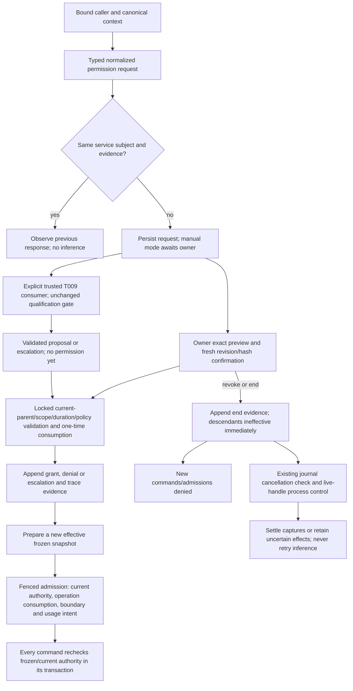

# Permission lifecycle and standing authority

P002-T010 implements the explicit permission consumer interfaces for [FL04–FL06/FL13](../phase/P002-T001-flows.md)
under [D291](../DECISIONS.md#d291--permission-ancestry-manual-standing-grants-and-exact-targets).
No productive task/phase/autonomy graph is added; those consumers remain T014–T016.

Owner controls use `permissions.inspect/request/preview/respond` through DomainOperations, its idempotency outcomes
and trace journal. Owner requests can select the grantee; agent role/project/operation and source attempt are
transport-bound. Scope, role, canonical evidence, purpose class and operation identify the service subject;
rephrasing, changed spelling, broader targets and duration alone do not create evidence. Explicit owner replacement
links preserve the old response. Confirmations are rejected after a changed permission revision, preview, target
identity, active source attempt or authority. A new context/evidence does not itself authorize inference: the
T009 consumer still requires explicit reconsideration under supplied bounds, with no T016 defaults.

`PermissionLifecycle.prepare` is a trusted boundary interface, not a model command. A prompt marker names its
snapshot ID/hash. `agent_started` seals it with the existing native intent; replay cannot attach it to another
attempt. Effective grants intersect frozen/current ceilings; grant additions never modify older boundaries.
Operation grants consume one journal operation identity in the same transaction; failed admission rolls back
consumption and accounting. Permission checks on command replay preserve the original effect without repeating it.
Product permissions retain project/revision scope; no acceptance grant can waive actual acceptance or READY.

All dependent authority ends with its parent, irrespective of duration/origin; independent owner grants retain their
own lifetime. Revocation is serialized before later commands, while a command already holding the write lock may
finish. The existing CLI/command loops observe persisted revocation/expiry/ceiling narrowing and own termination of
live handles. No persisted PID is signalled. An action already in flight may complete; captures, stopped-process
proof and uncertain accounting/effects use the existing recovery path. There is no recovery-time native relaunch.

The run-scoped legacy ledger remains separate (`once`/`task`, maximum TTL 24h); old adapter snapshots and histories
are unchanged. The new provider reads no legacy grants. Unmarked historical/manual paths retain their earlier
permissions. Current owner project controls display grant origin, ancestry, duration and explicit revocation;
permanent duration has no default selection. Read-only inspection by persisted project ID works in query-only
archives without registration/checkout. Mutations keep local-session/CSRF/archive guards and never run on an archive.

T010 technical-review corrections: delegation classifies tools from exact service-owned catalogue entries; opaque
native identities cannot establish safe effects and are not judge-delegable. The owner's existing exact native
command path remains separate. Child delegation narrows every inherited tier/evidence bound, and current ancestry
rechecks old records. For native postprocessing, `command_started` pins `permission_attempt_id` to the current
executor, even after its result settles. Intent admission and runner cancellation recheck that command's pinned
boundary; later attempts do not rebind it and older snapshots do not cancel new valid stages. Historical events,
snapshots and schema stay unchanged. [Correction evidence](../phase/P002-T010-permissions.md#6-technical-review-corrections--owner-only-tools-inherited-tiers-and-post-executor-revocation).
