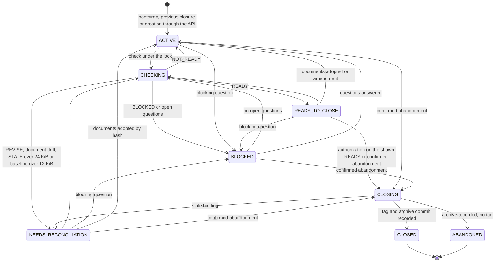
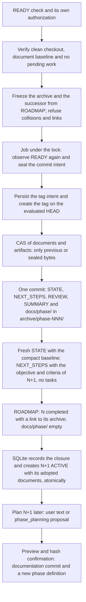
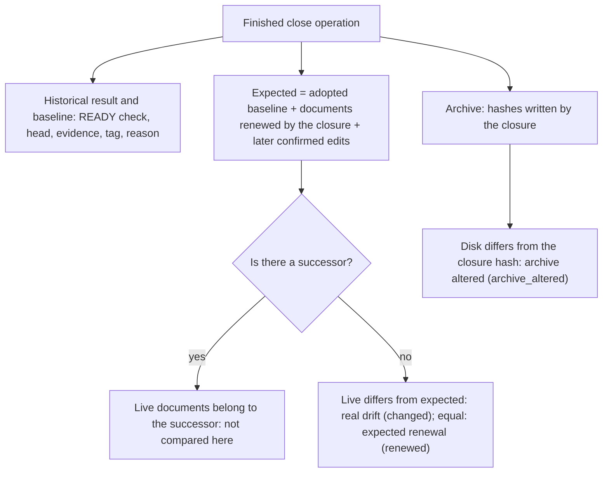
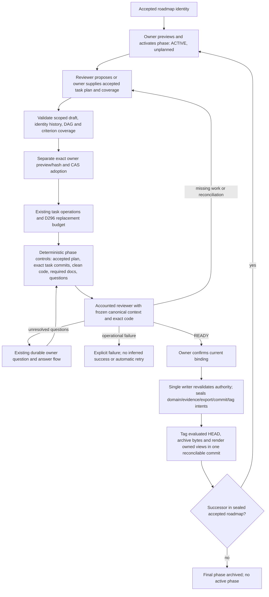

# Flow — phase lifecycle

Phases live in SQLite and READY is bound to exact content
([D032](../DECISIONS.md#d032--phases-in-sqlite-and-ready-bound-to-exact-content),
[D034](../DECISIONS.md#d034--unattended-batches-versioned-definitions-and-deterministic-annotated-tags)); closure
and archive form a single flow ([D091](../DECISIONS.md#d091--unified-closure-and-archive-with-later-planning)).

## Phase states

A check or closure that fails, is refused before effects or whose writer is confirmed stopped returns the phase to
its previous state (`BLOCKED` if there are open questions); a closure also invalidates its authorization and leaves
the tag intent sealed as an uncertain effect for reconciliation. Resuming a closure requires the same terminal state
and, for `CLOSED`, the same READY binding. Questions are refused in `CLOSING`, `CLOSED` and `ABANDONED`; amendments
also during `CHECKING`.

An amendment keeps the previous definition and invalidates READY and batches. The unattended batch chains
`task → commit → next task` but never checks or closes. An interrupted closure keeps its sealed intent: after the
writer is confirmed stopped, a new explicit request resumes the same run and commit.

## Unified closure and archive

Abandonment uses the same archive and commit, without READY or tag. If ROADMAP has no successor, the phase is
archived and STATE says that there is no active phase. STATE and NEXT_STEPS are archived byte for byte, as are binary
artifacts and subfolders of `docs/phase/`. REVIEW and SUMMARY are generated from the SQLite snapshot.

Separate phase transitions from earlier versions are refused; intents already sealed keep their recovery path in the
engine, without API or UI endpoints. A pending intent is never recomputed and its snapshots are never rewritten. The
planning prompt targets the exact phase of its context: the empty ACTIVE phase. It proposes NEXT_STEPS and requires
its own plan confirmation; it authorizes no other transition. The page of an ACTIVE phase without tasks offers text
or a conversational proposal, a preview with diff and hash, a reason and an idempotent confirmation of the plan.
Changing the phase version or the plan source discards the preview. A closed phase links to its successor.

## Reading a closed phase

Reading a `CLOSED` or `ABANDONED` phase adds `closure`, without changing `phase.documents`, the READY result or what
a check verifies:

The documents page uses the same expected hashes when the latest phase is finished, so the renewal made by the
closure does not show as drift. An open phase keeps its guards: drift against the adopted baseline and a stale READY
if the documents change.

## Source

- `core/engine/phases.py`, `storage/phases.py`: check, closure, questions, amendments, abandonment and batch.
- `storage/closure.py`, `core/engine/document_ops.py`: preparation, intent and adoption of the archive.
- `storage/phase_plan.py`, `storage/planning.py`: later plan confirmation and conversation over the empty active
  phase.
- `storage/transition.py`: reconciliation of earlier transitions.
- `storage/phases.py` (`closure_view`, `expected_documents`), `storage/documents.py` (`status`) and
  `frontend/src/Phases.tsx`: reading a finished phase.
- `core/engine/documents.py`: REVIEW, SUMMARY and the STATE, NEXT_STEPS and ROADMAP projections.

## Structured knowledge lane (P002-T015)

The documentary diagrams above remain the compatibility lane. For accepted structured knowledge, SQLite owns
meaning and the accepted roadmap. See [D298](../DECISIONS.md#d298--structured-manual-phase-plans-and-sealed-lifecycle-exports)
and the [implementation evidence](../phase/P002-T015-phase-lifecycle.md).

Changing accepted knowledge, adopted plans, task evidence, questions, required committed documents or code invalidates
old evidence. Committed edits of generated files are inputs to replacement, not database drift; uncommitted bytes,
links, traversal and unowned archive collisions refuse writes. Reconciliation means a scoped adopted plan revision;
it never adopts changed Markdown as authority. General owner knowledge edits supply product amendments separately.

The supervisor owns phase jobs; `managed-phase@1` records inference routing and invocation ledger identities.
The existing phase journal and exchange records own effects and recovery. Partial generation, an existing tag/commit
or an unrecorded result reconcile the same sealed inputs after explicit stopped-writer confirmation. A manual batch
only queues/commits tasks; it cannot check/close a phase and is invalidated by plan adoption or stale knowledge.
History and query-only archives expose evidence without mutation. Events correlate phase, operation, run and job
identities for T017/T018; those interfaces and T016's delegated loop are outside T015.

On structured closure recovery, Git first checks the sealed commit. A reachable exact commit and its sealed tag
provide evidence for recording the original closure even after a later knowledge adoption. Archive and export
receipts come from the committed tree and retain the original revision. If publication is still pending, the
current binding and authority must pass before further effects. Generated ROADMAP views rebuild all archived
phase links and terminal statuses from persisted closure outcomes.

A new structured closure tag requires the sealed checkout fingerprint immediately before publication.
Git verifies HEAD in the same reference transaction that creates the tag. A stale checkout stops closure
before archive publication. Recovery of an exact existing tag and validation of sealed partial archive bytes
remain separate from new tag publication.
