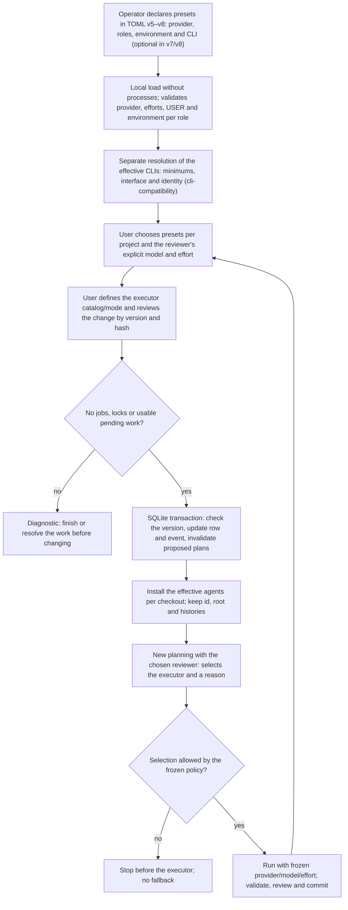

# Flow — agent selection per project

Per-project roles come from presets declared by the operator in the TOML
([D116](../DECISIONS.md#d116--creation-authority-per-project-presets-and-separate-preparation)). `local-config-7`/`8` keep
provider, model, effort and environment explicit, while the executable and version are optional: the service detects
the effective CLIs before admitting work, with common minimums Codex 0.163.0 and Claude Code 2.1.304
([discovery, freezing, guards and quarantine](cli-compatibility.md)).

A row without `agent_selection` inherits `[agents.reviewer]` and `[agents.executor]`, without creating an override
when it is read or the service restarts. Formats v1–v6 remain readable with their configuration hashes; v1–v4 refuse
the new presets and selection. Older version pins are explicit assertions, not a bypass of the current minimums.
TOML-declared projects are read-only in the UI. Creating a child and registering an existing checkout accept the same
optional selection.

The browser sends only preset ids and the reviewer selection. Executables, tools and environments stay in the private
TOML. Choosing another preset does not preselect the reviewer's model and effort; both fields are cleared. In
`catalog` mode, the executor's models and efforts are subsets of the preset. `open` mode requires the preset's
permission: the model is free text with an accepted shape and the effort belongs to the subset that preset allows;
catalog models are references. The UI shows the executor's models as checkboxes: the preset's models in `catalog` mode,
otherwise the packaged suggestions for the executor's provider plus any model added by hand, and always the models
already in the policy ([D231](../DECISIONS.md#d231--packaged-model-suggestions-and-small-ui-patch-releases)). The
reviewer decides the concrete selection and its reason per task and revision.

Presets can also be declared in the global editor's guided form, with the same fields and checks as TOML; tool lists
are offered only for executor-only Claude presets ([D250](../DECISIONS.md#d250--guided-profile-and-agent-forms-over-the-existing-configuration-contract)).
A project with its own profile setup keeps the agents copied into its private configuration when first saved and
edits them in its project editor after activation; later preset or global agent changes do not rewrite that copy.

Preview and confirmation reuse `/registry/preview` and `/registry/apply`: CAS, and repeating the same preview does not
increment another version. The hash binds the row, the selection, both full presets and the versions. An absent or
incompatible preset never inherits another provider; at restart, an invalid row stays unavailable with a diagnostic.
Changing capabilities in the TOML keeps quarantining jobs by composition before any effect.

The transaction is serialized with admission. It refuses `QUEUED`/`ACTIVE`/`RECOVERY_REQUIRED` jobs, locks, pending
acceptance, a commit with an intent, unresolved chat proposals and definitions or onboardings with still usable turns
or incomplete document operations (including import operations of the retired flow kept as data). Those already
adopted do not block. A pending or uncertain recipe preparation also blocks role changes, even after its lock is
released ([preparation](project-preparation.md)).

Proposed phase plans become `SUPERSEDED` with actor, date and a reference to the new version, in the same
transaction. Their content and hash and the turns' requests and results are not rewritten; a new planning turn is
needed before accepting another plan. Conversations without turns froze no agents. A chat without pending proposals
can continue with a new turn and the effective agents. The UI shows blockers in reads and previews.

Admission of new runs, resumption and commit check the active registry version under the same SQLite lock; the row id
and hash are bound too, so an earlier context cannot be admitted when another id adopts the same root. If an older
request arrives before the change, its job prevents the change; if it arrives after, it is refused. Reads and
idempotency of earlier operations are kept. Per-job adapters use the checkout's agents, without mutating the global
pair or other projects.

## Source

- `services/local_config.py` (presets and compositions), `services/project_registry.py`, `storage/registry.py`,
  `services/managed_runtime.py`.
- `frontend/src/pages/Settings.tsx`, `frontend/src/pages/Configuration.tsx`, `frontend/src/ProfileFields.tsx`.
