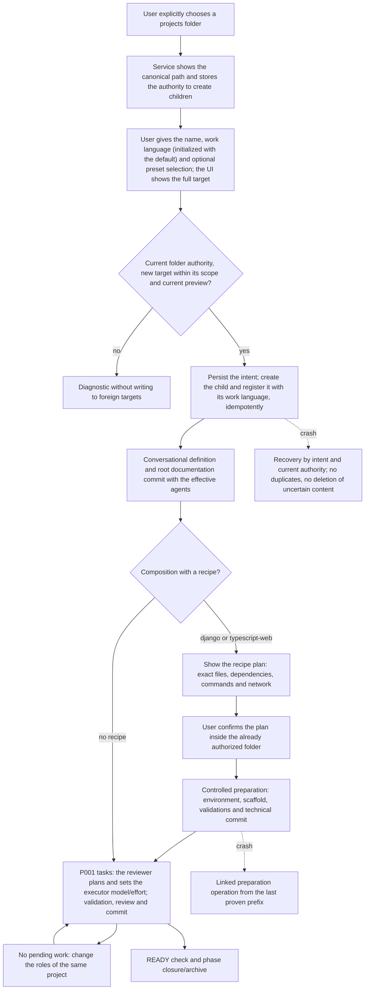
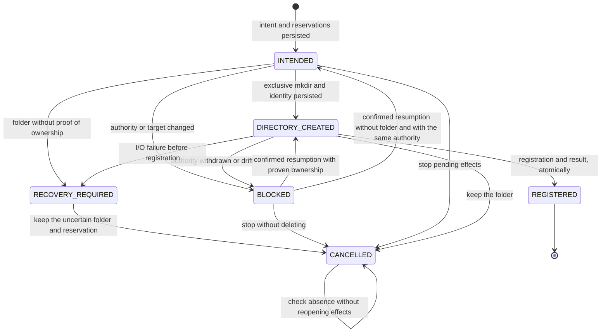

# Flow — projects folder and creation from scratch

For v9 own profiles, the [guided configuration flow](configuration-setup.md) adds profile adoption after context,
private TOML save after the documentary commit, generic confirmed preparation and separate activation before tasks.
The composition/recipe diagrams below describe the retained legacy lane; they do not bypass those v9 gates.

The user chooses a projects folder in the UI; the service creates and registers new children inside it, and the
project then goes through definition, an optional recipe preparation and its first tasks
([D116](../DECISIONS.md#d116--creation-authority-per-project-presets-and-separate-preparation)). Details of each
stage: [definition](project-definition.md), [preparation](project-preparation.md), [agents](project-agents.md),
[work language](project-work-language.md), [task](task-run.md) and [phase](phase-lifecycle.md).

A composition with a recipe blocks tasks, checks and closures until the preparation completes with its receipt.

The parent folder is chosen by a UI action; the AI does not discover or infer it. Storing it lets the service create
new children without asking for the folder permission for each project; it gives the executor no write access to
the parent or siblings and no general authorization for network, installation or providers. Technical operations run
inside their confirmed plan, with a prior intent, idempotency and recovery.

Roles are configured per project from the service presets: the user sets the reviewer's provider, model and effort
and the executor's provider and catalog; the reviewer sets the executor's concrete model and effort. Changing the
settings never modifies earlier snapshots.

The UI authority allows new direct children even if the parent is not a TOML registration root. TOML roots keep
authorizing the registration of existing folders with exact trust; choosing the parent does not widen that
registration or trust siblings. Storing, changing or withdrawing the selection increments its revision. Before each
short effect, creation checks that revision and the parent's identity under an exclusion shared with withdrawal.
Conflicts include physical ancestors and case-insensitive aliases, also for reservations whose folder does not exist
yet. An already registered child keeps its own authority. Choosing the same path again does not resume operations
automatically.

A crash after `mkdir` and before persisting the identity requires explicit recovery; an empty folder does not prove
ownership. Uncertain folders are never deleted. Repeating the key and payload returns the original operation;
another key cannot reserve the same target or id. A response lost after registration returns the same project, even
if the parent was withdrawn afterwards. `BLOCKED` grants no authority to continue.

API: `/project-creation-root` (GET, preview and apply) and `/project-creations` (preview, confirm, read by id,
resume preview, resume confirm and cancel). Confirmations require the session, CSRF header, idempotency key, version
and hash; the form keeps the request envelope after a lost response or a reload. At startup, a present target without
proven identity is classified `RECOVERY_REQUIRED` without touching it. Effects are synchronous and short, serialized
with withdrawal through a lock and SQLite transactions. Storing another selection or withdrawing it blocks pending
intents; resuming confirms the same operation and preserves its original intent. Cancelling releases reservations
only when absence is proven, and keeps the bytes; after an external resolution, a new versioned check can release a
cancelled reservation without reopening effects. Tables in [DDBB-DIAGRAM](../DDBB-DIAGRAM.md#projects-folder-and-creation-of-new-projects).

## Source

- `services/project_creation.py`, `storage/project_creation.py`, `services/project_registry.py`,
  `storage/registry.py`.
- `frontend/src/pages/Registry.tsx` (projects folder and creation form).
