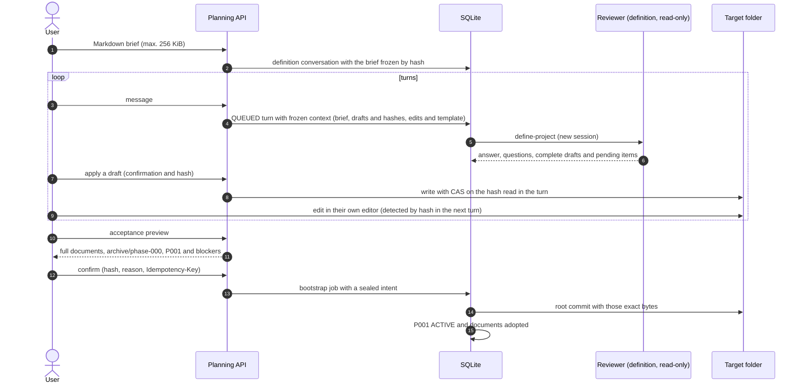

# Flow — project definition (new project)

For v9 own profiles, the [guided configuration flow](configuration-setup.md) adds profile adoption after context,
private TOML save after the documentary commit, generic confirmed preparation and separate activation before tasks.
The composition/recipe diagrams below describe the retained legacy lane; they do not bypass those v9 gates.

A new project in an empty folder with the unified documentation contract
([D075](../DECISIONS.md#d075--conversational-creation-and-planning-with-drafts-on-disk),
[D088](../DECISIONS.md#d088--unified-documentation-contract)). This conversational definition is the only way to
create a project; the earlier one-shot creation is refused by the engine
([D089](../DECISIONS.md#d089--mandatory-layout-and-template)). The agent never writes: the harness applies confirmed
drafts with CAS and the root commit follows the bootstrap intent
([D037](../DECISIONS.md#d037--root-commit-intent-for-new-projects)).

The choice of the projects folder, the creation of the child and the later recipe preparation are in the
[creation flow](project-creation.md). Drafts and the root commit contain only documents: the scaffold and the
environment are prepared afterwards by a separate operation, without widening the allowed drafts or accepting foreign
markers in the definition folder.

Questions are answered in their own fields and sent, one, a selection or all together, as one ordinary message per
turn ([answers](project-onboarding.md#answering-the-reviewers-questions)); they stay open until an answered turn
stops asking them or they are deferred with a reason.

Acceptance is blocked by: missing mandatory documents, a ROADMAP without phases, P001 without objective and criteria,
NEXT_STEPS without a valid `P001-TNNN` task, DECISIONS with repeated numbers, open blocking questions not deferred,
or files outside the template.

Managed markers are optional in the drafts. The preview regenerates the STATE, NEXT_STEPS, ROADMAP and DECISIONS
blocks where their markers are and appends any missing block at the end of the document; a partial marker, or one
in another document, blocks. In a new folder the turn context lists no drafts and the `define-project` template asks
to write from the brief, without asking about earlier content or markers.

Accepted drafts: the documentation template (AGENTS, CLAUDE, GEMINI, README, SPECIFICATION, ARCHITECTURE, ROADMAP,
STATE, NEXT_STEPS, DECISIONS and DDBB-DIAGRAM) and `docs/flows/*.md`. AGENTS, CLAUDE, GEMINI and DDBB-DIAGRAM that
were not drafted come from the template, with the conversation title and the commands of the frozen profile. Those
defaults are shown to the reviewer in the turn context; they do not replace existing drafts. The eleven documents
are mandatory in the accepted result. The preview blocks an AGENTS longer than 60 lines and CLAUDE/GEMINI longer than
15. Flow drafts allow a single folder level; neither `docs/phase/` artifacts nor separate decision files are
definition drafts.

The definition replies in the interface language frozen for each turn, while drafts and generated documents follow
the project's work language ([work language](project-work-language.md)).

## Existing repositories

A repository without a harness enters through [onboarding](project-onboarding.md), with its own preview and
confirmation before the commit. Earlier harness formats are not imported or converted
([D161](../DECISIONS.md#d161--retirement-of-the-previous-harness-support)). Registering or reopening a project this
harness already manages keeps its authority and does not repeat the definition.

## Source

- `core/engine/definition.py`, `storage/planning.py`, `adapters/bootstrap.py`, `storage/bootstrap.py`.
- Templates `define-project.md` and `plan-phase.md`; `core/engine/documents.py` (`skeleton`).
