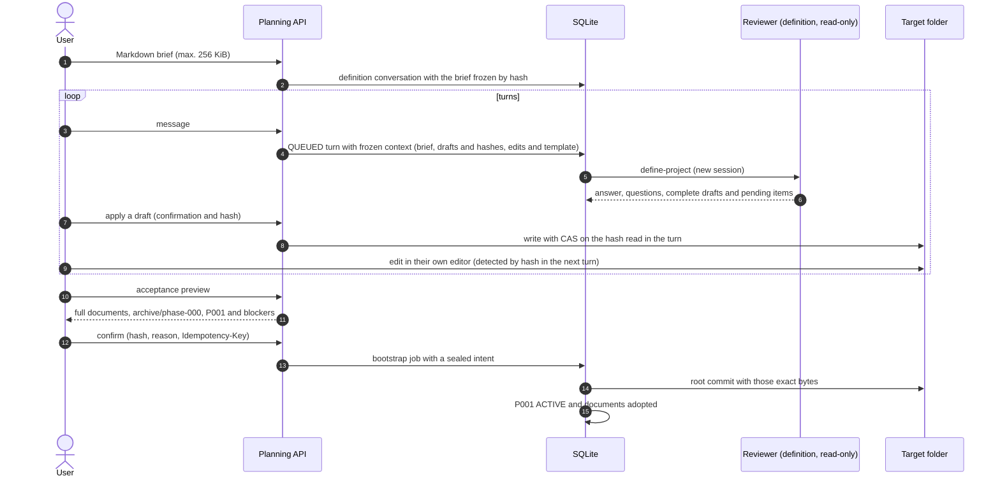

# Flow — project definition (new project)

## Structured intake (P002-T011 source complete; technical re-review passed)

New UI conversations select `structured-intake-1`; API callers opt in with `structured=true`.
Existing conversations keep the historical documentary lane described below. Brief/static HEAD and model
output are noncanonical evidence. The accounted reviewer turn proposes D284 entities/relations with
known/inferred/unknown sources. Earlier answered owner messages remain scoped, hash-verified evidence.
Owner staging persists a normalized database draft. Deterministic original instructions are matched against
HEAD and prior staging by identity, content and provenance, preserving them once with their ordered links. The owner reviews
full contents, relations, changes, questions and gaps, then confirms an exact preview with a reason and
Idempotency-Key. Adoption rechecks conversation version, proposal, draft and (onboarding) HEAD/inventory.
It creates an immutable `owner_confirmed` revision without modifying source files or originals.
Interrupted inference is never retried. Staging/adoption recover through the same domain outcome identity.
A later turn needs a new staging/review; stale previews cannot adopt it. Unresolved blocking questions
require a later answered turn or explicit deferral; answers alone do not resolve them.

Export/commit is explicitly pending T013. A structured profile proposal uses the existing full profile
validator, with exact knowledge and source bindings. Owner profile confirmation requires staged knowledge,
current conversation/source versions and resolved or deferred blocking questions. The UI supports its
review/edit/confirm controls. Knowledge adoption, profile confirmation, private configuration, preparation,
activation and readiness are distinct states; satisfying one does not satisfy another. No operational delivery
is claimed.

For an intake with no selected profile, knowledge adoption requires an available, current validated profile
proposal. A `profile: null` response remains valid but cannot close the conversation: the server refuses
adoption with an actionable diagnostic and the owner can request another turn and stage its proposal.
Profile confirmation is still independent and may precede or follow knowledge adoption. Intakes with an
already selected profile retain their existing adoption path. No post-adoption inference path is added.
See [active evidence](../phase/P002-T011-db-intake.md) for limitations and conversion references for T020.

## Historical documentary lane

For v9 own profiles, the [guided configuration flow](configuration-setup.md) adds profile adoption after context,
private TOML save after the documentary commit, generic confirmed preparation and separate activation before tasks.
The composition/recipe diagrams below describe the retained legacy lane; they do not bypass those v9 gates.

A new project in an empty folder with the unified documentation contract
([D075](../DECISIONS.md#d075--conversational-creation-and-planning-with-drafts-on-disk),
[D088](../DECISIONS.md#d088--unified-documentation-contract)). This conversational definition is the only way to
create a project; the earlier one-shot creation is refused by the engine
([D089](../DECISIONS.md#d089--mandatory-layout-and-template)). The agent never writes: the harness applies confirmed
drafts with CAS and the root commit follows the bootstrap intent
([D037](../DECISIONS.md#d037--root-commit-intent-for-new-projects)).

The choice of the projects folder, the creation of the child and the later recipe preparation are in the
[creation flow](project-creation.md). Drafts and the root commit contain only documents: the scaffold and the
environment are prepared afterwards by a separate operation, without widening the allowed drafts or accepting foreign
markers in the definition folder.

Questions are answered in their own fields and sent, one, a selection or all together, as one ordinary message per
turn ([answers](project-onboarding.md#answering-the-reviewers-questions)); they stay open until an answered turn
stops asking them or they are deferred with a reason.

Own-profile executable aliases, safe field-specific rejection diagnostics and previous-turn failure feedback follow
the same [intake rules](project-onboarding.md#reverse-engineering-conversation). A rejected profile fails the complete
turn without creating applicable documents; the UI distinguishes its returned document list from valid proposals.
Only a new explicit message starts another reviewer call; earlier requests/catalogs remain frozen (D241).
Own-profile adoption first requires applying the exact document proposals to drafts. Missing/changed documents have
their own diagnostics; informational pending notices do not block, while unresolved nondeferred blocking questions
do. Revalidation and exact confirmation follow the same onboarding adoption rules (D244).
The joint review can apply selected current document proposals with one consent through the same per-document CAS
routes. It excludes profile/plan/history proposals and stops on conflict or uncertainty, retaining acknowledged
drafts and requiring a fresh review of the remainder; it never confirms the profile or root commit (D245).

Acceptance is blocked by: missing mandatory documents, a ROADMAP without phases, P001 without objective and criteria,
NEXT_STEPS without a valid `P001-TNNN` task, DECISIONS with repeated numbers, open blocking questions not deferred,
or files outside the template.

Managed markers are optional in the drafts. The preview regenerates the STATE, NEXT_STEPS, ROADMAP and DECISIONS
blocks where their markers are and appends any missing block at the end of the document; a partial marker, or one
in another document, blocks. In a new folder the turn context lists no drafts and the `define-project` template asks
to write from the brief, without asking about earlier content or markers.

Accepted drafts: the documentation template (AGENTS, CLAUDE, GEMINI, README, SPECIFICATION, ARCHITECTURE, ROADMAP,
STATE, NEXT_STEPS, DECISIONS and DDBB-DIAGRAM) and `docs/flows/*.md`. AGENTS, CLAUDE, GEMINI and DDBB-DIAGRAM that
were not drafted come from the template, with the conversation title and the commands of the frozen profile. Those
defaults are shown to the reviewer in the turn context; they do not replace existing drafts. The eleven documents
are mandatory in the accepted result. The preview blocks an AGENTS longer than 60 lines and CLAUDE/GEMINI longer than
15. Flow drafts allow a single folder level; neither `docs/phase/` artifacts nor separate decision files are
definition drafts.

The definition replies in the interface language frozen for each turn, while drafts and generated documents follow
the project's work language ([work language](project-work-language.md)).

## Existing repositories

A repository without a harness enters through [onboarding](project-onboarding.md), with its own preview and
confirmation before the commit. Earlier harness formats are not imported or converted
([D161](../DECISIONS.md#d161--retirement-of-the-previous-harness-support)). Registering or reopening a project this
harness already manages keeps its authority and does not repeat the definition.

## Source

- `core/engine/definition.py`, `storage/planning.py`, `adapters/bootstrap.py`, `storage/bootstrap.py`.
- Templates `define-project.md` and `plan-phase.md`; `core/engine/documents.py` (`skeleton`).
