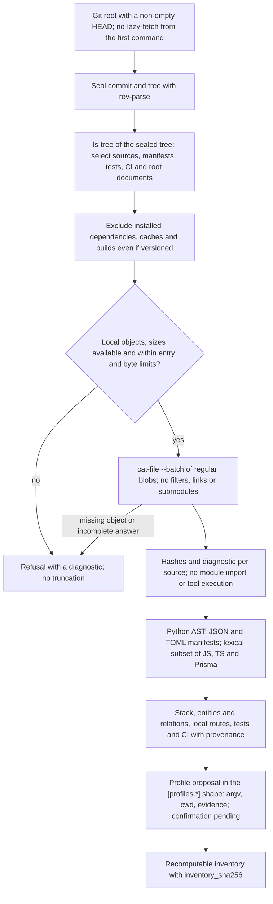
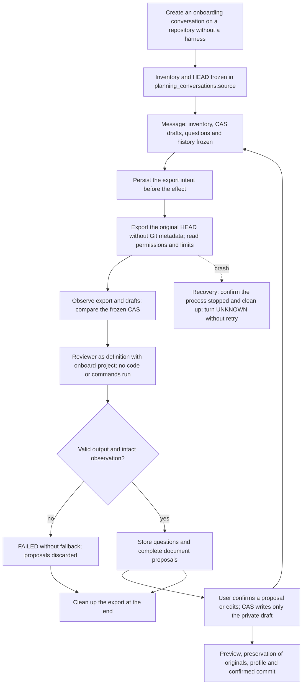
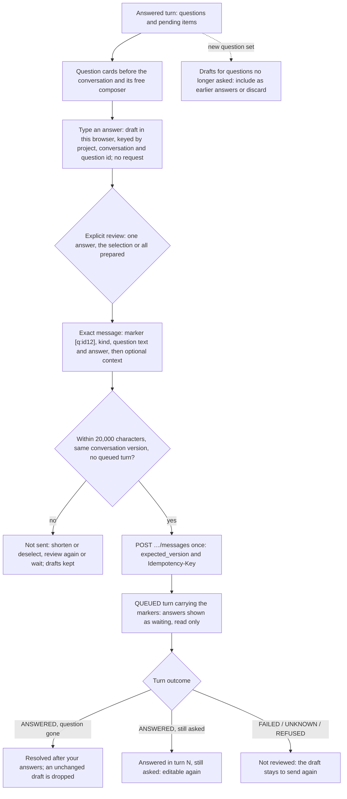
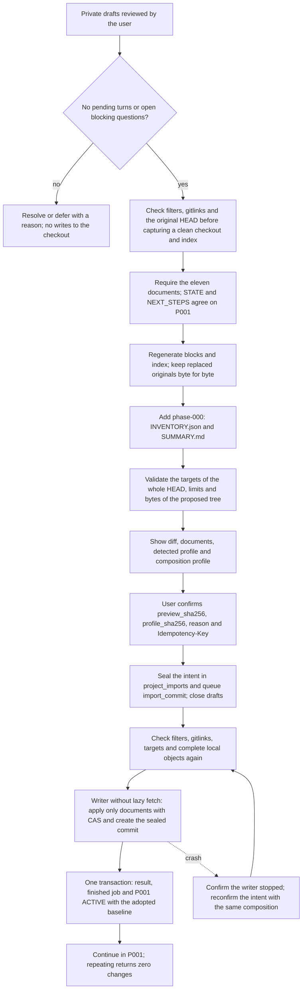

# Flow — onboarding a repository without a harness

## Structured intake (P002-T011 source complete; technical re-review passed)

New UI conversations select `structured-intake-1`; API callers opt in with `structured=true`.
Existing conversations keep the historical documentary lane described below. Brief/static HEAD and model
output are noncanonical evidence. The accounted reviewer turn proposes D284 entities/relations with
known/inferred/unknown sources. Earlier answered owner messages remain scoped, hash-verified evidence.
Owner staging persists a normalized database draft. Deterministic original instructions are matched against
HEAD and prior staging by identity, content and provenance, preserving them once with their ordered links. The owner reviews
full contents, relations, changes, questions and gaps, then confirms an exact preview with a reason and
Idempotency-Key. Adoption rechecks conversation version, proposal, draft and (onboarding) HEAD/inventory.
It creates an immutable `owner_confirmed` revision without modifying source files or originals.
Interrupted inference is never retried. Staging/adoption recover through the same domain outcome identity.
A later turn needs a new staging/review; stale previews cannot adopt it. Unresolved blocking questions
require a later answered turn or explicit deferral; answers alone do not resolve them.

Export/commit is explicitly pending T013. A structured profile proposal uses the existing full profile
validator, with exact knowledge and source bindings. Owner profile confirmation requires staged knowledge,
current conversation/source versions and resolved or deferred blocking questions. The UI supports its
review/edit/confirm controls. Knowledge adoption, profile confirmation, private configuration, preparation,
activation and readiness are distinct states; satisfying one does not satisfy another. No operational delivery
is claimed.

For an intake with no selected profile, knowledge adoption requires an available, current validated profile
proposal. A `profile: null` response remains valid but cannot close the conversation: the server refuses
adoption with an actionable diagnostic and the owner can request another turn and stage its proposal.
Profile confirmation is still independent and may precede or follow knowledge adoption. Intakes with an
already selected profile retain their existing adoption path. No post-adoption inference path is added.
See [active evidence](../phase/P002-T011-db-intake.md) for limitations and conversion references for T020.

## Historical documentary lane

For v9 own profiles, the [guided configuration flow](configuration-setup.md) adds profile adoption after context,
private TOML save after the documentary commit, generic confirmed preparation and separate activation before tasks.
The composition/recipe diagrams below describe the retained legacy lane; they do not bypass those v9 gates.

Onboarding describes existing code before proposing its documentation and placing it under the harness: a static
inventory with a profile proposal, a read-only reverse-engineering conversation over HEAD with private drafts, and a
confirmed documentation commit that adopts `P001`
([D102](../DECISIONS.md#d102--onboarding-by-reverse-engineering-over-head-with-private-drafts)).

## Static inventory and profile proposal

The reading uses the tree of the sealed commit, even with local changes: it does not inspect the worktree, the index
or untracked files, and does not use `status`, which could invoke `clean` filters. Reading the same tree yields the
same inventory; the fingerprint contains neither the root nor the commit date or id. All Git calls go through the
local Git wrapper with mandatory `--no-lazy-fetch` from the first command (a Git without that support is refused). A
missing object, an unavailable size or an incomplete blob answer blocks with a diagnostic, without transport,
recovered objects or partial inventories; the same applies to the export and preview that share the snapshot reader.

Each selected source carries its Git mode, size, SHA-256 and status. Links and submodules are not followed; an
oversized, binary, non-UTF-8 or unparsable file leaves an explicit diagnostic. The full tree still identifies the
base, including files outside the scope. Limits: 50,000 tree entries, 1 MiB per source and 32 MiB of sources read;
exceeding the total or the entries refuses the operation.

The analysis observes declarations of Django and SQLAlchemy models, TypeORM entities, Prisma models, Django routes,
FastAPI decorators and recognized Express router calls. It does not evaluate expressions or resolve imports,
cross-module inheritance, includes, mounts or imported prefixes. Findings cite path and line, dynamic routes are
marked `dynamic`, and unknown relation targets are `null`. The reviewer must complete and check this evidence against
the code snapshot; the inventory does not prove the runtime schema.

The proposal contains only commands based on observed tools or configuration, scripts declared in `package.json`,
`manage.py` next to Django evidence, or `go.mod`. Each command keeps its `cwd` and sources. Preparation is empty; it
installs and runs nothing, adds no unobserved JUnit and does not write the TOML. Without validations, `ready=false`:
the user must define them. It always requires confirming or editing commands, timeouts, paths and scripts, and
providing executables, environment and composition.

## Reverse-engineering conversation

The API accepts `kind = "onboarding"` on the existing planning routes, without brief or phase. It freezes the full
inventory in the conversation and uses its HEAD in every turn, even if the live checkout changes; the confirmation
refuses a stale base before writing. A versioned STATE/NEXT_STEPS or `.harness/` folder blocks onboarding: earlier
harness formats are not imported ([D161](../DECISIONS.md#d161--retirement-of-the-previous-harness-support)). Phases,
a creation or a confirmed import already recorded in this installation also prevent onboarding again.

The full export uses the chat snapshot limits
([D083](../DECISIONS.md#d083--chat-over-a-head-snapshot-in-its-own-lane)), stricter than the inventory's: 20,000
files, 16 MiB per file and 128 MiB in total, without links or submodules. Git requires `--no-lazy-fetch`; there are no
filters, no execution of sources and no profile commands. The joint context of inventory and drafts is limited to
2 MiB without truncation. The export keeps the planning lane and lock, with cooperative read permissions, not
operating-system isolation.

The template asks for the eleven documents of the contract, flows of the observed modules, entities and relations
checked against the real code, and DECISIONS entries with the status "inferred from code". It does not use the "No
persistence" diagram or template commands as a fallback. It asks about unknowns, including the future work of P001;
blocking questions and their explicit deferrals are stored for the confirmation. A reviewer proposal does not prove
its content is correct: semantic generation depends on human review and confirmation.

Own-profile commands use logical names such as `python` or `docker` in each direct `argv[0]`; installed paths belong
to the later private configuration. `tools` lists exactly those direct names, with nested/container requirements
described under their direct tool. Invalid executable names identify the structural field/index without echoing
candidate values. A rejected profile still fails the whole turn and creates no document/profile proposals. Its
returned document list is labelled unavailable to apply; earlier valid proposals survive. Subsequent turns freeze
the recorded failure reasons in `previous_turns`, without treating rejected output as an answer or rewriting the
failed turn ([D241](../DECISIONS.md#d241--actionable-intake-profile-rejections)).

For own-profile adoption, first review and apply the document proposals to the private drafts, then review/adopt
the saved profile. A new profile draft is needed only for edits. Missing bound document paths and changed/extra paths
produce specific adoption blockers; the candidate is revalidated only after the exact document base is present.
This prevents the same absent documents from also producing an invalid-profile error. Informational `pending`
notices remain recorded but do not block; blocking questions require resolution or explicit deferral. Confirmation
repeats document, HEAD/inventory, context/version and candidate checks against its exact preview. No documents or
profiles are silently applied, repaired or rebound (D244).

The joint document review (also available in definition) reads all applicable pending draft proposals and their
current draft contents. It displays each exact diff, allows excluding documents and requires one explicit consent
for the selected proposal hashes/version. Before writing it rereads the conversation and every selected base.
It then uses the existing per-document CAS apply route in order, advancing the expected version only for its own
acknowledged writes. A conflict/error or lost response stops the sequence; acknowledged drafts remain applied,
the unconfirmed item and unattempted paths are reported, and remaining proposals need a fresh explicit review.
There is no atomic batch, rollback or automatic replay. Profile adoption and the later documentary commit stay
separate. No API/schema change or provider call is introduced (D245).

## Answering the reviewer's questions

The same workflow serves onboarding, the new-project definition ([flow](project-definition.md)) and phase planning
conversations ([D240](../DECISIONS.md#d240--question-first-answers-and-the-live-activity-rail)). The UI only composes
an ordinary planning message; the API, the questions and their blocking rules are unchanged.

Each question has its own answer field. Typing saves a draft only in this browser (local storage), so drafts survive
polling, reloads, navigation and request errors without calling a model. Nothing is sent until the user opens a
review of one answer, the selected answers or all prepared ones; the review shows the exact message and its size and
sends it as one planning message, so one turn and one reviewer call, never one call per question. Empty or unselected
answers are not sent and are not deferrals. The message names each question by a language-neutral marker made of the
first 12 hex characters of its id (the hash of its text) and repeats its text, so the reviewer and later turns can
tell which question each answer belongs to.

The service still derives the questions from the latest answered turn: sending answers does not close a blocker or
make the confirmation available, and a blocking question is only resolved by a later answered turn that no longer asks
it, or deferred explicitly with a reason. Deferral stays a separate control. The UI reads the turn messages to show
each question's state: draft, waiting in a queued turn, resolved after an answered turn, still asked after an answer,
or not reviewed when the carrying turn failed. A changed question set never moves a draft to another question: drafts
for questions no longer asked are listed for an explicit decision. A review becomes stale when the conversation
version changes and must be checked again; while a turn is queued no submission is possible, and a repeated click
reuses the same request and key. The 20,000-character limit of a planning message applies to the whole composed
message: an oversized batch is refused as a whole, not cut or split. Confirmed conversations show their questions
without answer controls.

Drafts are stored in `onboarding-drafts/<id>/` next to the SQLite database. Changes before invoking prevent the
call; changes to the export or the draft area during the turn discard the answer. The original README and the rest
of the checkout stay untouched when a confirmed proposal is applied: only the private draft changes. The template
asks for consent before proposing to replace the README; the confirmation keeps the original. The detected profile
stays a proposal; the operator's composition is confirmed separately in the preview. The TOML is never written.

Language ([D167](../DECISIONS.md#d167--immutable-work-language-per-root-language-pair-per-job-and-attempt),
[D169](../DECISIONS.md#d169--sealed-language-directive-generated-documents-in-the-work-language)): registration
confirms the root's work language before the conversation; without it, turns and the confirmation answer 409
`work_language_required` without queueing. The conversation answers in the interface language frozen for each turn,
and drafts, blocks and the `phase-000` `SUMMARY.md` follow the work language ([flow](project-work-language.md)).

## Preview, confirmation and continuity

`POST …/planning/{c}/onboarding/preview` requires valid drafts, AGENTS of at most 60 lines, CLAUDE/GEMINI of at most
15 and a P001 with objective and criteria in ROADMAP. It does not fill documentation or commands from a template. A
pending turn, or a blocking question neither answered nor deferred, prevents confirmation. A different phase,
occupied targets, case or file/folder collisions and exceeded limits block before the effect.

The preview shows the exact documents and bytes, the diff, HEAD and the proposed tree, the kept originals and the full
composition profile (validations, preparation, JUnit and paths). The detected profile is shown as a proposal: the
operator declares or edits it in their TOML and selects the composition in Settings.
`POST …/onboarding/confirm` requires `preview_sha256`, `profile_sha256`, a reason, an explicit confirmation and an
Idempotency-Key. It accepts no arbitrary commands or executables from the client, does not write the TOML and runs
no preparation, validator or project code.

The frozen inventory is kept in `docs/archive/phase-000/INVENTORY.json`, and the summary, conversation, questions,
deferrals, pending items and profile in `SUMMARY.md`. Each replaced original is kept in
`onboarding-originals/<original path>`. A README without replacement stays in place. No earlier file is overwritten
or renumbered. The code of the original HEAD keeps paths, bytes and modes in the resulting commit.

The operation uses `project_imports` and `purpose = import_commit` with `preview.flow = onboarding`
([data](../DDBB-DIAGRAM.md#confirmed-documentation-commit-of-onboarding)). The intent holds bytes, author, date,
tree and commit before writing. The CAS admits the original or the sealed bytes; a crash requires confirming the
writer stopped and reconfirming the intent with the same context, versions and author to reconcile the same run and
commit. No phase is created until the result is recorded; adopting P001 ACTIVE, its document baseline and the end of
the job are atomic. The confirmation closes the drafts of every conversation of the checkout; an uncertain intent
blocks new work.

## Git boundary

The shared Git writer runs no clean/process filters during onboarding: configurations of those filters (includes
too) are refused before capturing and before executing the commit. The sealed blobs are compared with the preview
bytes; any internal conversion that would change them also blocks. The guards check the whole resulting document
tree, new ignored targets and tree equality at the final seal, and they are repeated when executing or resuming,
without altering the intent. Limits: those of the chat snapshot, 512 KiB per document and 4 MiB of diff, without
truncation. HEAD and an index with gitlinks at any path block before capture or sealing, writing or recovery: only the
parent's trees and index are queried, without inspecting children or running their filters. The static inventory
reads HEAD without following submodules; it does not prove that the checkout will pass this later guard, and
submodules are not supported.

The writer is bound to the local Git wrapper before capturing, sealing, executing or resuming. Every call, including
reconciliation and the index, requires `--no-lazy-fetch`; boolean questions first check support through `--version`.
The future commit can be created locally without transport. A needed object of HEAD or of the proposed or sealed tree
that is missing blocks before writing, also outside the document scope: the whole tree is checked with `ls-tree` and
`cat-file --batch-check`. Configuration is never changed and objects are never fetched.

`GET …/projects/{p}/onboarding` recovers the operation, and the UI route `/projects/:p/onboarding[/:c/*draft]` provides
the conversation, the CAS editor and the confirmation, with the profile and the continuation in P001. A P001 task is
queued by a later action with the confirmed composition. The frozen `document_layout` quarantines earlier jobs
before effects; snapshots, intents and histories are never rewritten.

The dispatcher requires an `onboarding` conversation, an inventory in the onboarding format and
`preview.flow = onboarding`, with consistent roots. Retired-flow work, a missing source or a contradictory
classification is quarantined before building ports or writers and is never interpreted as onboarding
([compatibility](legacy-compatibility.md)). A valid onboarding operation keeps its normal recovery and reconciliation.

## Source

- `adapters/project_onboarding.py` (`read_inventory(root)` with read-only Git) and `core/project_onboarding.py`
  (`build_inventory(entries, head, tree)` and the profile proposal).
- `storage/onboarding.py`, `storage/planning.py`, template `core/engine/templates/onboard-project.md`; the export and
  cleanup reuse `adapters/chat_snapshot.py`.
- `core/engine/onboarding_commit.py`, `storage/onboarding_commit.py` and the shared `core/engine/import_commit.py`,
  `storage/project_import.py`, `adapters/import_git.py`, `adapters/local_git.py`, `core/tree.py`,
  `storage/private_drafts.py`, `storage/retired_work.py`.
- Tests: `tests/product/test_project_onboarding.py`, `test_onboarding_conversation.py`, `test_onboarding_commit.py`.
