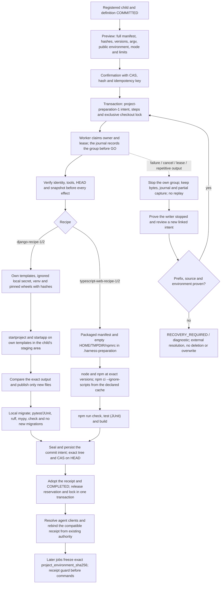
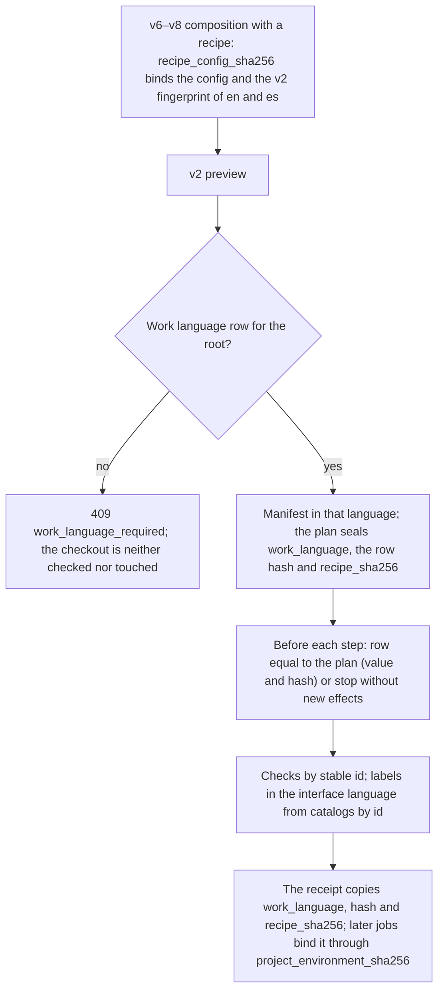

# Flow — confirmed preparation by recipe

For v9 own profiles, the [guided configuration flow](configuration-setup.md) adds profile adoption after context,
private TOML save after the documentary commit, generic confirmed preparation and separate activation before tasks.
The composition/recipe diagrams below describe the retained legacy lane; they do not bypass those v9 gates.
New generic plans additionally freeze read-only aliases of declared tools outside local write scope (D247), with
exact chain evidence and post-effect/receipt guards described in the configuration flow. D248 also binds external
directory aliases along those exact tool chains while continuing to refuse checkout directory links. This leaves
the recipe link policies and fingerprinted sources below unchanged.

Generic preparation with a Claude executor that has write scope also requires one of `Write`, `Edit` or `MultiEdit`
to be both enabled and allowed. Preview refuses otherwise, and an older queued plan fails before launch. During the
executor step, `output-guard-1` stops repetitive streamed text and issues no receipt. A failed heartbeat is retried
while the lease lasts. When ownership is lost, the adapter stops its group and leaves a partial `capture.json`, and
the closing owner settles the stale `RUNNING` row from independent liveness before closing
([D251](../DECISIONS.md#d251--writer-tool-admission-bounded-repetitive-output-and-lease-renewal-evidence)).
The executor intent is also the expected P001 accounting invocation (`preparation_step`, no run or attempt), bound
through the plan's frozen configuration data; `process_finished` or the closing owner's settlement appends its
capture in the same transaction. Native command/JUnit/commit steps are never model invocations
([D259](../DECISIONS.md#d259--native-accounting-capture-frozen-revision-binding-and-format-3-archives)).

Recipes prepare the technical stack of a newly created project after its root documentation commit:
Django ([D119](../DECISIONS.md#d119--django-recipe-preparation)) and TypeScript web
([D143](../DECISIONS.md#d143--typescript-web-recipe-1)). They apply only to new children registered by the service,
with a composition that sets `recipe = "django"` (packaged profile) or `recipe = "typescript-web"` (built-in profile)
and an accepted root documentation commit. `local-config-5` selects the v1 recipes; `local-config-6`–`8` select
the v2 recipes, which follow the child's work language ([below](#v2-recipes-by-work-language)). No agent runs. Both
recipes share the `project-preparation-1` contract, the `preparation-commands-1` binding, tables, locks, journal,
technical commit and recovery; each provides its manifest, steps, source rules and receipt.

## Common core and Django recipe

The already authorized parent folder is not confirmed again: this confirmation covers new technical effects inside
the child. The preview does not install, resolve packages or start Django or uv processes. It only queries local Git
in a controlled way, without filters, submodules or lazy fetch. It requires a documentation root HEAD and absent
targets, even ignored ones. The Python templates are materialized inside `.harness-preparation/`; generation does not
use the Django templates that introduce secrets or version-dependent content. Protected configuration is written by
this confirmed service; the ordinary executor keeps its restrictions.

The installer uses wheels with hashes, `--no-deps`, no builds, no discovered configuration, no Python downloads and
no HTTP retries. Offline mode does not switch to the network on failure: it uses the operator's explicit wheelhouse,
if any, or the child's private cache. A child without wheels or cache fails with a capture. Network mode requires the
operator's ceiling and the confirmation of that plan. HOME, TMPDIR and the cache are local to the child; the global
environment is never modified.

Operation states: `QUEUED → ACTIVE → COMPLETED`; `FAILED`/`CANCELLED` for proven stops; `RECOVERY_REQUIRED` for an
uncertain lease or owner. Steps go `PENDING → STARTED → DONE` with a snapshot after the result. Processes use
`preparation-commands-1` and the `preparation_id` foreign key, never fictitious events or runs. GET shows the journal
and captures; cancel and confirm-stopped are CAS-checked and idempotent. Cancelling uses the process's own handle,
waits for the group to die and only then releases the lock. A persisted PID is never signalled.

A crash does not authorize repeating installation or network access. A new preview and confirmation with
`previous_id`/`retry_step` creates another operation; the `DONE` prefix is copied with its evidence, keeping the
earlier steps. If the environment differs from the last proven prefix, there are foreign files, a partial initial
write or an uncertain venv, it blocks. There is no automatic cleanup or reinstallation. If only the adoption of an
already sealed commit is missing, the new operation keeps its original bytes, date and identity and reconciles the
same hash without repeating commands. A crash after the last step's checkpoint can also reconcile that commit.

An uncertain reservation blocks new tasks, role changes and unregistration even when the process is no longer alive.
Job admission and confirmation share the SQLite transaction; there is no second lock per root. After `COMPLETED`,
the receipt pins the interpreter and executables, every distribution, the environment hashes, the lock, the local
secret by hash and the protected files. Changing roles keeps that receipt if the recipe does not drift. It is
validated before tasks and checks and before each native command; earlier document snapshots are not rewritten.
Client resolution recomposes the project and rebinds its compatible completed receipt from the existing preparation
service before admission. It preserves work language, observed CLI versions and the exact environment digest, rather
than copying an obsolete composition hash. Missing receipts, a changed recipe configuration or protected/tool drift
still block work. The identity of the checkout and of `.venv` is compared by inode, because macOS renumbers the device when the volume is
remounted after a reboot; bytes are still verified in full
([D130](../DECISIONS.md#d130--preparation-receipts-compare-the-inode-not-the-device)).

Backups include the inline journal and captures, locks and processes of both owner kinds and the new roots; a restore
stays query-only, loads no configuration and grants no executable authority. Retention keeps the preparation evidence
and refuses live or uncertain writers and groups of both kinds.

## TypeScript web recipe

`[recipes.typescript-web]` declares absolute node and npm paths with exact versions, the operator's npm cache (an
existing folder outside checkouts and state), a network ceiling, a timeout and an output limit. The composition names
the built-in `typescript-web` profile, `node`/`npm` executables that resolve to the same files and an own environment
whose `npm_config_cache` is that cache: the service does not rewrite it, and every task reinstalls with the cache
the preparation proved.

The preview shows the full manifest (`package.json` with the project id and exact `engines`, a v3 lock with the
pinned `typescript`, `tsconfig.json`, `.gitignore`, `scripts/`, `index.html`, `src/main.ts` and its test), the
targets that must be absent (`node_modules`, `.build`, `dist`, `.local`, `.harness-preparation`), the registry, the
cache and the warning that network mode writes to it. There is no generator or publish step: the first step writes
the whole manifest. Offline adds `--offline` and a cache miss does not switch to the network; network mode requires
`allow_network` and choosing it in the preview. Steps set `HOME`/`TMPDIR` and two empty npmrc files (user and global
must be different files) inside the child, `engine-strict`, the registry and `fetch-retries=0`.

Receipt: identity, the manifest files that match the profile's `protected_paths` (same glob semantics) and the
resolved `node`/`npm` with their hash. `node_modules` is not frozen: the profile reinstalls it before each task. An
`npm ci` is retried only if `node_modules/` is unchanged since the last proven prefix; with an empty cache npm fails
without creating it, and partial bytes or an `npm ci` without a checkpoint block with a diagnostic, without deleting.
The technical commit contains exactly the manifest. The manifest stays fixed after preparation; adding dependencies
needs a future flow.

## v2 recipes by work language

`local-config-6`–`8` accept `[recipes.django]` and `[recipes.typescript-web]` with the v5 keys and
select `django-recipe-2`/`typescript-web-recipe-2`; v5 keeps selecting v1 with its hashes
([D168](../DECISIONS.md#d168--v2-recipes-in-local-config-6)). Effects, order, core, locks, journal, recovery and
technical commit are those of v1; the technical prose of the scaffold, the profile (Django v2 with English
instructions and the profile formatter; TypeScript with its own copy of the profile) and the identity change.

- The language comes from the root's row ([D167](../DECISIONS.md#d167--immutable-work-language-per-root-language-pair-per-job-and-attempt)),
  never from the default, the interface language or the content. A successor operation keeps the original plan's
  values and is refused if the row no longer matches.
- Checks by `id`: versions (`python-version`, `installer-version`, `installed-versions`, `node-version`,
  `npm-version`), uncertain environment (`create-environment`) and partial or complete source (`generate-*`;
  `migrate`, `validate-*`). v1 plans, without `id`, are checked by their frozen labels with the same result.
- The UI shows v2 steps with the en/es catalogs by `id` (validations with the profile command) and the plan's work
  language; the plan keeps its English label. v1 plans show their frozen label.
- The child's functional language (`LANGUAGE_CODE`, `<html lang>`, visible texts) is never derived from the interface
  or work language. Moving a project prepared with v1 to v6–v8 is not supported: it would change its frozen
  composition.

## Source

- `recipes/` (`django.py`, `django_2.py`, `typescript_web.py`, `typescript_web_2.py`), `services/project_preparation.py`,
  `storage/preparation.py`, `adapters/preparation.py`.
- `frontend/src/pages/Preparation.tsx`, `frontend/src/preparation.ts`.
