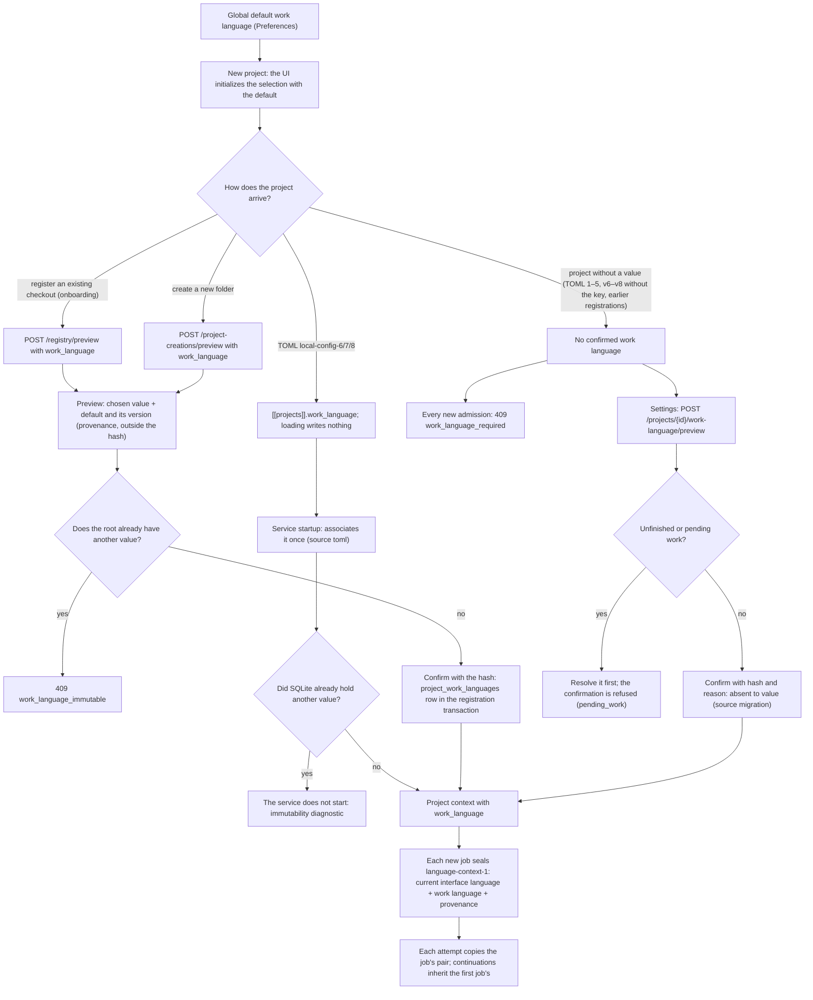
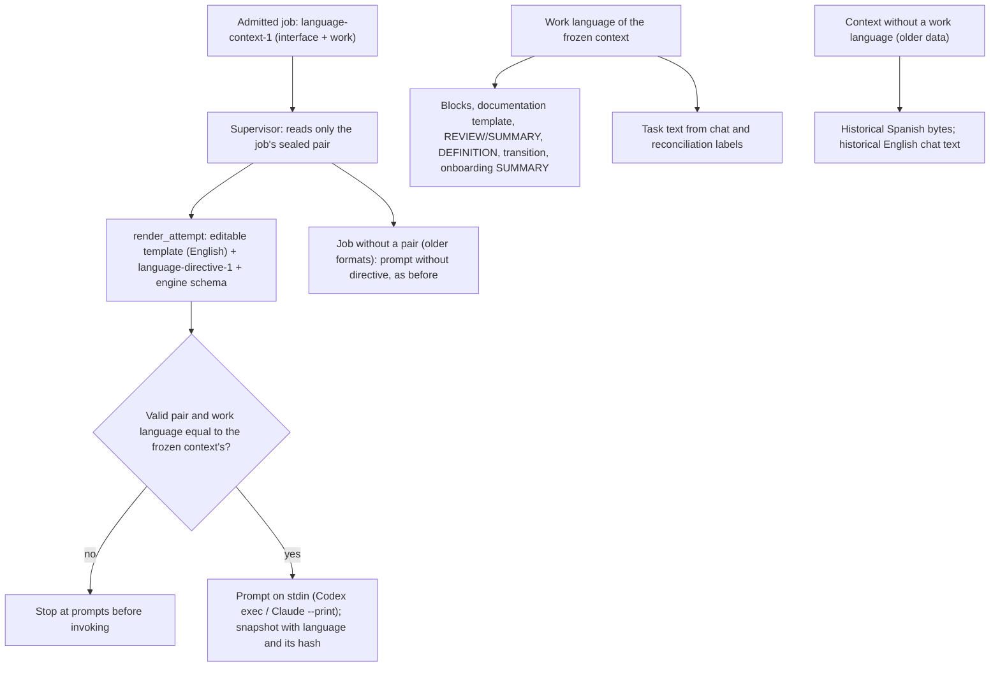

# Flow — work language per project

The work language (`en`/`es`) governs the documentation, plans and code that agents write in a project. It is chosen
once per canonical root and never changes
([D158](../DECISIONS.md#d158--global-interface-language-and-immutable-work-language),
[D167](../DECISIONS.md#d167--immutable-work-language-per-root-language-pair-per-job-and-attempt)); the interface
language is a separate global preference ([preferences](language-preferences.md)). The job's pair reaches the agent
as a directive and the documents the harness generates use the work language ([below](#sealed-directive-and-generated-documents)).

- Immutability: updating or unregistering a registry row with `work_language` in the body answers 409
  `work_language_immutable`; reopening (unregister and register the same root again) only accepts the original value
  and keeps the original row. A v6–v8 TOML with another value stops the startup; without the key, the project reads
  the value already confirmed. Project settings only display it.
- Changing the default work language between preview and confirmation does not alter the confirmed value: the hash
  seals the chosen value and the existing association; the default and its version are provenance in
  `confirmation`.
- The explicit confirmation does not translate, rename or inspect files; the language is never inferred from content.
- Admission: the pair is read in the transaction that admits each new job (task, turn, check, commit, document
  operation, preparation…). Retries, revalidations and resumptions copy the `language_context` of the run's first job,
  including an older `ui-language-1` value or null; they never receive an invented work language.
- A stale project context with another `work_language` (it should not happen: the row never changes) is refused.
- Downgrading `0025` is refused when any association exists. Backup and query-only restore keep it.
- Recipes: with `local-config-6`–`8`, `[recipes]` selects the v2 recipes, which prepare with the
  row's language and seal it in the plan and the receipt; without a row, the preparation is refused before effects
  ([flow](project-preparation.md#v2-recipes-by-work-language)).

## Sealed directive and generated documents

[D169](../DECISIONS.md#d169--sealed-language-directive-generated-documents-in-the-work-language):

- The directive includes "Respond to the user in {interface}. Write project documentation and code in {work}.", the
  fields of each role addressed to the user and those that are documents or code, the literal technical values and
  the documentation labels in the work language. It precedes any language instruction in the templates, which stay
  editable.
- Changing the interface language governs only new jobs: retries and revalidations inherit the first job's pair.
- Commit messages and trailers stay technical English; the parsers read English and Spanish labels.

## Source

- `core/engine/language.py` (directive), `core/engine/prompts.py::render_attempt`, `services/managed.py`
  (`job_language`), `core/engine/document_text.py` and `documents.py` (en/es vocabulary).
- `storage/work_language.py` (row, pair capture), `storage/registry.py::confirm_work_language`,
  `storage/managed.py::_language`/`agent_started`.
- `services/project_registry.py` (preview and seal), `services/project_creation.py` (`project-creation-2`),
  `services/work_language.py` (explicit confirmation), `services/managed_runtime.py` (TOML startup and context),
  `services/local_config.py` (`local-config-6/7/8`).
- `api/managed.py` (`/projects/{id}/work-language`, 409 codes), `api/schemas.py`.
- `frontend/src/WorkLanguage.tsx`, `pages/Registry.tsx`, `pages/Settings.tsx`.
