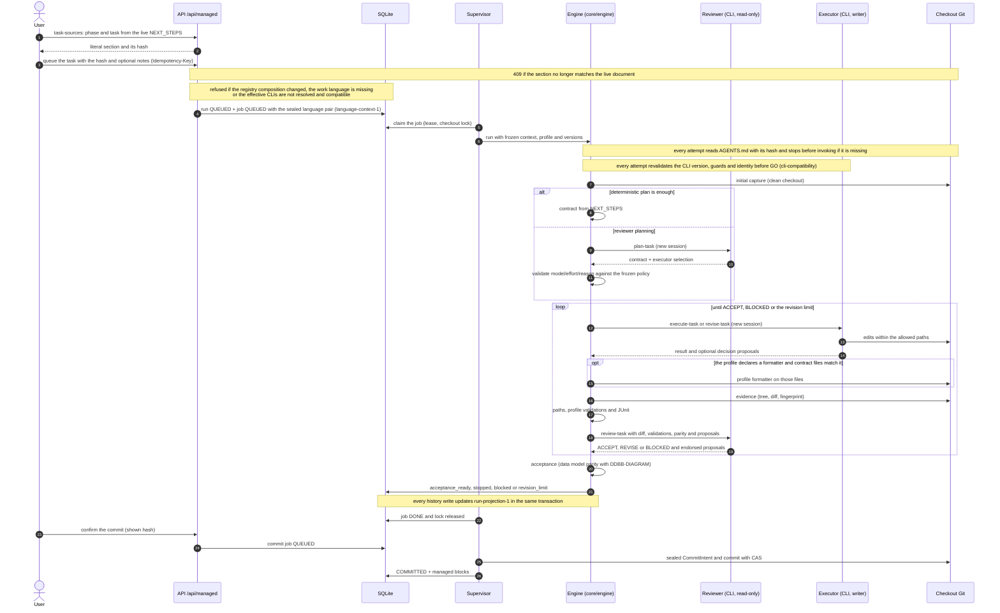

# Flow — running a task

Path of a `task` run from queueing to the harness commit. The reviewer plans and reviews read-only; the executor is
the only writer; the commit is a separate action
([D052](../DECISIONS.md#d052--reviewer-and-executor-with-provider-model-and-effort-chosen-by-the-user),
[D056](../DECISIONS.md#d056--agent-output-shapes-aligned-with-the-engine-validators)). Agents come from the
[per-project selection](project-agents.md); admission, resumption and commit check the active registry version in
the same transaction.

## Run states

```mermaid
stateDiagram-v2
    [*] --> QUEUED
    QUEUED --> ACTIVE: the supervisor claims the job
    ACTIVE --> PLANNING
    PLANNING --> EXECUTING
    EXECUTING --> VALIDATING
    VALIDATING --> REVIEWING
    REVIEWING --> EXECUTING: REVISE within the limit
    REVIEWING --> ACCEPTANCE_READY: ACCEPT and eligible acceptance
    REVIEWING --> BLOCKED: BLOCKED
    REVIEWING --> REVISION_LIMIT: limit exhausted
    ACTIVE --> STOPPED: stop with stage and reason
    ACTIVE --> REFUSED: guard before effects
    ACTIVE --> RECOVERY_REQUIRED: exception, expired lease or uncertain failure
    RECOVERY_REQUIRED --> INTERRUPTED: writer confirmed stopped
    RECOVERY_REQUIRED --> COMMITTED: confirmation with the commit already recorded
    STOPPED --> QUEUED: revalidate or retry (explicit action)
    BLOCKED --> QUEUED: revalidate or retry
    REVISION_LIMIT --> QUEUED: revalidate (a retry returns to the limit without invoking)
    INTERRUPTED --> QUEUED: revalidate, retry or reconcile the commit intent
    ACCEPTANCE_READY --> QUEUED: commit job confirmed
    ACTIVE --> COMMITTING: commit job claimed; intent sealed before the effect
    COMMITTING --> COMMITTED: commit result with CAS
    COMMITTING --> STOPPED: content or HEAD changed (INVALIDATED)
    COMMITTING --> RECOVERY_REQUIRED: crash with a pending intent
    COMMITTED --> [*]
```

The intermediate states are stages of the same `ACTIVE` job: `PREPARING`, `VALIDATING` and `REVIEWING` arrive by
checkpoint and `PLANNING`/`EXECUTING`/`REVIEWING` when each attempt starts; the `phase`, `chat`, `definition` and
`planning` roles use `CHECKING` or `ANSWERING`, and `bootstrap` uses `DISCOVERING`. That is why `STOPPED`,
`REFUSED` and `RECOVERY_REQUIRED` can be reached from any of them. Revalidating requires a `stopped`, `blocked` or
`revision_limit` history with a frozen contract; retrying the executor also requires allowed paths. A refusal before
effects keeps the history's terminal state (or `COMMITTED`) and only marks `REFUSED` when there was none. An
`INVALIDATED` commit does not block a revalidation; a `COMMITTED` commit prevents resuming and repeating the commit.
The job follows `QUEUED → ACTIVE → DONE | REFUSED | RECOVERY_REQUIRED → INTERRUPTED`; an attempt without a result
when the stop is confirmed becomes `INTERRUPTED` with no automatic retry.

## Reading a run

- `GET /runs/{id}` returns the summary, the stops, `history.cycle_count` and `history.latest_cycle`; cycles are read
  with `GET /runs/{id}/cycles?offset&limit` (by number, 10 by default, up to 100). A cycle's diff is requested in
  byte pages with its hash; JUnit cases by ordinal. None of these reads selects `history_json` or decodes the
  history: they use the `run-projection-1` projection ([diagram](../DDBB-DIAGRAM.md#run-projection),
  [D144](../DECISIONS.md#d144--run-projection-run-projection-1)).
- The run page polls the visible page of cycles together with the detail; the chat `/tests` command uses the latest
  cycle.
- Live activity ([D240](../DECISIONS.md#d240--question-first-answers-and-the-live-activity-rail)): the side panel of
  the project, phase, task and run pages, and of chat and planning conversations, reads the same confirmed events
  with `GET /runs/{id}/events?after&limit`. It starts from windows below the run's version (at most eight pages of
  100, until a dozen readable steps are found) and then follows the cursor, every 1.5 s while the run advances and
  every 10 s otherwise. It shows the recorded agent records (`agent_event`: Claude `stream-json` messages, tool calls
  and results, Codex items), lifecycle, validation and recovery events in plain words, newest first; byte notes and
  partial deltas only feed the "now" line. It is read only and keeps at most 1,500 relevant events in the page; the
  run page keeps the complete event list and evidence.

## Paths, parity and proposals

[D090](../DECISIONS.md#d090--executor-paths-diagram-parity-and-decision-proposals):

- When the contract is frozen, an `allowed_paths` or `forbidden_paths` entry ending in `/` becomes `dir/**`
  ([D129](../DECISIONS.md#d129--directory-paths-frozen-as-dir)). Contracts already frozen are read as stored.
- The executor does not write STATE, NEXT_STEPS, ROADMAP, DECISIONS, `docs/archive/**` or AGENTS, CLAUDE and
  GEMINI (`harness_owned_paths` and the profile's `executor_protected`); the phase reconciliation
  (`<phase>-RECONCILE-<n>`) does edit the prose of the first four.
- The reviewer's input includes `documentation`. If the profile declares `data_model_paths` and the diff touches them
  without `DDBB-DIAGRAM.md`, acceptance is not eligible even if the reviewer accepts; flow parity is judged by the
  reviewer.
- The executor's `decision_proposals` reach the reviewer; those it returns stay in the cycle's review and in the
  reconciliation evidence. They never write DECISIONS or change the verdict.

## Queueing from the documents and additional notes

- `GET /projects/{id}/task-sources` reads the live NEXT_STEPS and offers each `PNNN-TNNN` task with its literal
  section (preceded by the shared constraints, if any) and its SHA-256. A repeated id is not offered. The form picks
  phase and task from drop-downs and shows the contract without editing it; manual entry remains available.
- With `source_sha256`, `POST /runs` reads the document again and answers 409 `task_source_changed` if the task is
  gone, moved to another phase or its text differs. Without it, the text is taken as given.
- `notes` (up to 4000 characters; blank means absent) travel in the job request, with no extra column. The engine
  passes them to the planner as `additional_notes`, freezes them in the contract under that key (reviewer and
  executor see them in `TASK_JSON`) and adds them to the executor's instructions. Only the user provides them: the
  same key invented by the planner is removed. They do not widen paths, commands or permissions. The run page shows
  them.

## Profile formatter

[D133](../DECISIONS.md#d133--the-harness-runs-the-profile-formatter-after-each-executor-turn):

- After each executor turn, and before capturing the evidence, the engine runs `formatter_argv` + paths on the
  `changed_paths` that match `formatter_paths`, exist as files and are allowed by the contract. Revalidating does not
  format. Without matching files nothing is launched. The Django recipe profile declares it (`ruff format --`,
  `*.py`).
- The native runner authorizes it as `formatter-paths`: the profile argv followed only by existing checkout files.
  If it cannot run, the run stops at `formatter` before review. A non-zero exit code reaches validation and the
  reviewer.
- The cycle stores `formatting_json` (history format 8). The reviewer receives it as `formatting`, and the API and
  the run page show it. `PROFILE_INSTRUCTIONS` tells the executor not to reformat by hand.

## Project instructions

[D094](../DECISIONS.md#d094--agentsmd-in-every-frozen-prompt):

- Every attempt (planner, executor, revision and reviewer; also phase, chat and planning) reads `AGENTS.md` at the
  root of the attempt's checkout and includes it in its prompt. Its path, SHA-256 and size are stored in the
  attempt's snapshot; a later change only affects the following attempts.
- A missing, linked, non-regular, empty, non-UTF-8 or larger than 32 KiB `AGENTS.md` stops the run at `prompts`
  before invoking the agent. So does an active template version without `{{PROJECT_INSTRUCTIONS}}`.
- The CLIs do not load another copy: Claude Code runs with `--setting-sources ""` and Codex with
  `project_doc_max_bytes=0`.
- Language ([D169](../DECISIONS.md#d169--sealed-language-directive-generated-documents-in-the-work-language)): each
  attempt receives, after the templates and before the schema, the directive of its job's frozen pair, sealed in the
  snapshot; an invalid pair or one whose work language differs from the context stops the run at `prompts`. The
  commit regenerates the blocks in the work language ([flow](project-work-language.md#sealed-directive-and-generated-documents)).

## Source

- `core/engine/workflow.py` (plan → execute → validate → review loop), `core/engine/contracts.py`,
  `core/engine/planning.py`, `core/engine/acceptance.py`, `core/engine/commit.py`.
- `storage/managed.py` (queue, lease, lock, states), `storage/run_projection.py` and `storage/managed_views.py`
  (projection and run reads), `services/managed.py` (supervisor), `adapters/cli_agents.py`,
  `adapters/commands.py`, `adapters/git.py`.
- Managed blocks in the commit: `core/engine/documents.py` (see [documents](documents.md)).
