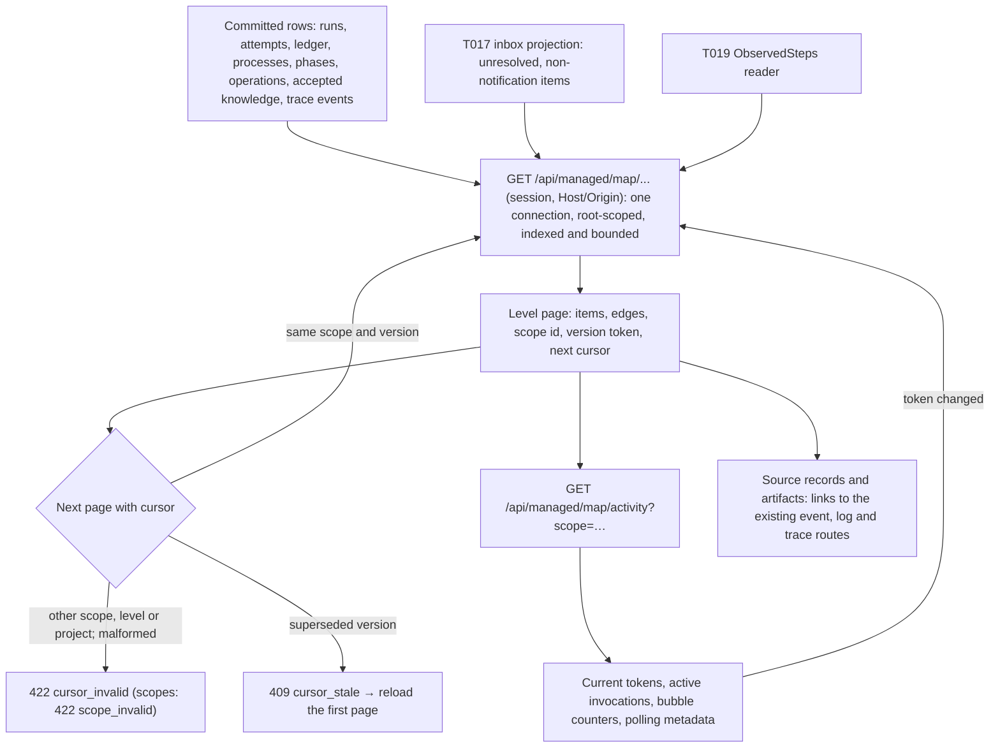

# Flow — work-map reads

P002-T020 implements the read side of [D304](../DECISIONS.md#d304--work-map-levels-cards-navigation-and-status-classes)
and [D306](../DECISIONS.md#d306--work-map-read-projections-polling-refresh-and-archive-map) under the
[T018 contract](../phase/P002-T018-work-map-contract.md#7-read-projections-and-api-t020); the choices it made are
[D311](../DECISIONS.md#d311--work-map-read-projections-tokens-and-indexes). The map is a projection (FL14): rebuilt
from persisted rows on every read, never stored, never authority. Rendering, navigation and the polling timers are
T021–T023.

## Levels

| Route (`GET`) | Level | Content | Page |
|---|---|---|---|
| `map/projects` | L0 | Project cards: derived class, mode, active phase, phases closed/total, R/E/J/H circles, every active invocation (chat included), last activity, errors, bubble counters, configured agents (ordinary mode) | 100 |
| `map/projects/{p}/phases` | L1 | Roadmap identities with their instances, roadmap order edges, tasks committed/total, READY and last check, Plan · Check · Close slots with the actors that took part | 200 |
| `map/projects/{p}/phases/{code}/tasks` | L2 | Task nodes (plan, accepted identities, run-only tasks), latest run, attempts and revision limit, acceptance and commit, `depends_on` and `replaces` edges | 300 |
| `map/projects/{p}/phases/{code}/tasks/{task}/runs` | L2 | Run selector, latest first | 50 |
| `map/projects/{p}/runs/{run}/steps` | L3 | Agent invocations and the Harness format, validate and commit stages, in order | 200 |
| `map/projects/{p}/invocations/{i}` | L4 | Header: identity, owning context and breadcrumb for every lane, counters, observed-step state | — |
| `map/projects/{p}/invocations/{i}/steps` | L4 | T019 steps with source records resolved | 200 |
| `map/projects/{p}/invocations/{i}/related?group=` | L4 | `records` (receipts, discovery and schema loads, broker and tool events, rulings, context, observation, artifact links) or `permissions` (requests the attempt raised) | 200 |
| `map/activity?scope=` | — | Version token per requested scope (≤ 10), active invocations, bubble counters, polling metadata | ≤ 8 KiB idle |

`{p}` accepts the project's T017 identity and its aliases (knowledge project, registered project, `run:` and
`phase:` references, a configured project id). Every query and secondary reference is filtered by the resolved root;
an identifier of another project answers `404 map_not_found` exactly like a missing one.

Pages are keyset pages over stable keys: checkout roots (L0, the cursor carrying the last project key), phase codes
(L1), plan position then task code within plan, accepted identities and run-only tasks (L2), creation time and id
(runs, permissions), attempt number and sub-step, then the tail of cycles without their executor attempt and commits
(L3), trace event id (L4). A page selects and enriches only its own rows; counters over a whole scope (phases
closed/total, tasks committed/total) are SQL aggregates.

## Statuses, actors and counters

- Each status is `{code, class}` from the persisted value through T018 §5.2; an unmapped value is `unknown` with its
  raw code. A parity test reads the writers, constants and check constraints so a new value fails until mapped.
- Circles: R for reviewer-agent roles, E for the executor (and preparation), J for the judge (shown with a judge
  profile or where a judge ran), H for deterministic Harness work (validation, formatting, commit writer, preparation
  commands, autonomous supervisor). Active invocations come from every attributable ledger: a managed attempt without
  a result whose process is `PENDING` or `RUNNING` (a chat turn lights R on its conversation's scope beside the task
  lane), an executor step of a reserved preparation, and a configuration assistance scoped to a registered project; a
  global assistance has no project and is listed apart as unscoped. Each circle names its latest persisted invocation
  in the element (its L4 target, or `inert`) and whether owner items wait on it, also with nothing running.
- Permission requests keep their historical answer apart from the authority a grant confers now (T010
  `PermissionLifecycle.active` over the grant and its ancestry); an unanswered request whose ancestry expired or ended
  is no longer answerable, exactly as T017 resolves it. The acceptance decision of a run is `absent`, `rejected` or
  `eligible`, never a commit.
- Bubbles reuse T017's projection and only add the circle: permissions follow the asking attempt's role, task gaps
  and questions R, judge escalations J, lifecycle confirmations H; an origin that cannot be attributed sits on H with
  `attributed: false`. They carry item identities and counts; no question, answer or native content.
- Counters keep `{value, source, reason}`; absent evidence is `absent` with a reason, never zero. Native turns,
  harness attempts and revision rounds stay separate, and the frozen identity, requested model and reported model
  are separate fields.

## Evidence resolution

Each observed step's `source_record` becomes links to the existing `GET /api/managed/runs/{run}/events` route
(`after = sequence − 1`, `limit = 1`) and, for oversize records, to the bounded
`GET /api/managed/runs/{run}/attempts/{attempt}/logs` view with the reference's offset, size and digest. Availability
is `available`, or `unavailable_after_retention` when the retention audit records the attempt's stdout as removed;
the logs route still verifies the bytes on read. Related trace events link offloaded artifacts to the existing trace
artifact route of their thread. The map never copies or serves the content itself.

## Refresh

Every level response carries an opaque `scope` and a `version`. The client polls `map/activity` with the scopes in
view (every 2 s while anything is active, every 10 s when idle, paused while hidden, never in archives:
`polling.enabled = false`). A changed token reloads that level's first page; a cursor of a superseded version answers
`409 cursor_stale`. Each token digests what its responses show (markers, configured agents, retention of the
trace's own streams, time-driven permission validity), so a sealed trace keeps its token while other work runs and
changes it only when its own source records stop being available.

## Archives

A restored `query_only` copy serves the same routes from SQLite alone: no checkout, project composition, provider or
supervisor. Responses carry `read_only_archive: true`, configured agents are absent and nothing is written; reads
work with the original checkout removed ([backup consultation](backup-consultation.md)).

## Source

- `src/my_harness/core/engine/work_map.py`, `src/my_harness/storage/work_map.py`, `src/my_harness/api/work_map.py`,
  `src/my_harness/api/schemas.py` (`Map*`), migration `0041_work_map_reads`.
- Evidence: [P002-T020 record](../phase/P002-T020-work-map-api.md).

## Re-review read dependencies

L2 selects plan keys, then accepted identity codes, then run-only codes with SQL exclusion of plan and accepted
phase membership. Only the displayed page reads identity inspector texts and run details, including the final page.
Permission refresh includes clock crossings of requests, their answer grants and both ancestry chains; historical
answers remain separate from effective authority. A superseded permission cursor follows the same 409 path above.
Circle targets resolve chat ownership through the persisted conversation (phase or associated task run), and
project assistance through its registered project (including logical retirement) and persisted ASSIST operation.
Historical consultation does not require operational ACTIVE status, compose a checkout or admit new operations. Active and settled invocations
use the same chronological selection and L4 ownership; global assistance stays unscoped.
