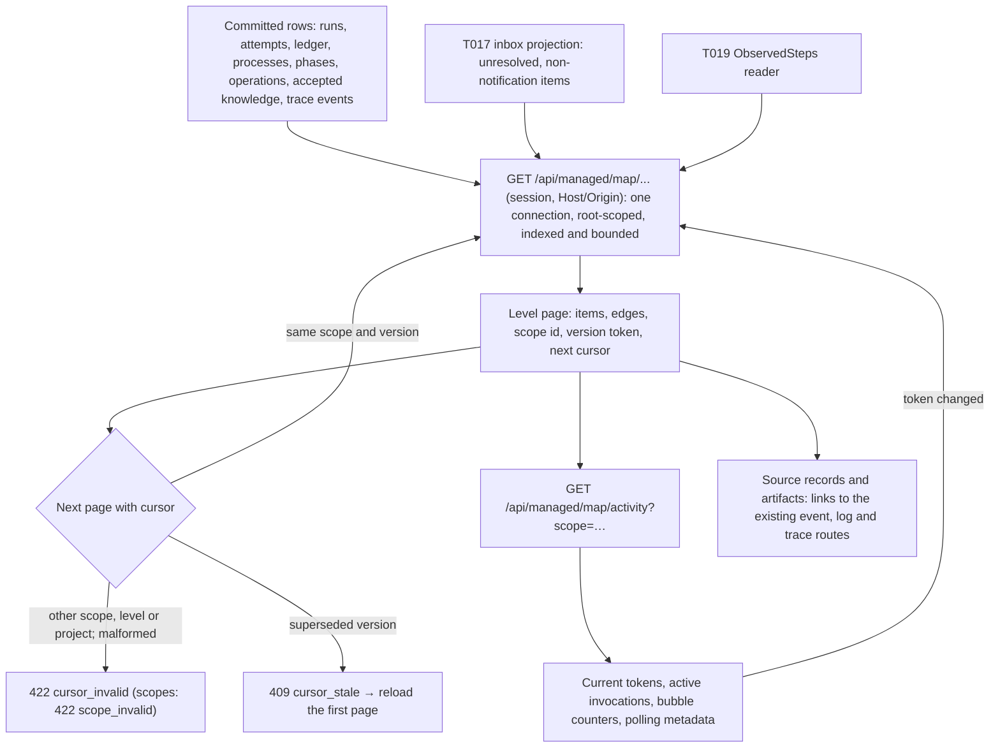
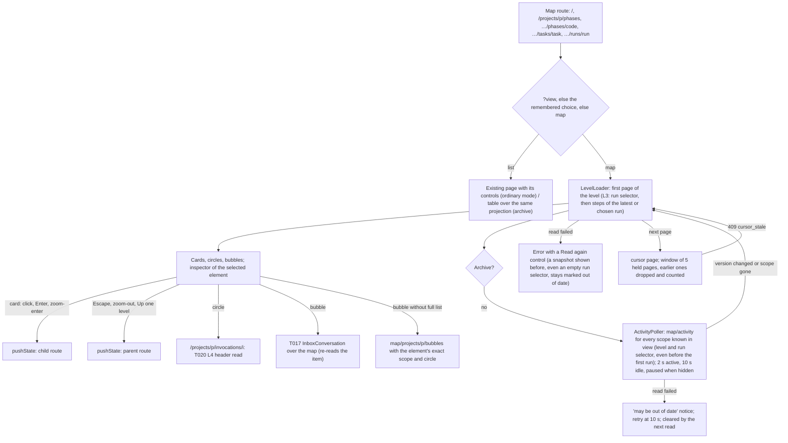

# Flow — work-map reads

P002-T020 implements the read side of [D304](../DECISIONS.md#d304--work-map-levels-cards-navigation-and-status-classes)
and [D306](../DECISIONS.md#d306--work-map-read-projections-polling-refresh-and-archive-map) under the
[T018 contract](../phase/P002-T018-work-map-contract.md#7-read-projections-and-api-t020); the choices it made are
[D311](../DECISIONS.md#d311--work-map-read-projections-tokens-and-indexes). The map is a projection (FL14): rebuilt
from persisted rows on every read, never stored, never authority. T021 supplies the rendering engine. P002-T022
([D314](../DECISIONS.md#d314--work-map-levels-on-the-product-routes-refresh-client-and-read-only-archive-map)) renders L0–L3 on the product routes with the navigation and
polling client below. T023 locally implements L4 and the drawer (D315), pending independent/owner visual review
and the bounded large-original decision; it is not closed.

## Levels

| Route (`GET`) | Level | Content | Page |
|---|---|---|---|
| `map/projects` | L0 | Project cards: derived class, mode, active phase, phases closed/total, R/E/J/H circles, every active invocation (chat included), last activity, errors, bubble counters, configured agents (ordinary mode) | 100 |
| `map/projects/{p}/phases` | L1 | Roadmap identities with their instances, roadmap order edges, tasks committed/total, READY and last check, Plan · Check · Close slots with the actors that took part | 200 |
| `map/projects/{p}/phases/{code}/tasks` | L2 | Task nodes (plan, accepted identities, run-only tasks), latest run, attempts and revision limit, acceptance and commit, `depends_on` and `replaces` edges | 300 |
| `map/projects/{p}/phases/{code}/tasks/{task}/runs` | L2 | Run selector, latest first | 50 |
| `map/projects/{p}/runs/{run}/steps` | L3 | Agent invocations and the Harness format, validate and commit stages, in order; the run's chat lane (`chats`: active chat invocations attached to the run, at most 20, `chats_truncated`; same on every page, part of the version; P002-T022 re-review, D314) | 200 |
| `map/projects/{p}/invocations/{i}` | L4 | Header: identity, owning context, direct workflow operation if linked, breadcrumb for every lane, counters, observed-step state | — |
| `map/projects/{p}/invocations/{i}/steps` | L4 | T019 steps with source records resolved | 200 |
| `map/projects/{p}/invocations/{i}/related?group=` | L4 | `records` (receipts, discovery and schema loads, broker and tool events, rulings, context, observation, artifact links) or `permissions` (requests the attempt raised) | 200 |
| `map/projects/{p}/bubbles?phase=&task=&run=&attempt=&circle=` | L0–L3 | One element's unresolved owner items (P002-T022 review, D314): id, kind, topic, circle, attribution and phase/task/run, filtered exactly by the element's scope and optionally one circle on every page, with the counts of the whole filtered set; keyset by item id | 50 |
| `map/projects/{p}/documents[?path=…]` | L1–L4 drawer | Accepted canonical Markdown/tree/revision from SQLite; exact Markdown path on demand, no transfer payload; ordinary-only legacy checkout signal | One document |
| `map/activity?scope=` | — | Version token per requested scope (≤ 10), active invocations, bubble counters, polling metadata | ≤ 8 KiB idle |

`{p}` accepts the project's T017 identity and its aliases (knowledge project, registered project, `run:` and
`phase:` references, a configured project id). Every query and secondary reference is filtered by the resolved root;
an identifier of another project answers `404 map_not_found` exactly like a missing one.

Pages are keyset pages over stable keys: checkout roots (L0, the cursor carrying the last project key), phase codes
(L1), plan position then task code within plan, accepted identities and run-only tasks (L2), creation time and id
(runs, permissions), attempt number and sub-step, then the tail of cycles without their executor attempt and commits
(L3), trace event id (L4). A page selects and enriches only its own rows; counters over a whole scope (phases
closed/total, tasks committed/total) are SQL aggregates.

## Statuses, actors and counters

- Each status is `{code, class}` from the persisted value through T018 §5.2; an unmapped value is `unknown` with its
  raw code. A parity test reads the writers, constants and check constraints so a new value fails until mapped.
- Circles: R for reviewer-agent roles, E for the executor (and preparation), J for the judge (shown with a judge
  profile or where a judge ran), H for deterministic Harness work (validation, formatting, commit writer, preparation
  commands, autonomous supervisor). Active invocations come from every attributable ledger: a managed attempt without
  a result whose process is `PENDING` or `RUNNING` (a chat turn lights R on its conversation's scope beside the task
  lane), an executor step of a reserved preparation, and a configuration assistance scoped to a registered project; a
  global assistance has no project and is listed apart as unscoped. Each circle names its latest persisted invocation
  in the element (its L4 target, or `inert`) and whether owner items wait on it, also with nothing running.
- Permission requests keep their historical answer apart from the authority a grant confers now (T010
  `PermissionLifecycle.active` over the grant and its ancestry); an unanswered request whose ancestry expired or ended
  is no longer answerable, exactly as T017 resolves it. The acceptance decision of a run is `absent`, `rejected` or
  `eligible`, never a commit.
- Bubbles reuse T017's projection and only add the circle: permissions follow the asking attempt's role, task gaps
  and questions R, judge escalations J, lifecycle confirmations H; an origin that cannot be attributed sits on H with
  `attributed: false`. They carry item identities and counts; no question, answer or native content.
- Counters keep `{value, source, reason}`; absent evidence is `absent` with a reason, never zero. Native turns,
  harness attempts and revision rounds stay separate, and the frozen identity, requested model and reported model
  are separate fields.

## Evidence resolution

Each observed step's `source_record` becomes links to the existing `GET /api/managed/runs/{run}/events` route
(`after = sequence − 1`, `limit = 1`) and, for oversize records, to the bounded
`GET /api/managed/runs/{run}/attempts/{attempt}/logs` view with the reference's offset, size and digest. Availability
is `available`, or `unavailable_after_retention` when the retention audit records the attempt's stdout as removed;
the logs route still verifies the bytes on read. Related trace events link offloaded artifacts to the existing trace
artifact route of their thread. The map never copies or serves the content itself.

## Refresh

Every level response carries an opaque `scope` and a `version`. The client polls `map/activity` with the scopes in
view (every 2 s while anything is active, every 10 s when idle, paused while hidden, never in archives:
`polling.enabled = false`). A changed token reloads that level's first page; a cursor of a superseded version answers
`409 cursor_stale`. Each token digests what its responses show (markers, configured agents, retention of the
trace's own streams, time-driven permission validity), so a sealed trace keeps its token while other work runs and
changes it only when its own source records stop being available.

## Archives

A restored `query_only` copy serves the same routes from SQLite alone: no checkout, project composition, provider or
supervisor. Responses carry `read_only_archive: true`, configured agents are absent and nothing is written; reads
work with the original checkout removed ([backup consultation](backup-consultation.md)).

## Product map: navigation and refresh client (P002-T022)

- **Toggle.** The same path renders map or list; the toggle pushes `?view=map|list` (Back/Forward replay it) and
  remembers the choice in this browser. A parameter applies to its own URL only, so a link such as "Run evidence"
  (`…/runs/:run?view=list`) opens the existing page without changing the remembered choice, and cards and
  breadcrumbs keep entering the map. The last choice made in a page wins over an older stored value when writing it
  failed (storage that reads but refuses writes), and is kept in page memory when storage is unavailable. The check route is not a map
  level. In ordinary mode a project card enters its configured project id; archives and unregistered projects use the
  map key (an alias T020 and T017 accept).
- **Controls.** Card links navigate; circles, request bubbles, the details control and the run selector are separate
  controls and never trigger the card. Selection follows focus and fills the inspector (bottom sheet below 880 px).
  A closed sheet keeps only its heading and *Show details*: its body is out of the Tab order and the accessibility
  tree; open, only the body scrolls. Narrowing the window with the focus in the inspector opens the sheet and keeps
  that focus. On cards the status and the counter are separate rows, each fitted to the card.
- **Actors.** Each active invocation of an element is its own circle with its own target, so a task reviewer and a
  chat running at once are two R circles (rays on both, "chat" on the chat). At L3 an active chat attached to the run
  shown is a lane node of its own with no edge into the run's step sequence; its inspector lists the invocation. The
  lane comes from the run's steps read (`chats`, reread with the steps when their version changes; a cut list shows a
  coverage hint), never from the global activity list, whose truncation proves nothing about a chat. J, H and reduced
  motion follow the engine's rules unchanged.
- **Requests.** A bubble carries T017 identities; when the projection lists none (L0 aggregates) or only the first 20
  (`items_truncated`), the panel reads `map/projects/{p}/bubbles` with the element's exact scope (phase; phase and
  task; a step's run and attempt) and, for a circle's own bubble, that circle, in pages of 50: the count and the items
  shown are the same set, attributed by T020, never guessed from the request kind. The conversation re-reads the item
  and acts only through T017's guarded commands, so a changed item shows its current state instead of applying an old
  one.
- **Refresh.** One read in flight per level; a reload asked meanwhile runs once after it; a level that is no longer
  shown applies no late answer. One aggregated activity read per view over every scope known (a task without runs is
  followed through its run selector, so its first run appears without navigation), scheduled after the previous one
  settled; a changed token reloads the level's first page. Further pages load on demand inside a window of five held
  pages: past it the oldest pages are dropped and counted ("Back to the first page" reloads), so later data stays
  reachable with bounded memory; a stale cursor returns to the first page. A failed first read offers "Read again"; a
  failed reread over a snapshot still shown (including a run selector read empty before) shows the error and "Read
  again" over that snapshot; a failed poll shows that the map may be out of date until a read succeeds. A polite live region summarises status
  changes at most every 10 s.
- **Evidence.** "Run evidence" in the L3 summary and the invocation header opens the run page with its evidence and
  controls (`?view=list`; the short `/runs/:id` keeps the query when it resolves) and, in archives, the run
  consultation `/runs/:id`.
- **Archives.** No poller, announcer or action; the archive home is map L0 beside the run-id entry
  ([backup consultation](backup-consultation.md)). The table alternative gives each row a "Details" control that
  fills the inspector (steps included), links to each actor's invocation and opens the element's requests read-only.
  L3's chat lane comes from the same single steps read (the persisted active chats attached to the run).

## Source

- `src/my_harness/core/engine/work_map.py`, `src/my_harness/storage/work_map.py`, `src/my_harness/api/work_map.py`,
  `src/my_harness/api/schemas.py` (`Map*`), migration `0041_work_map_reads`.
- Evidence: [P002-T020 record](../phase/P002-T020-work-map-api.md).
- Product map (P002-T022): `frontend/src/map/` (`WorkMap.tsx`, `loader.ts`, `use-level.ts`, `refresh.ts`,
  `projection.ts`, `Inspector.tsx`, `Requests.tsx`, `LevelSwitch.tsx`, `view-mode.ts`, `InvocationPage.tsx`),
  `frontend/src/Page.tsx`, `frontend/src/navigation.tsx`; element request list: `WorkMap.bubbles` in
  `src/my_harness/storage/work_map.py` and its route in `src/my_harness/api/work_map.py`; evidence:
  [P002-T022 record](../phase/P002-T022-work-map.md).

## Re-review read dependencies

L2 selects plan keys, then accepted identity codes, then run-only codes with SQL exclusion of plan and accepted
phase membership. Only the displayed page reads identity inspector texts and run details, including the final page.
Permission refresh includes clock crossings of requests, their answer grants and both ancestry chains; historical
answers remain separate from effective authority. A superseded permission cursor follows the same 409 path above.
Circle targets resolve chat ownership through the persisted conversation (phase or associated task run), and
project assistance through its registered project (including logical retirement) and persisted ASSIST operation.
Historical consultation does not require operational ACTIVE status, compose a checkout or admit new operations. Active and settled invocations
use the same chronological selection and L4 ownership; global assistance stays unscoped.

## Invocation accounting evidence (P002-T025)

The L4 header exposes the graph thread and invocation operation from the same direct journal link as Accounting.
Unlinked lanes show the absence explicitly. The accounting link uses the L4 ledger identity to open that
invocation's capture, coverage and valuations in a dedicated read-only detail, also on a restored archive.
[Accounting flow](metrics-accounting.md).

## L4 trace and documentation client (P002-T023)

The invocation route reads the header and uses the shared `LevelLoader` to page its evidence. All evidence
combines one fresh page of up to 200 items from each unfinished group. A complete batch is published together
as a read unit, never a temporal watermark across the group's different cursor orders. Native steps keep `seq`
order. Exact persisted `tool.links` event IDs associate related records with unambiguous steps in that batch,
using labelled correlation links without arrowheads. Other evidence, including permissions and records whose
anchor is outside the batch, is shown in a separate **Related evidence — position undetermined** section in graph
and list, in group read order. Receipt clocks, native/broker call IDs and page boundaries never establish a native
position. Later reads do not reposition already published items; persisted references remain in the inspector
and group filters. No extra read or API change is required. SVG and list render up to 200 items in total across
the sections at once. Advancing across a batch
boundary requires its last window, and reversing across the boundary restores the preceding batch's last
window. Five batches plus the head are retained. Group filters start at the first page of their own history.
Turn order follows persisted step sequence. Turn membership (parallel fan-out), recorded event parentage and
explicit causation have distinct styles and never transfer a native position. Connections use visible items in
the same section only; the inspector retains references outside it. The list selects the same
inspector and source reads as SVG.
Ordinary mode polls the header and the scopes of the active evidence filter through D306. A changed evidence
scope or a `409 cursor_stale` restarts the active history from the first pages. Disposed loaders discard late
responses. Archives use on-demand
GETs only, including the drawer and originals, without action controls or operational chat/check navigation.

The non-modal drawer stores `doc`/`doc_anchor` beside `view` in the same route query, preserving browser history.
It reuses `pages/Docs.tsx`'s tree and safe Markdown/Mermaid viewer; links stay in the drawer and the map stays
interactive. The map and drawer fit the available content width beside the application sidebar. At mobile
widths the drawer follows the map. The tree sits beside the document when the drawer is wide enough and
below it at narrower drawer widths. Persisted level/phase/task context selects ROADMAP/NEXT_STEPS/SPECIFICATION and a deterministic
available-file fallback. Escape returns focus to the opener; delayed content cannot take focus from the map.
Canonical document reads use the map's existing root identities, accepted-revision integrity checks and D294's
renderer, from SQLite only. Exact Markdown paths are allowlisted from that render. Transfer JSON is excluded;
canonical errors never become checkout fallback. Only ordinary-mode legacy roots with a configured registered project may use the existing guarded
checkout tree/content viewer, addressed by that registered ID rather than a historical `run:` map key. Canonical documents never request checkout images. No export/adoption/edit control
is mounted.

Native originals remain explicit authenticated event reads, verified against attempt and sequence.
D316 adds `sequence` to the existing attempt-logs GET: omission keeps the metadata list; a positive persisted
sequence returns the typed exact-original envelope. The server verifies the attempt's event, sealed stdout,
chunk/capture/record digests, filesystem containment and 4 MiB plus newline bound before returning UTF-8 text.
Purged, pending, missing or unverified content stays null. Archives read their verified bundle copy and never
historical paths. The inspector checks the response's identity against its source reference and escapes the
content. The read has no side effects or polling. See the [T023 evidence](../phase/P002-T023-trace-docs.md).

## Contextual reviewer talk (P002-T024)

The separate talk button is a reviewer conversation entry, distinct from actor navigation and T017 request
bubbles. It selects the current phase/task, the run in view, or an inspector-selected L3 step. L4 managed invocation
headers resolve the owning run and attempt's L3 key. Executor and judge detail panels retain no free composer.
Before a task has any run, the valid run-selector read supplies its server-verified registered and knowledge
project identities; talk selects the task without creating an execution run. An archive mark from either the
level/steps read or the selector, or the explicit archive mode, suppresses talk. A subsequently observed first run
and inspector selection update the target through the same resolver.
`GET projects/{registered-project}/chat-context` returns a verifiable reference and server-owned label; a removable
tag appears in the existing chat composer. Map-created conversations have no implicit phase/task-run bindings.
Removal omits the reference and associated evidence; refresh is explicit after `409 element_stale`, and late reads
cannot reattach a removed tag or navigate away from a newer selection. Legacy projects explain the missing tag.
Restored maps mount no talk control and the API mutation middleware remains read-only.

The [chat flow](chat.md#contextual-map-entry-p002-t024-d307-d317) defines enqueue, T007 graph/operation sealing and
observed delivery. Evidence uses the canonical knowledge renderer or one bounded T020 projection selection, never
full native originals or run histories. Trace related records display the new `run_evidence` v3 receipt metadata
through the existing record viewer. T024 is integrated into develop after independent technical re-review and
owner visual acceptance. [Task record and visual fixture](../phase/P002-T024-contextual-chat.md).
