# P002-T001 — Flows, guards and recovery

Status: **accepted design**, 2026-10-29; not implemented. These diagrams specify the P002 target behavior for managed
projects. The implemented flows in [`docs/flows/`](../flows/task-run.md) remain normative for 0.1.9; each owning task
moves or updates the corresponding implemented flow there with parity when it delivers code. Contracts:
[P002-T001 contracts](P002-T001-contracts.md); threats: [threat model](P002-T001-threat-model.md); decisions D268–D279.

Each diagram is followed by its transitions with **guard**, **effect owner** and **failure/recovery**. Effect owners:
**Owner** (UI/inbox), **Graph** (routing and waits only, never effects), **Service** (typed domain command in a
transaction), **Supervisor** (sole process launcher, writer lease), **Git**/**Exporter** (adapters behind sealed
intents), and **Reviewer/Executor/Judge** (proposals or selections only). Cross-cutting rules apply to every transition:

- Every model call passes the revocation, local-bound, optional-cap and capability guards; every effect passes the
  writer, authority and intent guards (INV-01–INV-07).
- Any crash with an uncertain writer or effect leaves the ordinary path for
  [FL13](#fl13--crash-recovery-across-graph-and-domain-operations).
- Any stop persists a reason, evidence and an inbox item ([FL12](#fl12--durable-wait-inbox-answer-and-resume)).
- Quota, authentication, environment and policy failures stop without retry or fallback.

## FL01 — Admission and autonomous authorization

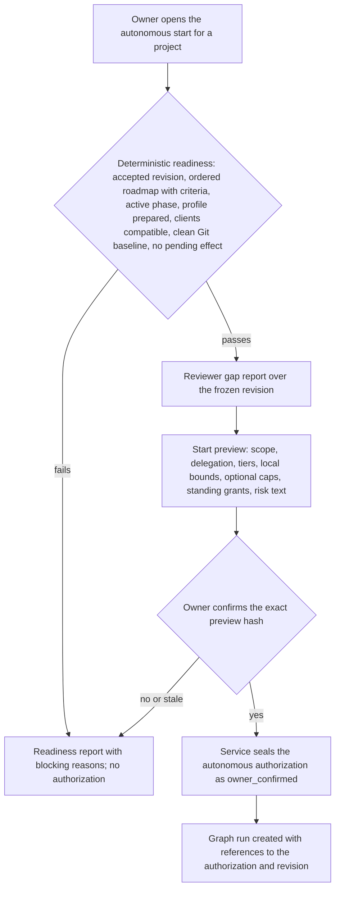

| Transition | Guard | Effect owner | Failure / recovery |
|---|---|---|---|
| Readiness | Structural checks of G12; no uncertain writer or sealed pending intent; feasible bounds | Service | Report only; nothing persisted beyond the check record |
| Gap report | Reviewer invocation within accounting; frozen revision | Supervisor/Reviewer | Malformed output or provider error stops the preview; no retry |
| Confirmation | Preview hash, Idempotency-Key, unchanged revision and configuration versions | Owner → Service | Stale preview refused (409); duplicate confirmation returns the same authorization |
| Run creation | One active autonomous authorization per project root; excludes manual batches on that root while active | Service, then Graph | Crash before the graph run exists: the authorization is reconciled on restart, never duplicated |

## FL02 — Autonomous run states

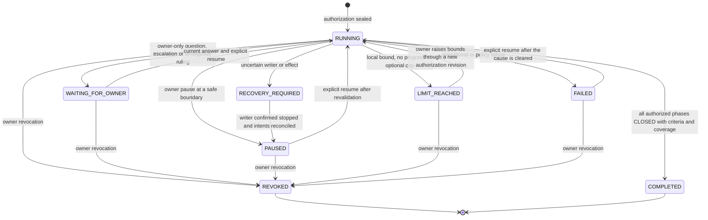

| Transition | Guard | Effect owner | Failure / recovery |
|---|---|---|---|
| To any stop | Stop class decided by the service from typed outcomes, never by a model | Service | Stop record and inbox item in the same transaction as the outcome |
| Resume | Explicit owner action; repository, authority, versions, remaining bounds and evidence revalidated | Owner → Service → Graph | Any mismatch keeps the stop with a new reason; uncertain state goes to recovery first |
| Bounds raised | New authorization revision confirmed by hash; counters are not reset | Owner → Service | Old revision remains in the audit |
| Revocation | Owner only; blocks new commands and attempts immediately | Owner → Service, Supervisor | Active writer stopped through process control; uncertain effects go to FL13 |
| Completion | Every authorized phase CLOSED (not ABANDONED), criterion evidence and final coverage | Service | Missing evidence keeps RUNNING or stops; never claims completion |

## FL03 — Autonomous roadmap loop

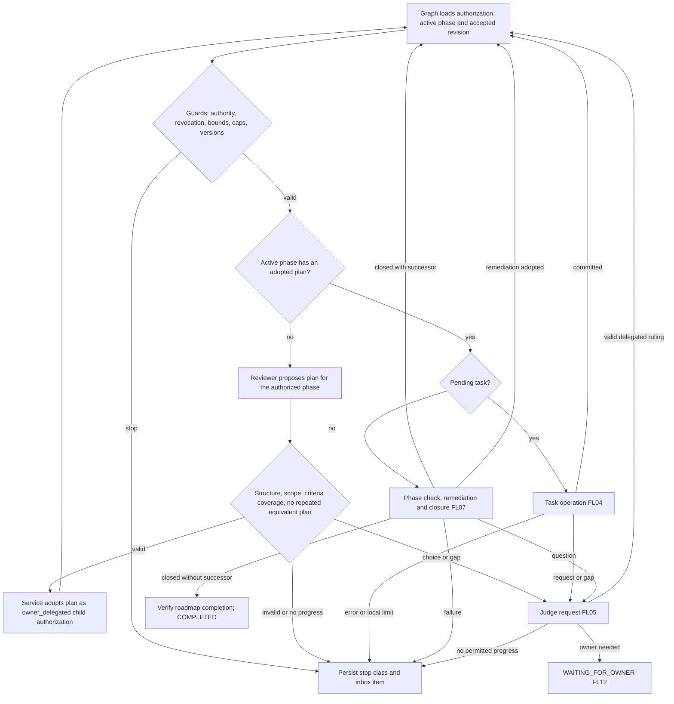

| Transition | Guard | Effect owner | Failure / recovery |
|---|---|---|---|
| Load and guard | Graph state holds only IDs and revisions; the service answers current authority | Graph → Service | Version drift of the graph definition quarantines the continuation (G03) |
| Plan proposal | Plan targets the authorized phase and revision; reviewer invocation accounted | Supervisor/Reviewer | Malformed output stops; equivalent repeated plans count against the replacement bound |
| Plan adoption | Stable task IDs, finite acyclic dependencies, profile-compatible capabilities, criterion coverage, no phase added | Service | Refused adoption returns typed reasons; nothing is half-adopted |
| Completion | No successor in the authorized roadmap revision; no invented phase | Service | ABANDONED phase stops the run without success |

## FL04 — Task operation in both modes

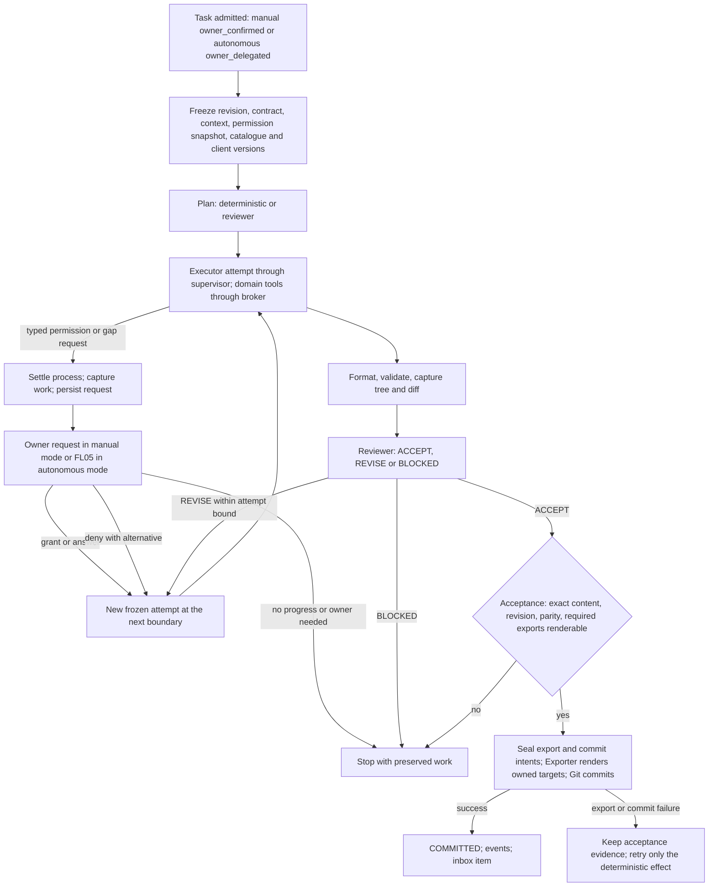

| Transition | Guard | Effect owner | Failure / recovery |
|---|---|---|---|
| Admission | Manual: owner hash confirmation. Autonomous: child authorization within parent scope | Owner or Service | Stale source refused; idempotent re-admission |
| Attempt | Single writer lease; client capability contract; frozen permission snapshot | Supervisor/Executor | Quota/auth stop; expired lease → FL13 |
| Request | Attempt ended and settled before any ruling; request fingerprinted | Service | Equivalent request without new evidence reuses the ruling or stops for no progress |
| Grant application | Only at a new attempt; failure lineage preserved | Service | Revoked before use → refused at admission |
| Acceptance | Code content + accepted revision + generated-doc parity + D090 data parity | Service | Any change after review invalidates; the evidence stays |
| Export and commit | Clean baseline for owned targets; sealed intents; CAS per D271 | Exporter, Git | Partial export recoverable from the generation manifest; crash after commit reconciles it |

## FL05 — Judge request lifecycle

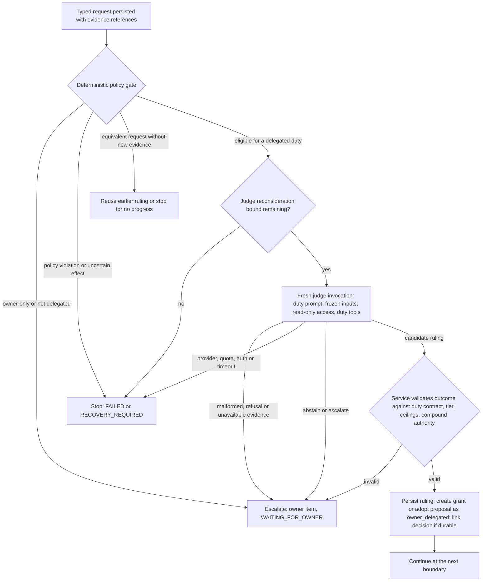

| Transition | Guard | Effect owner | Failure / recovery |
|---|---|---|---|
| Policy gate | Owner-only list, delegation tiers, request equivalence | Service | Never invokes a model for owner-only items |
| Judge invocation | Duty-specific contract; accounting from the first call; no persistent session | Supervisor/Judge | No retry after a provider failure; output preserved |
| Validation | Grant within tier and duration; chosen option was supplied; gap proposal within delegated intent | Service | Invalid ruling escalates instead of being repaired by the harness |
| Persistence | Ruling, grant or adoption and event in one transaction | Service | Crash before commit: request remains pending; crash during invocation: FL13 marks the inference uncertain |

## FL06 — Permission grant states

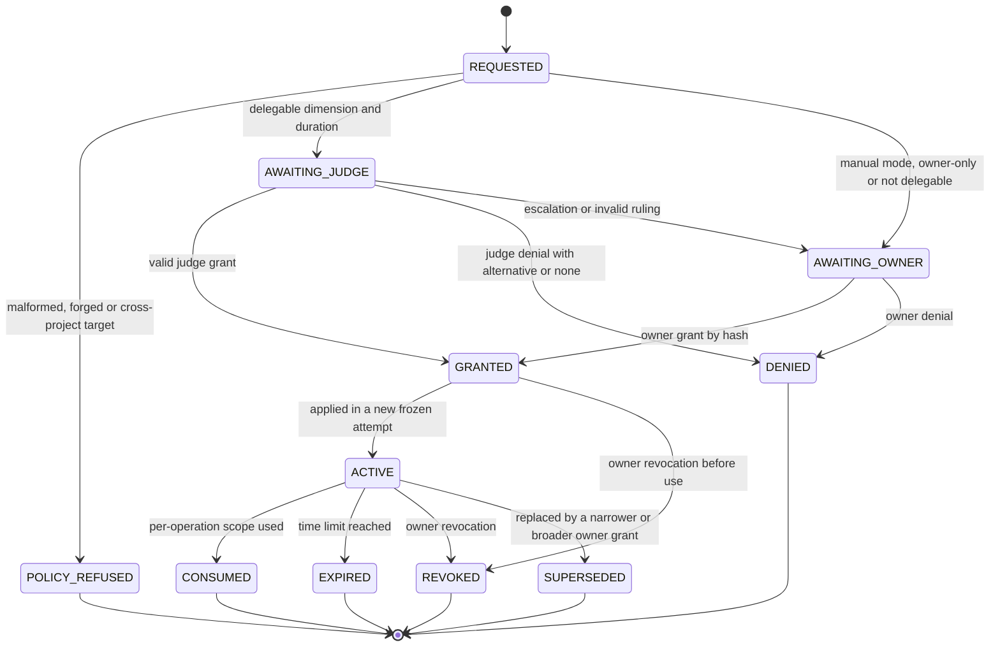

| Transition | Guard | Effect owner | Failure / recovery |
|---|---|---|---|
| Request | Bound to project, role, dimension, exact targets, purpose, invocation | Service | Forged or cross-project targets refused |
| Grant | Compound authority never yields an owner-only capability; permanent only if delegated | Service | Invalid grants are not created |
| Activation | Effective snapshot frozen per attempt | Service | A grant never alters a running attempt |
| Revocation | Owner only; checked at every mediated command and admission | Owner → Service, Supervisor | Active writer stopped; effects settled; cascade behavior is G10 |

## FL07 — Phase check, remediation, closure and successor

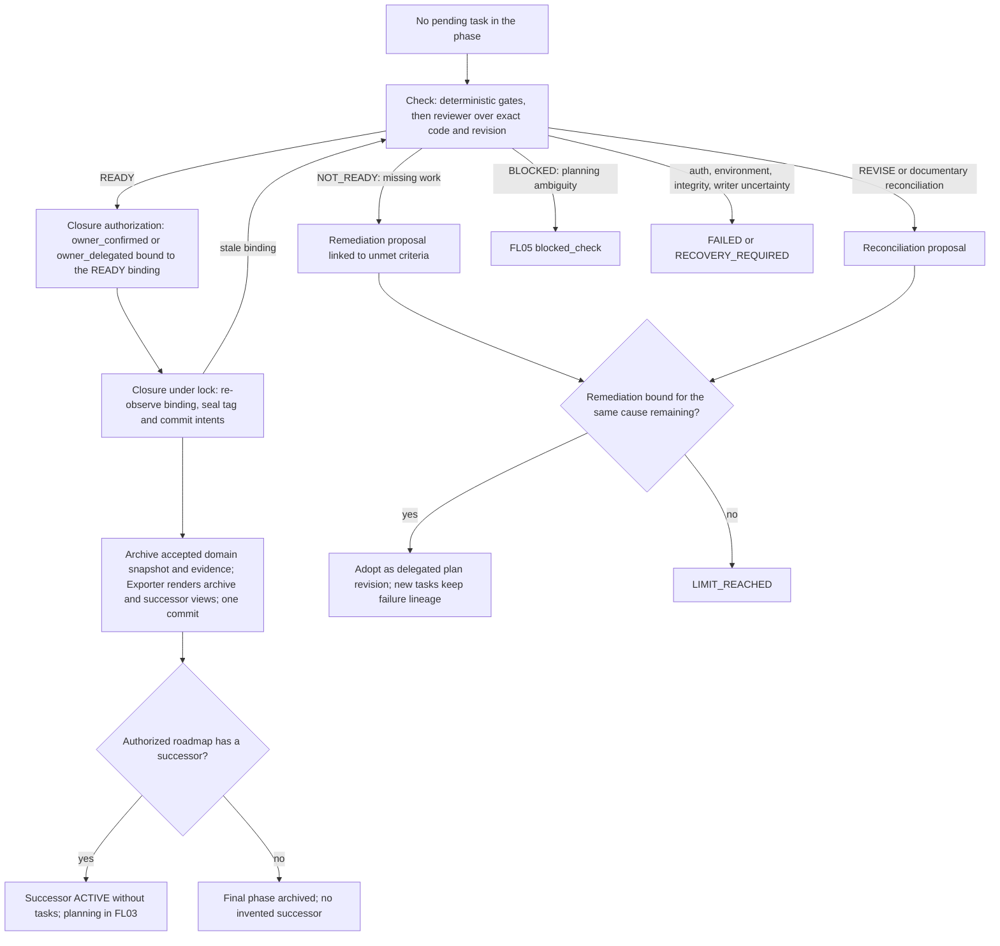

| Transition | Guard | Effect owner | Failure / recovery |
|---|---|---|---|
| Check | Clean baseline, accepted revision, committed tasks, answered questions; reviewer accounted | Service, Supervisor/Reviewer | Early NOT_READY without a model; malformed output stops |
| Remediation | Tied to unmet criteria; cannot weaken criteria or adopt external hash drift | Service | Equivalent remediation counts against the bound |
| Closure authorization | Current READY binding; manual mode keeps the owner confirmation | Owner or Service | Stale READY returns to check |
| Closure effects | Tag never moved; intents sealed; archive and exports from sealed inputs | Git, Exporter | Crash → FL13; same tag object and commit reconciled |
| Successor | Only from the authorized roadmap revision | Service | No successor ends the loop toward completion |

## FL08 — Context assembly and knowledge receipts

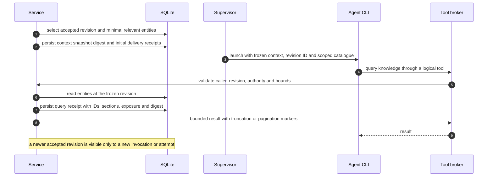

| Step | Guard | Effect owner | Failure / recovery |
|---|---|---|---|
| Selection | Accepted revisions only; never generated Markdown as authority | Service | Missing entity → explicit context-delivery failure event |
| Initial receipts | Persisted before launch with the attempt intent | Service | Crash before launch: no receipt claims delivery |
| Query | Frozen revision unless the boundary rule changes; bounded size | Service | Over-limit result truncated with a marker, never silently |
| Receipt | Delivery is availability, not comprehension; unobserved native reads stay unknown | Service | Lost receipt write fails the query rather than returning unrecorded content |

## FL09 — Portable tool discovery and invocation

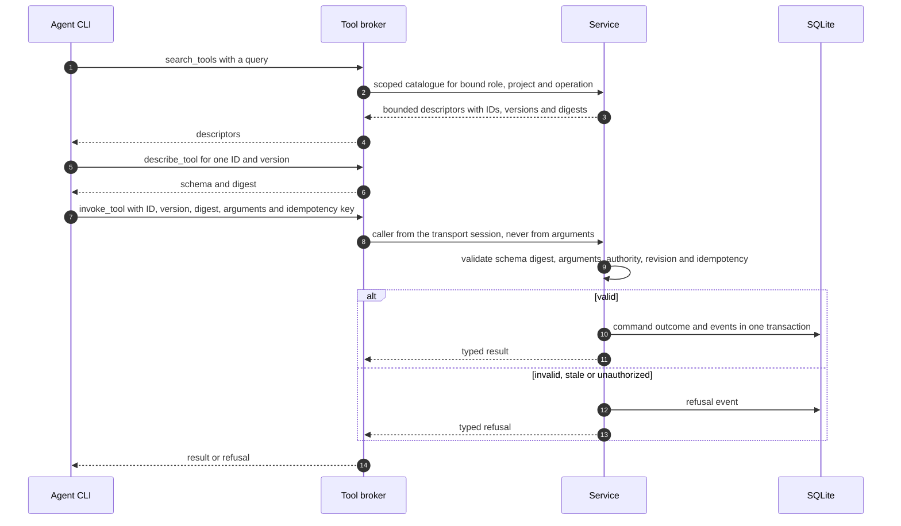

| Step | Guard | Effect owner | Failure / recovery |
|---|---|---|---|
| Search | Only scoped tools disclosed; results bounded | Service | No full-catalogue fallback when discovery is unavailable: admission blocks |
| Describe | Exact schema digest returned and traced | Service | Unknown or retired version refused |
| Invoke | Discovery is not a grant; generic envelope revalidated as the underlying command | Service | Duplicate idempotency key returns the first outcome; mismatched payload refused |
| Transport | Characterized per client (G04); no global configuration change | Supervisor | Unsupported client capability blocks admission with a diagnostic |

## FL10 — Generated export and explicit import

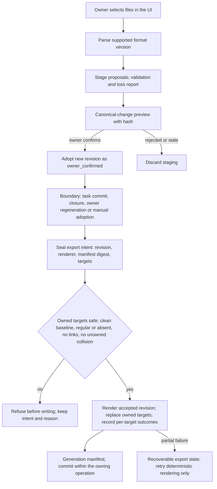

| Transition | Guard | Effect owner | Failure / recovery |
|---|---|---|---|
| Export intent | Inside a writer-locked operation; owned targets only | Exporter | Crash: same intent re-rendered from sealed inputs |
| Replacement | HEAD-relative expected state; no content comparison with the database | Exporter | Uncommitted edits refuse the operation; nothing discarded |
| Import parse | Supported version; untrusted input | Service | Unsupported content reported; never guessed |
| Import adoption | Exact preview hash; stable ID mapping; no execution, approval, grant or usage history created | Owner → Service | Stale preview refused; idempotent confirmation |

## FL11 — Project intake paths

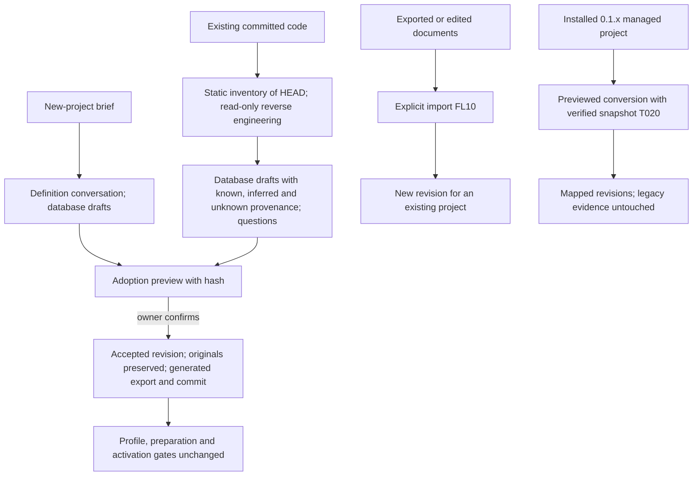

| Path | Guard | Effect owner | Failure / recovery |
|---|---|---|---|
| Definition | Drafts never authoritative before adoption | Service, Reviewer | Stale proposal refused |
| Onboarding | HEAD binding, private export, no project code executed | Service, Reviewer | Changed HEAD invalidates the preview |
| Import | Explicit, staged, no fabricated history | Owner → Service | Loss report blocks unless accepted |
| Migration | Verified pre-migration snapshot; stable identity mapping | Service (T020) | Unsupported continuations quarantined; originals retained |

## FL12 — Durable wait, inbox, answer and resume

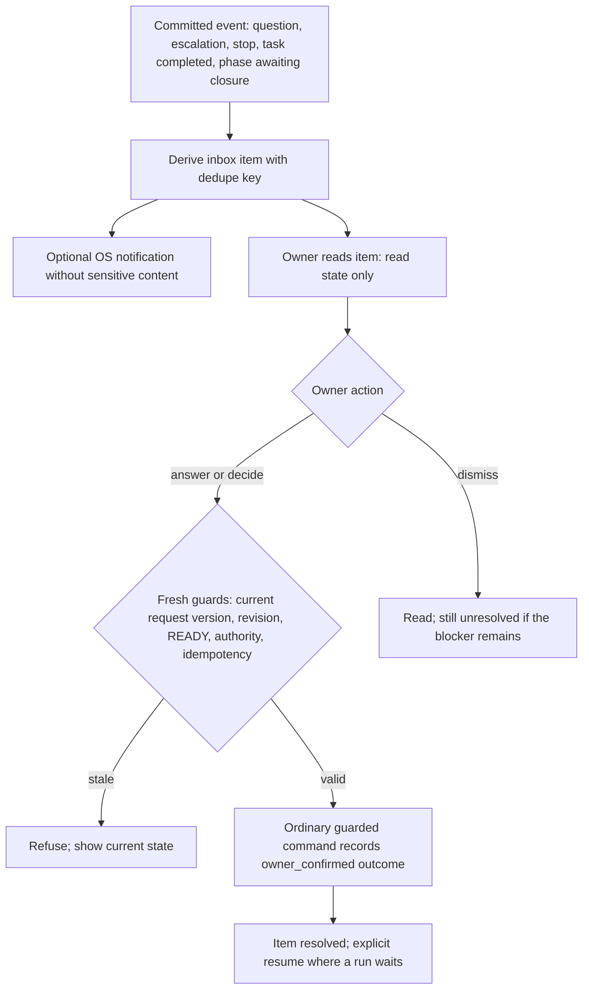

| Transition | Guard | Effect owner | Failure / recovery |
|---|---|---|---|
| Derivation | Only from committed events; deduplicated across restarts | Service | Rebuilt from events after a crash |
| Notification | Optional, secondary, non-sensitive | Service | Delivery failure never blocks the inbox |
| Action | Same command and guards as the normal UI; never an evergreen approval | Owner → Service | Stale or duplicate answer cannot authorize different work |
| Archive | Query-only bundles expose items without actions | — | Mutations return 409 |

## FL13 — Crash recovery across graph and domain operations

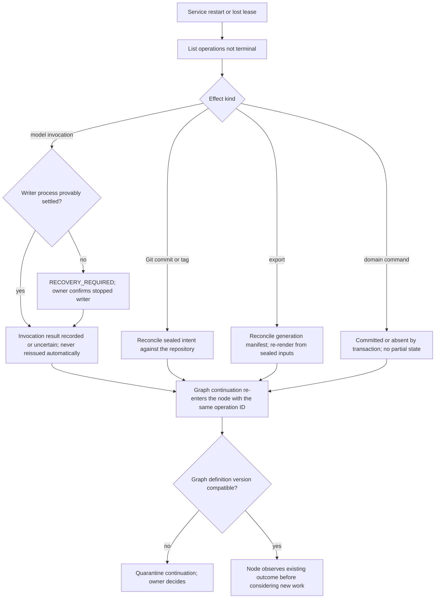

| Step | Guard | Effect owner | Failure / recovery |
|---|---|---|---|
| Classification | Operation identity, intent and evidence, not RUNNING status alone | Service | Unknown kind → RECOVERY_REQUIRED |
| Inference | Expired lease never proves a stop; uncertain inference kept, not repeated | Owner → Service | New inference only by a new explicit decision or bound-consuming attempt |
| Git/export | Sealed intents; tag never moved | Git, Exporter | Same commit/tag object reconciled |
| Graph re-entry | Same operation ID; consistency contract of G02 | Graph | Version mismatch quarantined (G03) |

## FL14 — Observation projection

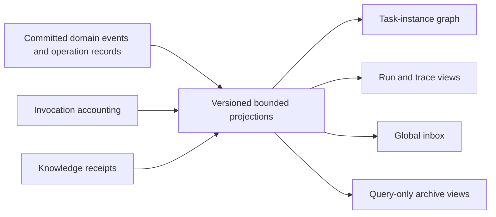

| Step | Guard | Effect owner | Failure / recovery |
|---|---|---|---|
| Projection | Derived, never authority; declared counter meanings and coverage | Service | Rebuildable from records; cursor gaps recovered by snapshot (D029) |
| Views | Read-only; no execution through visual edges | — | Missing telemetry shown as unknown |

## Verification

Mermaid validation and documentation checks are recorded in the
[T001 evidence](P002-T001-contracts.md#evidence).
