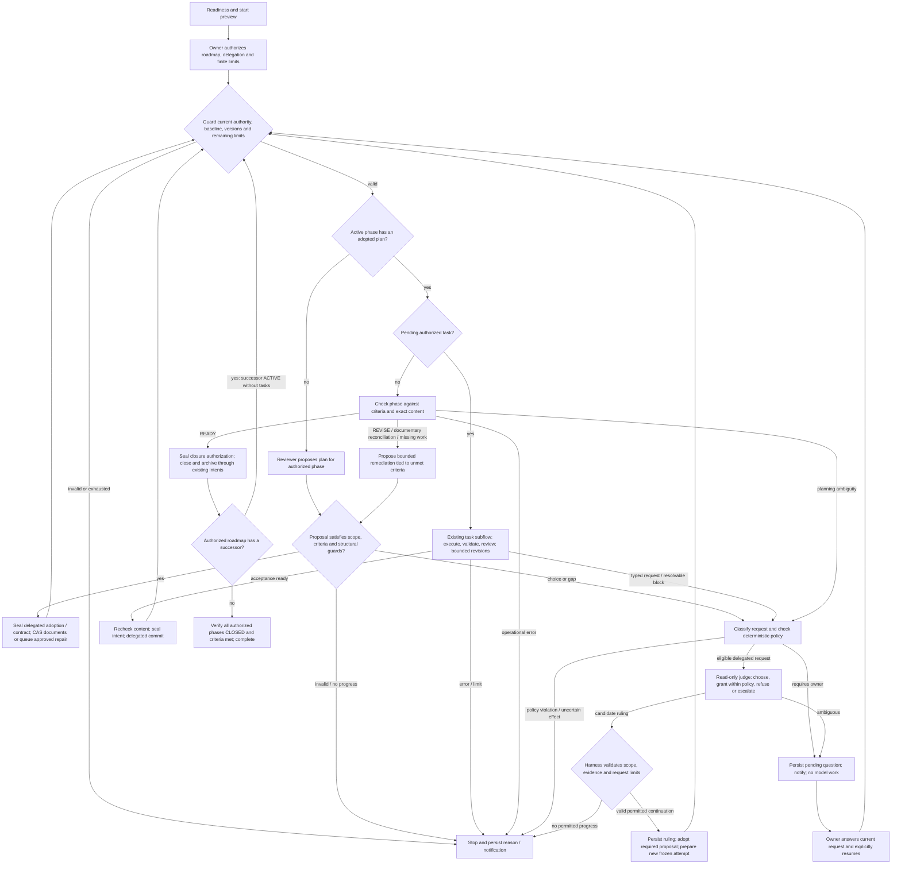
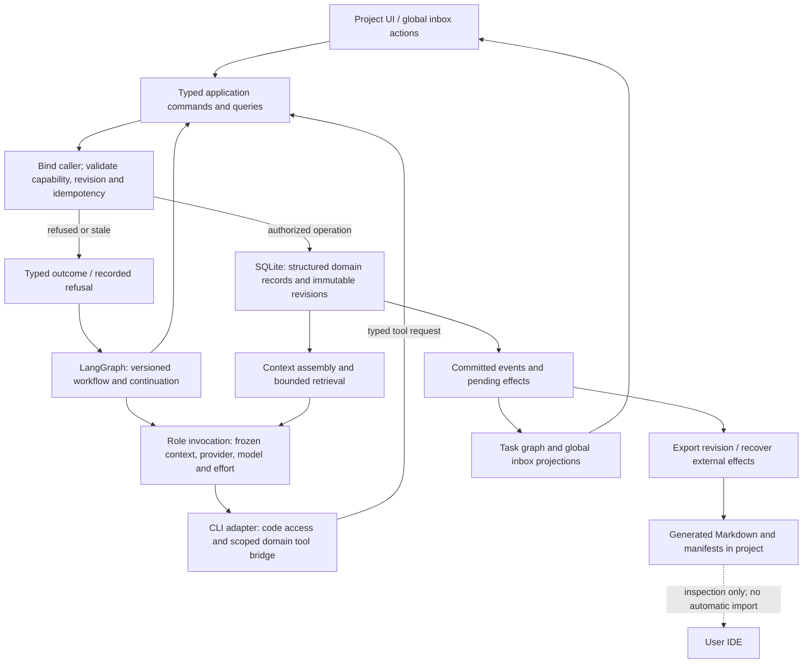
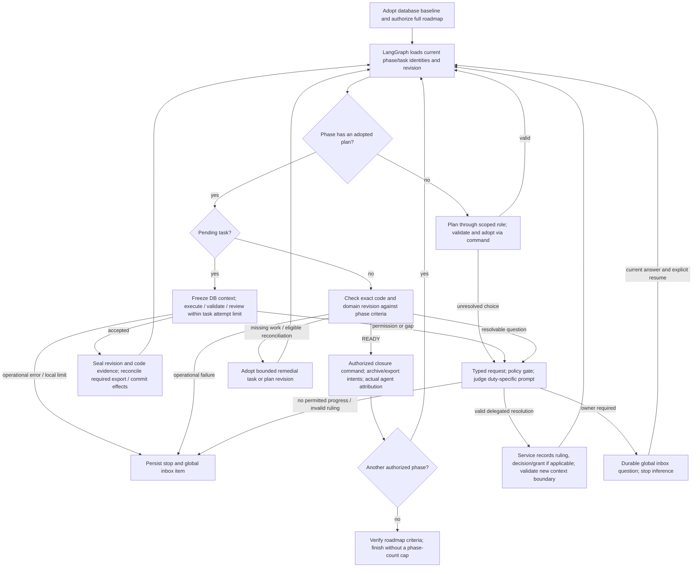

# P002 — Autonomous mode: discussion record

Status: **open discussion** (started 2026-10-29). Nothing here is decided or implemented. It supersedes the narrower
[continuous-mode proposal](P002-continuous-mode.md) as the basis for P002 planning. Outcome expected from the discussion:
agreed flow diagrams first, then decisions (DNNN) and the P002 task plan in [NEXT_STEPS](../NEXT_STEPS.md).
Target: **0.2.0** ([D253](../DECISIONS.md#d253--phase-release-targets-after-018)); current roadmap text:
[P002](../ROADMAP.md#p002--continuous-mode), reserved by
[D156](../DECISIONS.md#d156--continuous-mode-between-phases-reserved-for-v020).

## 1. Owner's statement (verbatim, Spanish)

> Voy a definirte cómo quiero que funcione, en base a ello, respondes a tus prehuntas. El cambio a la V0.2.0 es un
> cambio grande, por lo que no tenemos por qué dejar esta fase a medias o incompleta. Quiero que el harness pueda ser
> completamente autónomo una vez definido el proyecto.
>
> Mi intención es la siguiente. Actualmente cuando creas un proyecto, le pasas al hanress un documento de
> especificación, en base a eso comienzas una conversación en la cual se crean todos los documentos necesarios. A
> partir de ahí comienzas a ejecutar las tareas de cada fase, cuando una fase se queda sin tareas, se cierra y se abre
> la siguiente fase, en ese proceso se crean las tareas de la siuiente fase.
>
> Lo que quiero conseguir es que al tener creada la especificación y el Roadmap, el propio harness con sus agentes sea
> capaz de:
> 1. Ejecutar cada una de las tareas de la fase activa.
> 2. Cuando se terminan las tareas, debe de poder cerrar la fase y abrir la siguiente.
> 3. Debe de ser capaz de editar archivos como ARCHITECTURE.md DDBB-DIAGRAM.md, etc (todos los necesarios para llevar
>    a cabo un correcto desarrollo autónomo).
> 4. Si todo ha ido bien, el proceso se detiene cuando ha cerrado todas las fases.
>
> Este mismo proceso se puede hacer para un proyecto que ya tiene código y se quiere integrar en el harness, al final
> lo único que necesita para el modo autónomo es un roadmap definido y una especificación que declare claramente qué
> se quiere solucionar y cómo.
>
> El modo autónomo deja muchas decisiones importantes al harness, por lo que el usuario debe de ser consciente de que
> puede cometer fallos.
> El modo autónomo debe de poder hacer lo siguiente:
> - Si encuentra una gap de especificación, entra en un proceso con un system prompt nuevo que le permita resolver esa
>   duda como si fuese el usuario, si aun así no se resuelve, en ese caso sí se para el proceso y se le notifica al
>   usuario para que lo resuelva (mediante texto).
> - Si el ejecutor requiere de un permiso que no tiene, le manda el permiso a un nuevo agente: el juez. Este determina
>   si el permiso que pide es correcto. En este caso tiene 3 opciones. Si el permiso es correcto, se lo otorga (el
>   ejecutor puede pedir n+1 permisos, pero debe de especificar por qué los quiere y qué lo bloquea). Si el permiso es
>   completamente incorrecto, le pide que lo haga sin ese permiso. Si el permiso es ambiguo, deja la ejecución en
>   pausa y pregunta al usuario, hasta que el usuario no ha respondido sobre si aprobar o no, no se reanuda.
>
> Quizás deberíamos valorar sustituir la forma de trabajar con los agentes actualmente y comenzar a usar langchain y
> langgraph para el manejo de rutas según el resultado (grafo de langgraph) o incluir lo que ya tenemos a un grafo.
>
> De cara al usuario y para entender cómo está funcionando el modo autónomo, debemos de desarrollar una nueva vista del
> proytecto. Una vista de grafo puramente visual e informativa. En la que se muestre de forma interactiva y en forma de
> cards, las fases. Al pulsar en una fase, entras a sus tareas, y sobre cada tarea sale qué agente está ejecutándose
> ahora mismo, cuántos turnos lleva y demás información útil. Los agentes posibles (que ahora recuerde) son: Revisor,
> Ejecutor, Juez. Quizás sería interesante de forma visual separarlos en: Revisor, Ejecutor, Juez, el que cierra una
> fase, el que la abre.
>
> Aquí dime si sería un error hacer que el juez no solo participase en la aprobación de permisos, sino hacer que si el
> revisor tiene alguna duda de cómo abarcar un desarrollo (planificarlo), debe de pedirle al juez una elección. En este
> caso el Juez es el que más rol "Humano" tiene ya que es el que debe de resolver dentro de la medida todas las
> interacciones que serían HITL.
>
> Quizás lo interesante antes de plantear las tareas sería comenzando a crear los diagramas de flujo.

## 2. Summary of the requested behavior (English)

- **Autonomous mode** for a defined project (created or onboarded) with a SPECIFICATION and a ROADMAP: run every task
  of the active phase, close it, open and plan the next phase (agents create its tasks), and keep going until **all
  roadmap phases are closed**. The phase is a large 0.2.0 change and should be delivered complete, not partially.
- Agents may edit the project documents needed for autonomous development (ARCHITECTURE, DDBB-DIAGRAM, flows, …).
- The user explicitly accepts that the harness takes important decisions and can make mistakes.
- **Specification gaps:** a dedicated prompt tries to resolve the gap "as the user would"; if it cannot, the run stops
  and the user is notified in text.
- **Permissions:** an executor lacking a permission sends a justified request (what it needs, why, what blocks it; it
  may ask for several) to a new **judge** agent with three outcomes: grant, refuse ("do it without it"), or ambiguous →
  pause and ask the user; the run does not resume until the user answers.
- Consider **LangChain/LangGraph** for outcome-based routing, or model the existing flow as a graph.
- New **graph view** of the project: purely visual and informative, interactive phase cards → tasks → current agent,
  turns and other live details. Roles shown: reviewer, executor, judge, phase closer, phase opener.
- Question: should the judge also choose between options when the reviewer is unsure how to plan a development, making
  it the agent that absorbs every human-in-the-loop interaction?
- Proposal: draw the flow diagrams before writing tasks.

## 3. Constraints from the current product (for the discussion)

- Agents run through the official **Claude Code and Codex CLIs** on the user's own subscriptions; API keys are not
  assumed (SPECIFICATION §1). Any orchestration library must fit that.
- Guarantees that must survive: READY bound to exact content, acceptance by content, intent before every effect,
  recovery with explicit confirm-stopped, CAS on document writes, no hidden retries or fallback consumption
  (SPECIFICATION §5 rules 1–9).
- Today's five separate grants (file scope, tools, network, product/architecture change, acceptance; rule 6), reviewer
  `scope_grants`, executor-protected paths (D090: STATE, NEXT_STEPS, ROADMAP, DECISIONS, archive, AGENTS) and
  cooperative containment without OS isolation (D064).
- Existing building blocks: unattended batch with `chain_commits` (D034), READY check, unified closure/archive (D091),
  `phase_planning` proposal confirmed by hash, onboarding that adopts P001, the P001 accounting ledger.
- No new dependency without a recorded decision; no network installation without authorization (AGENTS).

## 4. Claude's initial position (2026-10-29), for discussion

Answers to the four earlier questions, re-read in the light of the owner's goal:

1. **Successor plan.** Accepted automatically by the mode. Planning doubts go to the judge; specification gaps go to the
   gap-resolution step; only what neither resolves stops the run. Keep sanity limits (tasks inside the profile, no
   edits to harness-owned documents outside the harness's own projections) as stop conditions, not as approvals.
2. **Budget.** Not a small mandatory budget: the goal is to finish the roadmap. An explicit risk acknowledgement at
   start, optional caps (time, tokens, invocations) as safety rails, and an immediate stop on provider quota or
   authentication errors (rule 4). Unknown usage is never counted as zero.
3. **Check not READY.** In autonomous mode: `REVISE`/`NEEDS_RECONCILIATION` → an automatic reconciliation task (the
   existing `<phase>-RECONCILE-<n>` kind) with a bounded number of attempts; `BLOCKED`/questions → judge, then the user;
   `NOT_READY` → the reviewer plans the missing work as tasks (bounded) or stops.
4. **Duration.** No 24 h cap for this mode: it runs until done, stopped or revoked, with the existing lease/heartbeat
   and an optional deadline.

**Judge for planning choices — not a mistake, with conditions.** Making the judge the single "human proxy" for every
HITL decision (permissions, planning choices, specification gaps, blocked checks) is coherent and simpler than several
ad-hoc resolvers; the gap-resolution prompt could be one of the judge's request kinds. Conditions:

- Separation of duties: the reviewer proposes options with trade-offs; the judge only chooses or escalates; neither
  executes.
- Every judge decision is persisted and traceable (inputs, options, choice, rationale) and durable choices become
  DECISIONS entries written by the harness.
- A hard list of things the judge can never grant (credentials, machine-wide configuration, network installs outside
  the profile, changes to the stated objective of the SPECIFICATION/ROADMAP, destructive Git operations): those always
  go to the user.
- Prefer a different provider/model for the judge than for the role it judges, to reduce self-confirmation.
- Bounded escalation loops (e.g. the executor cannot re-ask the same denied permission indefinitely).

**LangChain/LangGraph — recommendation: do not adopt them for 0.2.0; model the graph ourselves.**

- Their main value is orchestrating direct model-API calls and tool calling; this product deliberately drives the
  official CLIs on the user's subscriptions, which LangChain does not replace.
- The engine already owns durable state (SQLite, leases, intents, idempotency keys, recovery). A LangGraph checkpointer
  would duplicate it and could conflict with intent-before-effect and confirm-stopped.
- It would add a large dependency tree under a no-new-dependency rule, with fast version churn.
- Alternative: an explicit, persisted state machine/graph in our code (nodes = existing operations such as task run,
  commit, check, close, plan, judge request; edges = typed outcomes). It gives the same routing clarity and directly
  feeds the graph view. A time-boxed spike could revisit LangGraph if this proves insufficient.

**Graph view.** Agreed: read-only, derived from the persisted run/step records, phase cards → task cards with the active
role, turns, durations, tokens from the P001 ledger and the last stop/decision; it should also work on query-only
archives. Showing closer and opener separately is useful even though closure is mostly deterministic harness work plus
the reviewer's READY check.

**Order of work.** Agreed: first the flow diagrams (autonomous run, judge requests, spec-gap resolution, permission
requests, phase transition, stop/resume and user notification), then decisions, then tasks.

## 5. Open questions for the discussion

1. Judge identity: one judge role with typed request kinds (permission, planning choice, spec gap, blocked check) or
   separate agents? Which provider/model, and must it differ from the executor's/reviewer's?
2. What exactly is a "permission" the executor can request (paths, tools, commands, network, dependencies, document
   types), and which are never judge-grantable?
3. Which documents may agents edit autonomously (ARCHITECTURE, DDBB-DIAGRAM, flows, SPECIFICATION clarifications?)
   and how do harness-owned documents (STATE, NEXT_STEPS, ROADMAP, DECISIONS) get updated (harness projections from
   agent proposals?)
4. How is the user notified when the run pauses or stops (in-app only, or also an OS notification)? How does the user
   answer and resume?
5. Entry requirements: what makes a SPECIFICATION/ROADMAP "clear enough" to start autonomous mode, for created and for
   onboarded projects? Is there a readiness check before start?
6. Stop/resume semantics after a crash, a revocation or a user answer; what is reused and what is re-authorized.
7. Safety rails: risk acknowledgement text, optional caps, behavior on provider quota exhaustion, maximum
   reconciliation/replanning attempts.
8. Graph view data contract and refresh model (polling as today vs. streaming).
9. Own graph/state machine vs. LangGraph: confirm the recommendation or define a spike.
10. Scope of 0.2.0: everything above in one phase, and in which task order after the flows.

## 6. Codex review (2026-10-29)

Status: **discussion recommendations only**. This section records a review of the owner's statement, Claude's
position and the ten questions. It does not adopt a design, create tasks, change current product rules or authorize
execution. Sections 1–5 remain unchanged. The current STATE, NEXT_STEPS and ROADMAP still describe the narrower
continuous mode; expanding that scope requires an explicit later decision, not an implied change through this record.

### 6.1. Overall position and changes to the current contract

The owner's goal is coherent: complete an agreed roadmap with few interruptions while preserving inspectable
evidence and recoverable work. The key abstraction should be **bounded delegated authority**, rather than an agent
pretending to be the owner. The owner delegates classes of decisions; the harness enforces the delegation; models
propose or select outcomes inside it. A risk acknowledgement explains limitations but cannot grant unspecified powers.

Keep one operational authority in SQLite, one supervisor and one writer per checkout. Add a durable autonomous-run
coordinator above existing task, check, closure and planning operations. Do not flatten their lifecycles into one
large state machine or create a general workflow platform. Use typed outcomes and an explicit transition table,
with guards, idempotent operation identities and a versioned coordinator definition.

Several changes need decisions before implementation:

- SPECIFICATION §1 and §5 rules 6, 8 and 9 currently reserve human acceptance and confirmations. A policy-based
  delegation must specify how future concrete plan/document/commit/closure authorizations are derived. A parent
  approval cannot confirm hashes of bytes that do not exist yet. Seal each actual preview, record its policy basis
  and delegated origin, and retain CAS and exact-content acceptance. Never label delegated approval as human approval.
- D034 freezes a batch's task list and stops on questions or definition changes. Autonomous planning needs a
  distinct enclosing authorization, with child batches/operations for each adopted definition; do not silently
  broaden old `chain_commits` grants. Reaching the next phase must not reset the enclosing limits.
- D156, D233 and the current P002 criteria require scope and budget and stop on questions/blocks. Letting the judge
  resolve specified kinds of questions is a deliberate revision of those conditions. Operational errors, uncertain
  effects and unresolved questions must still stop; ordinary REVISE inside its declared correction loop need not.
- D088/D090 already allow contracted edits to ARCHITECTURE, SPECIFICATION, DDBB-DIAGRAM, flows and phase evidence.
  Autonomous mode does not need to make all documentation freely writable. Preserve the narrowly scoped existing
  reconciliation exception for harness-owned prose; archive bytes and instruction wrappers remain protected.
- D091 already handles a final phase without a successor. Preserve that terminal path: do not invent an empty next
  phase, a new roadmap item or a release/deployment operation merely to keep the autonomous loop moving.

### 6.2. Claude's position, point by point

1. **Automatic successor-plan adoption — agree with conditions.** It is necessary for the requested autonomy.
   Require a plan tied to the authorized phase/version, stable task IDs, finite dependencies, profile-compatible
   capabilities and explicit coverage of phase criteria. The harness validates structure and authority; the reviewer
   supplies the substantive rationale. Ambiguous product choices can reach the judge, but the judge cannot rewrite
   the goal or weaken acceptance to make a plan admissible. Empty, cyclic or repeatedly equivalent plans must stop.
2. **Optional budgets — disagree with the absence of a mandatory finite bound.** The budget need not be small or
   expressed in dollars. Require a finite total model-invocation allowance and finite per-invocation timeouts,
   including planning, judge, checks and repairs. Allow generous owner-selected values intended to cover the roadmap.
   Optional time/token/estimated-cost caps supplement these controls. Subscription quota cannot be reconstructed
   from tokens, and incomplete accounting cannot support a claimed hard monetary ceiling. Acknowledging risk does
   not prevent an expensive loop.
3. **Non-READY outcomes — agree with classification, not automatic repair of every failure.** REVISE or documentary
   NEEDS_RECONCILIATION can create a bounded reconciliation proposal; NOT_READY can propose missing work linked to
   unmet criteria. BLOCKED must first be classified: a planning ambiguity may be judge-resolvable; authentication,
   environment failure, writer uncertainty, integrity violations and authority gaps are not planning questions.
   Hash drift from external edits must not be automatically adopted as harmless reconciliation. New tasks are new
   contracts; preserve failed evidence and re-check after any repair.
4. **Run duration — agree.** No arbitrary 24-hour total limit is needed. Distinguish the lifetime of the enclosing
   authorization from short worker leases, invocation timeouts and an optional deadline. A long-lived authorization
   does not certify that a writer died, survive revocation or automatically accept a changed environment.
5. **One judge as the human proxy — agree on one role, disagree on unrestricted substitution.** Use typed request
   kinds and fresh read-only invocations with request-specific evidence. The judge can resolve delegated technical
   choices and bounded spec gaps, not infer undisclosed business intent. Separation by prompt/provider reduces some
   coupling but provides no security boundary or proof of independent judgment. Permit abstention; do not treat
   model confidence or agreement between models as authorization or correctness.
6. **Recorded decisions and hard exclusions — agree, with a writing distinction.** Persist every ruling as an
   operational record; only durable architectural/product choices need DECISIONS entries. Proposals are applied by
   a harness operation or the narrow reconciliation path, with review and CAS, rather than direct judge writes.
   The judge cannot change its policy, grant credentials, alter global configuration or turn a denied capability
   into a broader equivalent command. Explicit owner delegation can cover selected pinned dependencies or known
   network targets; arbitrary new installations or destinations require the owner.
7. **Different judge provider/model — useful preference, not a requirement.** Requiring two subscriptions would
   impair usability without guaranteeing independent errors. Select and freeze the judge configuration explicitly
   at admission; support a single-provider setup. Never substitute providers/models after a quota or auth error.
8. **LangChain/LangGraph recommendation — agree provisionally on avoiding a migration, but revise the reasoning.**
   LangGraph can route ordinary functions and does not require direct model API calls. Driving CLIs is therefore
   compatible in principle. A second durable authority is a design risk, not an unavoidable property of LangGraph.
   The case against migration must be the cost of preserving the harness's invariants relative to concrete benefits,
   not a presumed API-only limitation, an unmeasured dependency size or a blanket aversion to dependencies (§6.5).
9. **Graph view — agree.** Distinguish the project roadmap graph from the coordinator's runtime transition graph.
   The former explains progress; the latter explains execution. They can link through operation IDs without being
   the same graph. Closer/opener are useful stage labels, not reasons to introduce extra model agents.
10. **Flows before decisions before tasks — agree.** Include unhappy paths and authority boundaries now. Diagrams
    need a transition/guard table alongside them; a happy-path diagram alone cannot specify recovery.

### 6.3. Concrete recommendations for the ten open questions

1. **Judge identity.** One read-only role with `permission`, `planning_choice`, `spec_gap` and `blocked_check` request
   kinds; each invocation receives only the relevant frozen context. Reuse the existing provider/model selection
   mechanism conceptually, with an explicit judge selection and no runtime fallback. A different provider/model is
   optional. Do not introduce persistent conversations or a separate agent for every stage.

2. **Permission vocabulary and enforcement.** Keep the five existing grant dimensions separate: files, tools,
   network, product/architecture decisions and acceptance. Commands, dependency additions and document categories
   map to the relevant dimensions together; permission to edit a lockfile does not authorize an install or network.
   At start, distinguish capabilities active now, capabilities the judge may activate, and owner-only capabilities.
   The judge may activate only the middle set, with exact targets, purpose, operation scope and expiry.
   Secret access, writes outside the registered root, global configuration, policy/instruction changes, destructive
   Git, publishing and deployment are owner-only and never implicitly authorized by autonomous mode.
   Use the request → policy gate → judge (only if eligible) → policy validation → persisted decision/grant sequence.
   A refusal must give a specific permitted alternative or report that none exists. An ambiguous request waits for
   the owner. A grant never bypasses validation, reviewer acceptance or another grant dimension.
   Do not assume native CLI approval dialogs can be intercepted consistently. Prefer a typed request that ends the
   executor attempt; settle its process and capture its work before deciding. Apply a valid grant only in a newly
   frozen attempt. If an adapter cannot enforce it, stop rather than simulate permission through a prompt.

3. **Documents.** Permit ARCHITECTURE, DDBB-DIAGRAM, flows, README and active phase evidence within task contracts.
   Permit SPECIFICATION explanations only within a separately sealed requirements/acceptance baseline: a model
   calling a change a "clarification" is not sufficient. Any uncertain change of meaning goes to the owner.
   Require ordinary code/document parity. STATE/NEXT_STEPS/ROADMAP and DECISIONS change through validated harness
   proposals/projections, or the existing narrowly scoped reconciliation exception; never unrestricted executor
   access. Record whether decisions came from the owner or delegated authority. Do not alter archived evidence,
   earlier adopted definitions, frozen prompts or AGENTS/CLAUDE/GEMINI to unblock the run.

4. **Notification and response.** Make a durable in-app inbox the reliable channel. Every pending item has a stable
   ID, reason, evidence, alternatives and requested action; it survives browser closure and service restart.
   Optionally mirror it to an OS notification, without sensitive contents and without relying on delivery.
   Answer in text, then explicitly select "Answer and resume" against the current request/version and, where
   relevant, the exact permission or document diff. No response is no approval. A stale/duplicate answer cannot
   authorize different work. No email or external notification service is necessary for 0.2.0.

5. **Entry readiness.** Add a start preview and an admission check for both created and onboarded projects. Require
   adopted SPECIFICATION/ROADMAP versions, a finite ordered roadmap with phase exit criteria, an active phase,
   requirement coverage, no unresolved owner-only ambiguity, usable validation commands, compatible configured
   roles and a prepared active profile. Require a clean known Git baseline, no uncertain writer or pending effect,
   and a feasible authority/limit configuration. The reviewer reports gaps with citations; structural checks are
   deterministic. This demonstrates readiness to attempt work, not that the specification is complete or the result
   guaranteed. No active tasks is acceptable when planning them is within scope. Onboarding does not require a new
   code architecture; it requires reconciled intent and adopted baseline evidence.

6. **Stops and resume.** Separate waiting-for-owner, controlled pause/limit stop, operational failure,
   recovery-required, revoked and completed outcomes. Waiting stops inference and leaves no executor process
   awaiting a native dialog. Preserve evidence and the logical continuation without holding a database transaction
   or a live lease while the user thinks. Checkout ownership follows existing recovery rules; do not release an
   uncertain writer or start a second autonomous run over its partial work. Resume revalidates the repository,
   authority, profile/client versions, relevant hashes and remaining limits. Reuse only still-valid content-bound
   evidence; preserve partial edits rather than resetting them. After a crash, explicitly confirm the writer stopped
   and reconcile sealed intents before continuation. A revoked authorization requires a new grant. A broader owner
   answer or changed baseline requires a new authorization revision; it does not mutate earlier attempts. Provider
   quota/auth failures need an explicit later resume, not automatic polling until quota returns.

7. **Safety rails.** Start with a finite global invocation budget and existing per-attempt correction limits.
   Proposed discussion defaults: at most two reconciliation tasks for the same phase failure, two replacement plans
   per phase, and one judge ruling per equivalent request/evidence set; permit a second ruling only with new
   evidence. Also bound newly generated tasks per phase and total coordinator transitions at admission. Counters
   persist across phase changes, child tasks and resumes; a new task ID does not make an identical failure new.
   Detect repeated failure/decision/content fingerprints and stop on no measurable progress. Revisions require new
   evidence, not cosmetic diffs. Stop immediately on quota/auth errors, policy violations or uncertainty about an
   external effect. Count all model roles against consumption limits and display unknown coverage explicitly.
   A hard token/cost cap is available only if the actual CLI contract can enforce a bound on the next call; otherwise
   label it an observed threshold that may be exceeded by an in-flight invocation. The acknowledgement must explain
   autonomous choices, cooperative containment and these limits in plain language.

8. **Graph data and refresh.** Use an engine-independent, versioned read model: autonomous-run/authorization IDs,
   phase/task/operation/attempt IDs, parent links, sequence/revision, planned vs actual edges, stage, role, status,
   current wait/stop reason, timestamps, declared counter meanings, decision/evidence references and accounting
   coverage. Never invent internal CLI turns or double-count cumulative usage. Define whether a displayed count is
   a harness attempt, revision or provider-reported turn. Poll cursor-based deltas using current infrastructure;
   recover cursor gaps through a snapshot. Paginate history and expand phases lazily. Support query-only archives,
   keyboard navigation, a list alternative and status text beyond color. Keep the graph read-only; response and
   control actions can remain in the existing detail views. Streaming is an optional later transport optimization.

9. **Runtime choice.** Prefer a small typed coordinator reusing existing durable operations for 0.2.0, rather than
   retaining scattered orchestration conditions or building a generic graph engine. Keep its domain interfaces
   independent of a library. LangGraph remains a viable alternative if a focused comparison demonstrates less
   total complexity while preserving admission, frozen versions, intent/CAS, accounting and conservative recovery.
   No experiment, dependency change or migration is authorized by this recommendation (§6.5).

10. **0.2.0 scope and ordering.** Deliver the complete agreed journey in P002: admit → plan → execute → check →
    repair/resolve within scope → close/archive → next phase → final completion, including bounded judge decisions,
    durable human waits, recovery, accounting for new model calls and the project graph. Design order: agree flows
    and authority first; then coordinator/outcomes/recovery; delegated planning and phase transitions; judge and
    document paths; observation/response UX; end-to-end qualification and distribution. These are design areas,
    not task IDs or an adopted plan. A minimal observation/stop/resume view must accompany the first executable
    slice, not wait until the end. Exclude automatic publishing/deployment and a general visual workflow editor.
    Preserve manual mode and old histories. Source completion, integration, release/distribution and installation
    remain distinct; neither task commits nor final phase closure imply an external delivery authorization.

### 6.4. Additional risks and the design response

| Risk | Why existing success-path controls are insufficient | Recommended response |
|---|---|---|
| Prompt injection and permission laundering | Source, logs or dependencies can tell all roles to request broader powers. A judge can repeat the same instruction. | Treat repository/tool text as evidence, never policy; isolate sealed authority, prohibit self-editing policy, validate every proposed action outside the model. Retain D064's trusted-repository limitation. |
| Cooperative containment | A permitted tool, formatter or test can execute code with side effects; a path prefix is not isolation. | Inspect the effective capability, not its reassuring name; keep narrow profiles and preflight. Do not present the judge as an OS sandbox or claim that a checkbox makes untrusted code safe. |
| Permission accumulation and approval races | Individually small grants can combine into broad powers; the checkout may change after a ruling. | Check effective combined grants, bind them to request/content/profile versions, limit duration and revalidate under the writer guard immediately before effects. |
| Correlated mistakes and goal drift | Planner, judge and reviewer may agree on a wrong assumption, then edit the specification/tests to match it. | Preserve an owner-approved requirements baseline, trace decisions to it and evaluate against independent criteria. Record assumptions and uncertainty; abstain when product intent is missing. |
| Circular repair and work inflation | New task IDs, rewritten plans or new phases can evade local retry counters. | Bound the enclosing run and generated work, fingerprint equivalent failures and require substantive progress. Freeze the authorized roadmap; adding phases is a scope amendment. |
| Quota, unknown usage and overshoot | Subscription allowance is not a token balance; observations arrive after a call. All resolver calls consume resources too. | Mandatory invocation bounds, admission checks for each call, explicit unknowns, per-call timeouts and provider-error stops. Do not promise exact spend containment from retrospective accounting. |
| Crash between effect and checkpoint | CLI launch, commit/tag or document CAS can succeed before completion is recorded. Replaying may duplicate effects or inference charges. | Retain sealed domain intents and deterministic IDs; reconcile actual effects. An unresolved model invocation remains uncertain and is not reissued automatically. |
| Pause with partial edits | A stopped executor may leave a dirty tree; a second actor or stale browser answer can invalidate the continuation. | Preserve the captured work and checkout reservation as appropriate, bind answers by version, detect foreign changes, and require reconciliation rather than silently resetting or adopting them. |
| Evidence and context growth | Long roadmaps grow histories, prompts and graph payloads; summaries can lose requirements. Disk exhaustion can itself break journaling. | Bounded read models and captures, lazy UI, storage admission checks and compact derived summaries with source hashes. Never truncate canonical evidence or promote a summary to authority. |
| Upgrades during a long run | Changed CLIs, profiles, schemas, prompts or coordinator code may alter a persisted continuation. | Freeze versions, detect drift and quarantine incompatible continuation. Use explicit migration/re-authorization paths without rewriting old histories. |
| Misleading completion | Closed phases or passing generated tests can hide missing user-visible behavior; ABANDONED is also terminal. | Require criterion evidence and final requirement coverage. Success means all authorized phases CLOSED with satisfied criteria, never merely terminal/abandoned, and does not imply deployed or production-qualified. |

Judge quality should be evaluated using synthetic cases with known expected grant/refuse/escalate results, including
adversarial requests and missing evidence. Evaluate unsafe grants, unnecessary escalations and whether choices meet
the original criteria, not just the percentage of runs that finish. Optional provider diversity supplements this
evaluation; it does not replace it. No such evaluation has been run in this discussion.

### 6.5. LangGraph and maintainable structure

**The technical case for LangGraph is real.** It is a low-level runtime combining deterministic operations and
agent-driven routing; using the high-level LangChain framework is optional
([official overview](https://docs.langchain.com/oss/python/langgraph/overview)). Its nodes and conditional edges are
functions, so a node could submit/observe the harness's existing CLI-backed operations without changing subscriptions
to direct API billing ([Graph API](https://docs.langchain.com/oss/python/langgraph/graph-api)). It offers reusable
routing and interruption machinery. Dismissing it as useful only for direct model calls would be incorrect.

**Persistence is the important boundary.** Checkpointers store graph state at step boundaries, and custom savers are
supported ([checkpointers](https://docs.langchain.com/oss/python/langgraph/checkpointers)). Thus two databases or
irreconcilable authority are not inevitable. However, putting both sets of tables in SQLite does not by itself make
their updates one transaction or decide which record wins after a crash. An integration would need to define that
contract. The existing domain journal, process identity, checkout lock, commit/tag intents, CAS and accounting cannot
be discarded merely because a graph has checkpoints.

**Resuming a graph is not resuming an external process safely.** LangGraph documents that resuming an interrupt
restarts its node, including code before the interrupt, and requires idempotent side effects there
([interrupt semantics](https://docs.langchain.com/oss/python/langgraph/interrupts)). For this harness, an operation
may start a billable CLI or write a tag before a crash. The wrapper must recover the existing operation instead of
launching another. Even synchronous checkpointing cannot create an atomic transaction with an external CLI or Git.
This is a domain integration responsibility, not evidence that LangGraph itself is unsafe.

| Option | Benefit | Maintenance cost / limitation | Recommendation |
|---|---|---|---|
| Small coordinator over existing operations | One operational authority; reuses qualified recovery; simple typed routes | We own transition logic, wait handling and its tests | Preferred baseline for this fixed single-user workflow; no generic graph DSL |
| LangGraph as routing only, with SQLite operations authoritative | Familiar graph primitives and conditional routing; CLI adapters can stay | Added runtime vocabulary; durable interrupts still need an authority contract; much domain machinery remains | Viable, but require a concrete simplification over a transition table |
| LangGraph as durable orchestration authority | Reuses checkpoints, interrupts and graph execution throughout | Explicit migration and requalification of ownership, uncertain effects, old histories, accounting and backup | Consider only if measured benefits justify redesigning that boundary |

The second option need not enable a checkpointer at all if it only computes the next operation. That avoids a second
durable cursor but also gives up much of LangGraph's built-in interrupt/recovery value. Conversely, a custom saver
may integrate durability, but becomes adapter code we must maintain. Neither route should be assumed cheaper.
Do not add LangChain, hosted tracing or a deployment service merely because LangGraph is selected. Inspect the exact
locked dependency set and offline packaging impact before claiming it is large, unstable or cheap. A new dependency
is possible through a recorded decision; the repository rule does not prohibit evaluating one.

**Recommended structural direction, independent of runtime choice:**

- Keep task execution, phase lifecycle, judge adjudication and autonomous-run coordination as separate domain
  responsibilities. Distinguish operation/stage from agent identity: close/archive/commit are primarily harness
  operations, not extra autonomous personalities.
- Express state + event + guard → next operation in one inspectable domain transition table. Keep models out of
  authority checks. Effects go through the existing services/adapters and persisted intents, not route callbacks
  that bypass admission or the supervisor.
- Let each supervisor tick advance one durable step or schedule/observe an existing child operation. Waits persist
  without a long-lived Python call stack. Keep the current lock and one writer per checkout.
- Keep a small coordinator state with references to operations and evidence. Do not copy all streams, documents
  and ledger data into another mutable conversation state. The UI reads a projection and cannot drive execution
  by manipulating a visual edge.
- Preserve the standard-library-only core boundary. A future LangGraph integration could live outside the core
  behind domain interfaces; adopting it inside the core would itself be an architectural decision.

This changes the structure where autonomy needs it without turning 0.2.0 into a wholesale rewrite. Maintainability
depends on clear ownership, explicit outcomes and tests of failure paths, not on who wrote the graph library.
For present scope, scaling means longer roadmaps, more history and independently managed projects, not multiple
writers or a cloud cluster. Bound queries/context, preserve per-checkout exclusion and address measured bottlenecks.
LangGraph would not alone solve resource scheduling, provider quotas, SQLite contention or trustworthy decisions.

For usability, make the start preview understandable without configuring dozens of internal controls: show the
authorized outcome, effective capabilities, saved finite limits and what will require the owner. Offer sensible
saved defaults with details available for inspection. During execution, answer "what is happening, why did it stop,
what does it need from me, and what has it consumed?" directly, without requiring graph navigation. Keep a visible
stop control. Measure useful autonomy by criterion-complete outcomes, decision quality and recovery effort, rather
than hours without interruption or the number of tasks closed.

If the runtime choice remains contested after agreeing the flows, compare the same small synthetic lifecycle in
both approaches before committing to a migration. No real agents, production data or repository execution are
needed. Include pause/reply, denied permission, no-progress repair, quota failure, a crash after launch, and a crash
after a tag but before the result transaction. Compare authority boundaries, duplicated state, recovery code,
dependency/packaging impact and testability. Require preserved invariants and demonstrably fewer moving parts.
This is a possible later architectural experiment, not a newly created task or an experiment performed here.

### 6.6. Initial flow-diagram inventory

These are proposed diagrams, not changes to the current normative flows:

1. **Admission and delegation** — created/onboarded baseline, readiness, start preview, scope, budgets and revocation.
2. **Autonomous run overview** — tasks, check, bounded remediation, close/archive, successor and final termination.
3. **Task integration** — existing execute/format/validate/review/accept/commit loop, typed requests and new attempts.
4. **Judge request lifecycle** — evidence binding, deterministic eligibility, typed ruling, validation and persistence.
5. **Permission lifecycle** — five separate dimensions, active/delegable/owner-only capabilities, refusal and expiry.
6. **Specification and planning choices** — grounded clarification vs changed requirements, adopted decisions and gaps.
7. **Phase transition and plan adoption** — exact READY, closure intent/tag/archive, empty successor, plan hash/CAS,
   missing-work/reconciliation bounds and no-successor completion.
8. **Pause, notification, answer and resume** — durable inbox, stale answers, revalidation, limits and revocation.
9. **Crash recovery** — process uncertainty, explicit confirm-stopped, sealed intents, reconciliation and continuation.
10. **Observation projection** — coordinator/child records and accounting → cursor-based read model → graph/archive UI.

Alongside the Mermaid diagrams, specify allowed outcomes, guards, effect owners and recovery for each transition.
The following overview intentionally treats task execution and judge handling as subflows, rather than replacing
the existing detailed task and phase diagrams:

Cross-cutting rules omitted from individual edges for readability:

- Every operation may stop on revocation, quota/auth/environment failure or changed content/versions. Every model
  call passes the remaining-consumption guard; every effect passes the writer/authority guard and intent protocol.
- Reconciliation and missing-work proposals use the plan/contract validation path; they do not replace previously
  adopted phase definitions or erase failures. Definition changes use versioned adoption and new child operations.
- Before a judge request or human wait, settle the previous executor and preserve its work. A grant or answer is
  not a live mutation of that attempt. Required document/decision writes complete through reviewed exact proposals;
  any resulting content change invalidates old validation/review/READY bindings.
- Any crash with an uncertain writer/effect enters RECOVERY_REQUIRED instead of the ordinary guard loop. Continue
  only after explicit confirm-stopped, sealed-intent reconciliation and revalidation. This must have its own diagram.
- A denied request continues only through a concrete permitted alternative; the same request cannot circulate under
  a different wording. Remediation, judge and planning loops all consume the enclosing run's persistent limits.
- Completion is evidence for the authorized roadmap. It does not certify production readiness or publish/install
  anything, and an abandoned phase cannot satisfy the success condition.

### 6.7. Review scope and verification

Reviewed AGENTS and its STATE/ONE_OFF_TASKS/NEXT_STEPS/ROADMAP discovery, the full discussion, phase-lifecycle and
task-run flows, SPECIFICATION §1/§5, the relevant architecture/runtime boundaries, and D034/D064/D088/D090/D091/D156/
D233. LangGraph factual corrections use the linked official documentation, consulted on 2026-10-29; the architectural
recommendation is a judgment from those capabilities and the repository's documented guarantees, not a benchmark
or source-code audit. No product code, dependency, normative flow, task plan or decision status is changed here.

Verification: the original 12,782-byte discussion prefix is unchanged; the focused Markdown link/fence check and
the repository documentation check (76 tracked Markdown files) pass. The Mermaid grammar and graph construction
pass using the installed parser (22 nodes, 35 edges). Browser layout and HTML sanitization were not exercised;
the full Node-only Mermaid API could not run without a browser DOM. No product test suites, harness execution,
real agents/providers, installation or publishing were run for this documentation review.

## 7. Owner clarifications and Codex follow-up (2026-10-29)

Status: **continued design discussion**. The owner's clarifications below refine the requested product. Codex's
recommendations in this section revise the earlier preference for a small coordinator and a mandatory global
invocation budget. They do not adopt a schema, add a dependency, create tasks or change the current specification.
Sections 1–6 remain as discussion history; where they differ, the owner's later clarification takes precedence.

### 7.1. Clarified requirements from the owner

- Autonomous mode should traverse the whole defined roadmap without a limit on how many phases it executes.
  Attempts per task must be bounded. The objective is a project that can start and finish without intervention
  unless a blocker requires it, rather than a sequence of separately authorized phase batches.
- "One judge" means one configurable provider/model/effort selection. Its different duties need distinct prompts,
  input/output contracts, permitted tools, failure routes and bounded outcomes. It does not require one persistent
  CLI conversation or one generic prompt for every question.
- Product decisions and workflow rulings are different records. Product decisions remain available as
  DECISIONS.md; permission refusals and other operational rulings belong in the database/audit history.
- The judge's provider, model and effort should be configurable in the same way as the reviewer's and executor's.
- Grants must support permanent validity as well as operation-bound or time-limited validity.
- Notifications need a **global inbox**, identifying their project and, where applicable, phase/task. It serves
  both manual and autonomous modes. Notification kinds and shortcuts will be designed later; examples include
  a phase waiting for closure and a completed or blocked task, with appropriate actions.
- The graph displays persisted task instances and their agents' activity. Phase opening/closure are stages, but
  their actual agent involvement and details must be visible. The owner will supply a visual direction later.
- LangGraph is proposed as the orchestration authority, with a catalogue of controlled operations/tools instead of
  arbitrary model-generated database statements. P002 can include extensive refactoring for the new 0.2.0 product.
- Reconsider document authority: store structured project concepts, relationships and revisions in the database;
  assemble CLI context from them; export Markdown for inspection in the IDE. IDE edits do not update authoritative
  records. Project changes go through the harness UI or explicitly authorized agent tools.
- Include risk assessment, qualification and audits for the supported providers and future provider additions.
  The principal lifecycle remains a useful starting point, subject to this new authority model.
- Development one-offs remain separate from unreleased phase work. D261's route still applies: latest release on
  main → one-off topic branch → its release through main → main merged back into develop. This does not authorize
  direct pushes or bypass protected-main release procedures.

### 7.2. Revised recommendation: LangGraph as orchestrator, explicit domain capabilities

**With this expanded scope, LangGraph is now my preferred direction for the design.** A broader workflow with
several adjudication kinds, controlled domain tools, persistent waits and extensible agent stages gives more value
to a shared graph runtime than the original phase-chaining proposal. This changes the tradeoff; it is not a claim
that a migration has already been proved cheaper or safer.

Keep three responsibilities explicit:

| Responsibility | Proposed authority |
|---|---|
| Which workflow stage executes next, its branches and resumable waits | LangGraph, using a versioned graph definition |
| Project requirements, phases, tasks, product decisions, grants, accepted revisions and operation outcomes | The harness domain model persisted in SQLite |
| Validation, authorization and transactional execution of commands | Trusted harness application services, exposed through typed capabilities |

These are complementary responsibilities, not two engines independently scheduling the same checkout. Do not put a
second authoritative copy of task status or permission policy in an arbitrary graph-state dictionary. Store
identities/revision references in graph state and define the recovery handshake with domain operations. Nodes must
submit or reconcile the same operation ID after replay, not create a fresh effect simply because they ran again.

LangGraph can be used without a checkpointer; using it does not force a persistence replacement. However, this
product still needs durable pause/resume and recovery. Select how the graph's continuation is persisted and bound
to domain transactions; omitting a checkpointer does not remove that requirement. Its persisted graph state and
application data have distinct purposes
([official persistence guide](https://docs.langchain.com/oss/python/langgraph/persistence)). Git, CLI launch and
filesystem writes still require domain intents and reconciliation. A durable graph checkpoint cannot make those
external effects part of one SQLite transaction.

**A tool is an interface to trusted code.** Standardize a discoverable catalogue with typed schemas, descriptions,
capability requirements and stable results. LangChain tools provide such callable interfaces
([official tools guide](https://docs.langchain.com/oss/python/langchain/tools)); their implementations remain Python
application/domain code. The same use case should serve the UI, a graph node and an authorized CLI tool bridge,
instead of having separate implementations with different guards.

Illustrative capabilities, not adopted API names:

- `search_project_decisions`: bounded queries over decisions available to the current project/context revision.
- `propose_project_decision` / `adopt_project_decision`: separate proposal and adoption, with the required review or
  delegation and an expected revision. Never rewrite an earlier accepted decision; supersede it explicitly.
- `resolve_permission_request`: record the judge's typed ruling. The service checks delegable scope and grant
  duration and creates an effective grant only if those checks pass.
- `propose_phase_plan` / `adopt_phase_plan`: proposals and concrete content-bound adoption, not an unrestricted
  tool to replace tasks in flight.
- `request_phase_closure`: verify the current READY binding and authority, then create the recoverable operation;
  it cannot merely set a phase's status to CLOSED.

Every mutating command needs input validation, a server-bound project/role/attempt identity, authority checks,
expected revisions, an idempotency identity, a transaction boundary and a recorded outcome. Do not let the model
choose its caller identity, expand its own scope, submit SQL, bypass acceptance or reuse another project's IDs.
Separate query, proposal and effect capabilities. Not every operation needs to be available for model selection:
deterministic graph nodes can invoke required operations directly.

This also resolves the "read-only judge" ambiguity: **read-only code/filesystem access and authority to invoke a
specific domain command are separate capabilities**. The judge can issue `resolve_permission_request` without
editing files or opening SQLite. The trusted service applies or refuses the change and returns the persisted
result. A newly effective executor capability applies at a defined boundary/new frozen attempt. The same distinction
allows controlled reviewer decision tools without making the reviewer a code writer or allowing self-acceptance.

**CLI integration is a real design boundary.** A Python `@tool` declaration is not automatically visible to a
separate CLI process. Exposing model-selectable tools requires a characterized transport and capability contract,
potentially a scoped MCP bridge. LangChain documents its own MCP integration
([official MCP guide](https://docs.langchain.com/oss/python/langchain/mcp)); that does not establish compatibility
with the harness's particular CLI profiles. Structured-result dispatch remains another possible boundary.
The current source explicitly launches Claude with an empty MCP configuration and disabled hooks, and validates
those settings (`adapters/cli_agents.py`, `adapters/cli_compatibility.py`). Existing reviewer read-only modes also
need qualification with any newly exposed mutating domain tool. This requires an adapter redesign and tests for
each supported provider, rather than a prompt-only change or an assumption that a new package exposes the tools.

Graph events and instrumentation can improve observability
([official streaming guide](https://docs.langchain.com/oss/python/langgraph/streaming)), but "total traceability"
must have a defined scope. Persist domain command/tool outcomes, graph steps and observed CLI events with shared
identities. Hooks do not automatically reveal every internal CLI/model action, replace transaction-bound audit
records or prove exactly-once effects. Do not require hosted tracing or leak private project content to obtain
local lifecycle evidence. Additional roles should use explicit capability contracts, not arbitrary executable
nodes generated by an LLM.

### 7.3. Database-first project knowledge and generated documents

**I support the proposed database-first direction.** Normalize stable concepts and their relationships instead of
using one raw Markdown file as the sole representation of a phase or task. The current product already persists
phases, definitions, operations, attempts, permission requests and accounting. This is a migration of authority
and structure, not a greenfield database or recovery from having no persisted state today. Deleting Markdown today
does not erase every existing SQLite record, although it can break the current documentary contract.

Candidate conceptual areas, not final tables or a migration:

| Area | Structured information | Content that may still need versioned text/artifacts |
|---|---|---|
| Project intent | Requirements, constraints, criterion identities and coverage links | Requirement explanations and owner-authored prose |
| Roadmap and work | Phases, tasks, dependencies, criteria, accepted plan revisions and status | Objective/detail sections and acceptance explanations |
| Product decisions | Stable code, status, scope, supersession, author/origin and source links | Rationale, alternatives and consequences |
| Architecture and supporting documentation | Sections, revision ownership, links to affected concepts | Technical descriptions, Mermaid source and other rich content |
| Execution and adjudication | Runs, operations, attempts, typed requests/rulings, grants, events and associated errors | Bounded rationale, captures and evidence references |
| Delivery and observation | Export generations, manifests, pending effects, inbox items and action targets | Rendered documents and large referenced artifacts |

Natural-language explanations and diagrams still need text or artifact storage. Relational structure should express
the concepts that need identity, querying, constraints and history; it should not turn every sentence into a table
or attempt to encode all architecture prose as columns. This preserves expressive documentation while making
phase/task/decision operations reliable. Whether managed projects need a OneOffTask concept is separate from this
repository's development queue: do not add a product entity solely because this repository uses ONE_OFF_TASKS.

Product decisions live canonically as versioned domain records and export to DECISIONS.md. Operational rulings live
in the workflow audit. Link them when an operational choice establishes a durable product decision, rather than
duplicating every refusal into DECISIONS or hiding product choices in logs. Earlier accepted versions and decision
origins remain inspectable. An explicit change creates a new revision; it does not edit historical evidence.

Assemble CLI context from a selected, frozen domain revision plus the code snapshot and capability policy. Tool
reads must use a declared revision, not silently retrieve whichever task/specification happens to be latest during
the attempt. Accepted updates become available at a defined new context boundary. Provide indexed, bounded searches
with stable IDs/revisions and source references, rather than loading every decision into every prompt.
This can improve retrieval and reduce redundant context, but lower token use is a hypothesis to measure: extra tool
round trips and verbose exports can also consume more.

**Exported Markdown becomes a derived human-facing view.** Editing it in VSCode does not update the database,
agent context, requirements or task definitions. Missing generated files can be regenerated from the stored
revision and renderer version. Creation/onboarding still need an explicit import/adoption path for user documents;
there must be no silent ongoing import of IDE edits. Scope the export manifest to harness-managed documents, not
every file under docs/ or every ordinary product document. Editing authoritative knowledge through the UI must stay
usable, including rich text and useful diffs, rather than requiring users to maintain database fields individually.

Changing document authority does not establish **physical filesystem isolation**. D064/D065 and the actual tool
capabilities still apply: a CLI running as the user may read or alter local files when its effective tools allow it.
Marking files read-only or adding a prompt rule does not provide an OS security boundary. Distinguish these goals:

1. Disk edits cannot alter authoritative project knowledge: achievable through database authority and validated tools.
2. Agents normally use only injected context and domain tools for managed knowledge: enforce through their tool
   policy/workspace design and test it for each adapter.
3. Agents cannot physically read/edit exports or the database through any route: a stronger containment requirement
   needing a separate threat model and technical isolation decision. LangGraph does not supply that boundary.

Agents must never receive direct database access or a generic SQL tool as part of the product contract. If strict
physical protection is required, filesystem/code-execution capabilities, inherited credentials and same-user access
must be examined together. Moving a database outside the checkout is useful but is not itself isolation.

### 7.4. Revision, export, Git and recovery boundaries

The database becomes more important, so retain verified backups, referenced artifact preservation, explicit schema
migration and query-only consultation. Prefer redesigning the domain/schema within SQLite unless measured workload
or new deployment requirements justify another database engine. LangGraph adoption alone is not such a reason.

Define project portability as well: a Git clone with generated Markdown is not automatically a full backup of its
structured knowledge, revisions and audit history. Plan a project-scoped portable bundle and explicit import/restore
path, without requiring export of every other project in the operator's database. The database-first model must
support recovery on another machine and continued human inspection when the harness is unavailable. Markdown
deletion becomes recoverable, but database/artifact loss still needs a verified backup; moving authority does not
eliminate that failure mode.

Use an immutable accepted revision/snapshot at each relevant boundary. An audit trail of changed rows alone is not
sufficient to reproduce exactly what an agent saw, what READY checked or what a closed phase contained. Bind that
revision to prompt/capability versions and the exact code tree/diff. Archive and tag semantics must remain
reproducible even when current knowledge later changes or an exported file is deleted.

A domain command can transactionally persist its new revision, event and pending export/notification records (an
outbox). A worker then renders the identified revision, records a generation/manifest and performs guarded,
recoverable filesystem publication. Notifications can be delivered from the same committed event, with deduplication.
Do not treat SQLite + many file writes + Git as one magically atomic operation. Partial export failure needs its
own recoverable status and must not re-run the executor or judge. Regeneration/reconciliation reuses sealed inputs.

Before a task commit, bind required generated documents to the reviewed domain/code revision and include only
authorized projection changes. Whether an export is required before acceptance/commit or can remain pending is an
explicit delivery rule; code success and export success are distinct facts. A practical default is to block the
commit when its required documentary parity is not available, while retaining successful agent evidence and
retrying only the failed deterministic export. Closing a phase similarly needs the defined export/archive evidence.
Use a generation manifest to identify mixed/partial exports; one atomic file rename does not atomically publish
an entire documentation tree.

Do not automatically import externally modified exports. Detect divergence, retain the authoritative revision,
show the export as altered/stale and offer regeneration. The existing CAS protection still forbids overwriting
foreign bytes; any new generated-file replacement policy must be explicitly adopted. Refuse unowned-path
collisions and symlinks. Do not commit an unrelated IDE edit just because the path is in an export directory.

Graph resume and domain recovery must meet at operation IDs and observed results. LangGraph documents that an
interrupted node restarts from its beginning
([interrupt semantics](https://docs.langchain.com/oss/python/langgraph/interrupts)). Therefore a replayed node must
reconcile an earlier CLI/commit/export before considering new work. A model invocation with an uncertain result
is not automatically safe to repeat. Keep confirm-stopped for uncertain writers. Version graph definitions and
provide explicit handling of old/in-flight continuations; do not rewrite frozen histories to fit the new runtime.

Migration needs a trusted, previewed conversion from the current adopted files/definitions to structured revisions,
stable identity mapping, reference validation and a verified snapshot. Preserve existing histories and accounting
provenance; distinguish imported records from newly native records. Manual and autonomous modes must operate on
the same domain commands and authority model after adoption, with different authorization origins rather than
two competing sources of truth. No conversion is performed by this discussion.

### 7.5. Task-local bounds, typed judge duties and permanent grants

I withdraw the recommendation that every run needs a mandatory global invocation cap. The clarified requirement is
limits on task attempts while allowing all authorized roadmap phases to finish. Consumption caps can remain
optional. Preserve task lineage so splitting/relabeling a failing task does not reset its attempts; additionally
bound repeated judge requests, replanning and reconciliation for the same unresolved cause. This controls cycles
without imposing a phase-count limit or manufacturing new phases outside the authorized roadmap.

Technical graph limits also need to fit that intent. LangGraph has a recursion/superstep limit
([graph loop controls](https://docs.langchain.com/oss/python/langgraph/use-graph-api#impose-a-recursion-limit)); it must
not become an accidental product-wide limit on completed phases. Design durable execution boundaries and local
loop limits deliberately. Optional cost thresholds retain the earlier accounting/overshoot limitations. Quota,
authentication and uncertain-effect failures still stop instead of consuming through hidden retries.

Use one judge configuration with request-specific contracts. For example, permission adjudication returns exactly
grant/deny/escalate; planning returns one supplied admissible option or escalation; spec-gap resolution returns a
grounded interpretation/proposal within delegated requirements or escalation. A blocked-check request may identify
eligible remedial work or escalate; it cannot override integrity/READY failures. Specify malformed output,
unsupported capability, timeout, refusal, repeated request and unavailable evidence for each prompt separately.
The shared provider/model/effort configuration does not imply identical tools, write powers or context for every duty.

Support permanent grants as standing, revocable permissions with no time expiry. Permanence is independent of scope:
keep exact project/role/targets/purpose and provenance, and apply current safety ceilings on every use. A permanent
grant does not authorize a different repository, a new destination or a broader class of commands. The judge can
issue one only if the owner's delegation permits that scope and permanent duration. Each attempt freezes its
effective permission snapshot. Revocation blocks subsequent mediated commands and new attempts even if an old
snapshot recorded the grant. Stop an active native writer through the process-control path and retain uncertain
effect recovery; cooperative containment cannot promise that every in-flight filesystem action is prevented.

### 7.6. Global inbox and task-instance observation

Use a global inbox shared by manual and autonomous mode, sourced from durable domain events. Every item identifies
the project and optional phase/task/run/operation, explains the event or needed response, and links to current
evidence. Reading a message and resolving the underlying blocker are different states. Deduplicate repeated event
delivery; preserve notification identity across restarts. The detailed taxonomy, shortcuts and visual design remain
for later discussion, as requested.

Shortcuts such as closing a phase or starting the next task invoke the same guarded application command as the
normal UI. They must check fresh READY/authority/versions and idempotency; a notification cannot carry an evergreen
approval for a result that changed. Query-only archives expose history without execution controls. The inbox is an
actionable view of selected events, not a replacement for the full audit log.

The visual graph represents real persisted task identities, grouped by their phases, with links to operations,
attempts and role invocations. A task may have several reviewer/executor/judge invocations; the task instance is
not itself an agent or a single attempt. For opening/checking/closing a phase, show the actual agent and its
provider/model/effort, stage, status and observed metrics when a model is involved. Show the actor as Harness for
deterministic validation, archive, CAS or Git work. This preserves attribution without inventing a model invocation
to make every stage look like an agent. Do not claim unobserved internal CLI turns. Defer card layout, styling and
detailed controls until the owner supplies the intended design.

### 7.7. Revised architecture and main-flow sketches

These sketches are discussion material, not replacements for implemented flows.

The scoped tool bridge and physical filesystem guarantees still require the separate capability design above.
This diagram does not imply that project code or generated exports may be read as database authority.

All model calls and effects retain capability, revision, revocation and local-loop checks. Judge grant, denied
permission, escalation and invalid-output routes need their own diagram. Crash/uncertain effects enter the
confirm-stopped/reconciliation flow before rejoining this loop. Exports/notifications are associated with committed
domain events and safe lifecycle boundaries; a deterministic delivery failure must not re-run successful inference.

Extend the earlier diagram inventory with: structured-knowledge revisions and snapshot assembly; CLI tool transport
and caller binding; permanent-grant lifecycle/revocation; database → export-generation reconciliation; shared
manual/autonomous inbox actions; graph-checkpoint/domain-operation recovery; and migration/backup/restore authority.
Agree those boundaries before deriving a detailed schema or creating P002 tasks.

### 7.8. Qualification and remaining design work

Plan explicit review gates and measurable evidence, rather than claiming every possible LLM risk can be eliminated:

- Threat model for code, external text, exports, tool outputs, model replies, credentials and same-user access.
- Capability/decision tests: cross-project IDs, forged caller identity, compound/permanent grants, revocation,
  stale revisions, weakened criteria, prompt injection and separation of proposing/adopting/reviewing.
- Provider-specific contract tests for tool transport, prompt/schema behavior, role configuration, cancellation,
  malformed output, event/usage coverage and refusal. New providers enter through a characterized adapter contract;
  adding a node alone is insufficient.
- Recovery/fault injection around CLI launch, graph checkpoints, database commit, export publication, Git/tag
  effects, notification delivery and pending user answers; preserve evidence and avoid duplicate inference/effects.
- Migration, backup/restore, historical consultation, graph-version changes and manual-mode regression checks.
- Judge evaluation with unsafe-grant, unnecessary-escalation and product-criterion outcomes, plus task-lineage and
  cross-operation no-progress cases. Any real-provider qualification later requires its own explicit authorization.

The next design discussion should settle authority/revision boundaries, the capability catalogue and CLI exposure,
then the detailed graphs and data model. No P002 task breakdown is adopted here. Refactoring may be extensive, but
old immutable evidence, exact-content checks and recoverable external effects remain requirements to preserve.

Follow-up evidence: re-read the current branch/discovery, relevant specification/architecture/data/flow sections,
D064/D065/D261, and the narrow permission/CLI source paths cited above. Official LangChain/LangGraph links were
consulted on 2026-10-29. This is a design review, not a runtime integration or security qualification.

Verification: sections 1–6 were preserved byte for byte and the other discussion file is unchanged. The focused
documentation check passes. All three Mermaid blocks pass grammar/graph construction with the installed parser;
the new architecture and lifecycle sketches contain 14/16 nodes respectively. No browser rendering, product suite,
harness/provider execution, dependency installation, commit or publication was performed.

## 8. Tool discovery, trace evidence and full draft planning (2026-10-29)

Status: **owner clarifications and draft planning**, not implementation. The owner accepts the preceding discussion
up to the CLI integration detail, clarifies the requirements below and now requests a complete, refinable P002
task/subtask map plus a granular support document. This supersedes earlier instructions to leave the phase without
proposed tasks; it does not approve a particular schema or authorize source work, agents, installation or delivery.

### 8.1. Tool discovery terminology and integration

The requested ability is best matched by **Tool Search**, with deferred loading/progressive disclosure. It is
different from structured results, which constrain response shape. MCP need not load every full definition into
each model context: lazy discovery can operate over it. Anthropic's
[Tool Search explanation](https://www.anthropic.com/research/advanced-tool-use) separates it from Programmatic Tool
Calling; [Code Mode/code execution with MCP](https://www.anthropic.com/engineering/code-execution-with-mcp) is a related
approach for composing calls and reducing intermediate context, not a requirement to grant arbitrary code execution.

[Claude Code's documentation](https://code.claude.com/docs/en/mcp#scale-with-mcp-tool-search) describes deferred MCP
definitions. The implementation still needs to qualify the selected CLI/profile and startup catalogue overhead.
[OpenAI's documentation](https://developers.openai.com/api/docs/guides/tools-tool-search) establishes an API feature,
not its availability in the harness's admitted Codex CLI profile. Keep the integration choice open until characterized.
Searching/loading a tool never grants permission; return only the trusted role/project-scoped catalogue and
validate authority again at call time. Avoid silently falling back to the full catalogue or API billing.

### 8.2. Trace hierarchy and documentation-access evidence

**Owner direction.** Record the path from incoming request to result, attributable to phase, task and each agent:
participating agents, their turns and calls to named tools. Record which tasks, decisions and other knowledge were
accessible to each agent run. **Recommendation.** Correlate workflow, operation, invocation, observed turn/tool call
and outcome events, with their input/output/version references. Record initial injected context and later query
results separately, including stable entity/revision IDs, selected sections/exposure level and content digests.

A receipt can show content delivered to the CLI or returned by a tool. It cannot prove comprehension. Mark missing
native event coverage rather than equating an attempt with an internal turn or claiming every physical file read
was intercepted. Separate tool-definition discovery events from access to product knowledge.

### 8.3. Export/import and reverse-engineering correction

**Latest owner direction.** Do not compare the exported folder to the database or implement drift warnings/conflict
reconciliation for those generated documents. Database knowledge is authoritative. Known managed exports are
regenerated at task completion/safe lifecycle boundaries under the adopted ownership policy. IDE edits do not update
authority unless the owner explicitly requests a supported-format import through the UI. This supersedes the
divergence-detection recommendation in §§6–7; the earlier wording is retained as discussion history.

Support explicit staged parse/validation/preview/adoption into database concepts and portable exports. Do not
reconstruct trusted run/approval/cost history from Markdown prose. Keep path ownership/root/symlink guards separate
from semantic drift detection. Formalize the changed document-CAS contract before implementing generated-target
replacement; no arbitrary file under docs/ becomes owned by the exporter.

Preserve both project-entry flows. A new brief yields structured drafts/adopted knowledge. Existing-code onboarding
still uses static inventory and reverse engineering, now storing the resulting documentation in the database.
Manual document import is an additional explicit operation, not a replacement for that onboarding flow. Installed
managed-state migration remains a separate preservation problem.

### 8.4. Recoverable action identity

**Owner proposal.** An `agentic_task` record with an ID and mutable state may support continuation. Its final model
is explicitly open. **Recommendation.** Separate project Task, recoverable Operation and AgentInvocation/Attempt,
with linked events and tool calls. For recoverable effects, retain input/revision binding, operation identity,
result/error, process ownership and sealed effect evidence in addition to status. A stale RUNNING state alone cannot
prove whether a CLI or Git/database effect completed. Recovery must coordinate graph checkpoints and the existing
domain/process journal; do not build a duplicate scheduler or retry uncertain inference automatically.

### 8.5. Consolidated support and task proposal

The owner now asks to define the full P002 task/subtask breakdown, with general problems and expected outcomes and
explicit permission to refine or expand the plan as the redesign proceeds. The new
[design basis](P002-design-basis.md) consolidates 24 granular areas, separating owner directions, recommendations
and open design gates. [NEXT_STEPS](../NEXT_STEPS.md) now contains **draft v0.1 with 23 proposed tasks**, their
dependencies, subtasks and evidence requirements, from contract/flow adoption through qualified 0.2.0 delivery.

The plan is pending owner review; no task has started. Future task changes retain stable IDs and recorded reasons,
acceptance coverage and delivery status. Formal normative decisions/dependency versions are not silently adopted
by a planning file. STATE/ROADMAP distinguish this proposed expansion from implemented behavior. The existing
one-off queue stays empty and the narrower continuous-mode discussion stays unchanged.

## 9. Portable discovery and repository archive ownership (2026-10-29)

**Owner direction.** Future OpenCode compatibility should be possible without requiring Anthropic's native Tool
Search. The owner also requests separating completed one-off records from active phase work, with a dedicated
`docs/archive/one_off_tasks/` directory once the change reaches main.

### 9.1. Portable tool contract

**Recommendation.** Define a versioned harness-owned search/description/invocation contract over suitable existing
transports and adapter interfaces. A small static surface such as `search_tools`, `describe_tool` and `invoke_tool`
can operate against a trusted logical catalogue. This avoids requiring a CLI to dynamically load the entire native
catalogue or implement a provider-specific search extension. MCP is one possible transport; LangGraph uses the same
validated domain operations rather than becoming a separate permission authority.

The search result/schema reference is not a grant. Validate the selected logical operation's schema, bound caller,
project, revision, grants and idempotency for every invocation; record logical tool identity as well as the broker
call. Generic dispatch must not bypass the policy or expose arbitrary SQL. Native tool search can optimize the
same contract when characterized. A minimum adapter capability remains necessary; this is a portable product
interface proposal, not a claim that any arbitrary CLI already conforms.

OpenCode documents [MCP](https://opencode.ai/docs/mcp-servers/) and
[custom-tool](https://opencode.ai/docs/custom-tools/) interfaces. They are candidate integration surfaces; no harness
adapter, native lazy discovery, subscription compatibility or trace coverage has been qualified. Distinguish CLI
client kind from actual inference provider/model. Future OpenCode implementation is not silently added to 0.2.0.

The [design basis](P002-design-basis.md) and [23-task proposal](../NEXT_STEPS.md) advance to **draft v0.2**, refining
T002/T005/T008/T021 for portable contracts, conformance and audits. All product tasks remain proposed and unstarted.

### 9.2. Archive cleanup and explicit navigation exception

The owner explicitly approved changing only 17 relative navigation destinations in archived P001 STATE,
NEXT_STEPS and P001-metrics-records, while preserving their historical prose/results and other artifacts. This is
the bounded exception to D266 needed to follow relocated records; it does not relax frozen-history protection.

[D267](../DECISIONS.md#d267--archive-completed-one-offs-separately-from-active-phase-work) records the repository-only
workflow. Eleven one-off/support records move to the dedicated archive: OT001–OT008, queue setup, OT002's handoff
and the pre-numbering activation fix. Two earlier release/baseline notes move to `docs/archive/project-history/`.
Their recorded text/results remain unchanged except relative link targets. Current phase/ contains only P002 work.

Archive placement follows main integration, while pending agreed publication/installation remains visible in
ONE_OFF_TASKS under D242. The queue is still empty. No new OT ID is assigned retroactively and no managed-project
archive schema/flow is implemented. See the [archive index](../archive/README.md) and
[maintenance evidence](P002-portable-tools-and-archive-maintenance.md).
