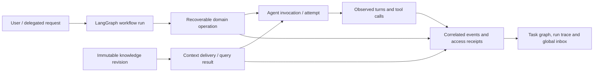
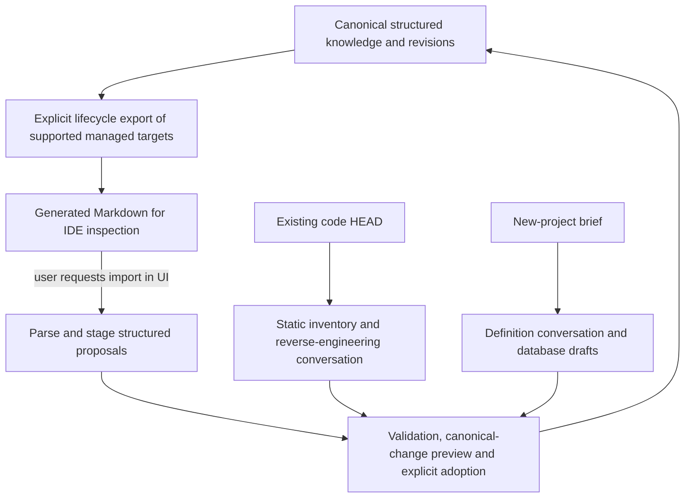

# P002 — Design basis and owner directions

Status: **adopted as the evolving baseline (D268), v0.2 text, 2026-10-29**; formalized by P002-T001 in the
[contracts](P002-T001-contracts.md), [flows](P002-T001-flows.md), [threat model](P002-T001-threat-model.md) and
D268–D279, which prevail where more precise. This is the granular working reference requested by the owner for the
0.2.0 redesign. It consolidates the [discussion](P002-autonomous-mode-discussion.md), including its later corrections,
and supports the [draft task plan](../NEXT_STEPS.md). It is not an implementation claim or an approved final schema.

**Owner direction** records a stated requirement or agreement. **Recommendation** records a proposed implementation
boundary. **Open** requires design/qualification before adoption. Earlier contradictory review recommendations in
the discussion are historical. Recommendations here are adopted only where the T001 records restate them; the
implemented 0.1.9 contract (SPECIFICATION §§1–13, flows) stays in force until each owning task replaces it.

No code, dependency installation, harness/provider execution, commit, merge, push, publication or installation is
authorized by this record. This repository remains developed by hand under AGENTS; the proposed database-first
contract describes projects managed by the product, not how agents should edit this repository today.

## B01 — Complete-roadmap autonomy

**Owner direction.** A defined or onboarded project can execute its tasks, check/close/archive each phase, plan the
successor and finish the authorized roadmap without a phase-count cap. It pauses for unresolved blockers or owner
decisions. Normal mode remains available. No automatic new objective, extra roadmap phase, deployment or publication
is implied. Completion needs satisfied criteria and CLOSED phases; abandonment is not successful completion.

**Recommendation.** Bind authority to a concrete roadmap/requirements revision. Amendments remain explicit domain
changes. Finite task attempts and cycle controls must not become a hidden cap on how many valid phases can finish.

**Coverage:** P002-T001, P002-T014–T016, P002-T022.

## B02 — LangGraph and domain authority

**Owner direction.** Use LangGraph as the proposed orchestration authority; extensive refactoring is in scope.
**Recommendation.** The graph controls stages, branches and waits. SQLite owns project knowledge, accepted revisions,
grants and domain-operation results. Trusted services validate effects. Keep references to domain records in graph
state rather than a competing editable copy of their authority. Preserve one writer per checkout and one owner of
process launch/admission. Manual and autonomous modes share domain operations.

**Open.** Exact dependency versions, package boundaries, checkpoint integration, graph-version migration and the
interaction with the existing supervisor/job queue. No dependency or replacement runtime has been installed.

**Coverage:** P002-T001–T006, P002-T014–T016, P002-T020.

## B03 — Structured project knowledge

**Owner direction.** Requirements, phases, tasks, decisions and related project knowledge become structured database
records with relationships and indexes. Markdown exports are derived views. **Recommendation.** Normalize concepts
requiring identity, constraints, querying or history; keep versioned rich text and Mermaid source for descriptive
content. Avoid a single raw-document field as the only representation, and avoid making every sentence a table.
Preserve architecture, specification and diagram expressiveness through usable UI editing.

**Open.** Entity boundaries, revision representation, requirement/criterion granularity and whether product-level
one-off tasks are needed. This repository's ONE_OFF_TASKS queue does not automatically require such a product entity.

**Coverage:** P002-T004, P002-T007, P002-T011–T013.

## B04 — Product decisions and operational rulings

**Owner direction.** Product decisions are distinct from workflow choices such as permission refusals. Product
decisions are available in DECISIONS.md, generated from canonical records. Operational rulings belong in SQLite
with their request, evidence, outcome and rationale. Link the two when a workflow choice establishes a durable
product decision. Preserve origin, stable identifiers and supersession; do not rewrite accepted historical decisions.

**Recommendation.** Query, propose and adopt are separate capabilities. A reviewer can have bounded domain decision
tools while retaining read-only code access. Tool availability must not allow self-acceptance or weakening of the
owner's criteria. API/UI/import and agents use the same adoption rules.

**Coverage:** P002-T004–T005, P002-T009, P002-T012–T013.

## B05 — Roles and configurable invocation profiles

**Owner direction.** Reviewer, executor and judge each have configurable provider, model and effort. One judge means
one such role configuration, not one persistent session or one universal prompt. Opening/checking/closing phases
must expose actual agent involvement and configuration. Deterministic work is attributed to Harness.

**Recommendation.** Freeze effective selection, prompt, tool policy and context per invocation. No silent provider
fallback or inference retry. Native CLI session behavior and future graph continuation are different concepts.

**Coverage:** P002-T002, P002-T006, P002-T008–T009, P002-T018–T019.

## B06 — Judge duties and bounded outcomes

**Owner direction.** Define each judge duty separately, including prompt, inputs, allowed tools, results and failure
routes. Permission requests yield grant/deny/escalate. Planning chooses among admissible options or escalates.
Specification gaps produce a grounded proposal within delegated intent or escalate. Blocked checks distinguish
eligible repair from conditions needing the owner. The judge never overrules integrity, acceptance or READY guards.

**Recommendation.** Specify malformed output, unavailable evidence, unsupported capability, timeout, provider
refusal and repeated requests independently for each duty. The judge may abstain. Only a concrete permitted
alternative supports continuation after denial. Prompt changes alone cannot enlarge authority.

**Coverage:** P002-T005, P002-T009–T010, P002-T015–T016, P002-T021.

## B07 — Permission dimensions, permanence and revocation

**Owner direction.** Retain separate file/tool/network/product-or-architecture/acceptance permissions. Support
per-operation, time-limited and permanent grants. Permanent means no time expiry, with explicit scope and revocation.
The judge can grant only what the owner delegated, including a permitted duration. Secret access, global settings,
unrelated roots and external delivery do not follow from enabling autonomous mode.

**Recommendation.** Bind requests and grants to project, role, targets, purpose and provenance. Check compound
effective authority and current ceilings. A mediated grant applies at a declared new attempt/context boundary.
Revocation blocks new commands and attempts; stopping an active native writer uses process control and preserves
uncertain effects. Cooperative containment cannot prevent every in-flight native filesystem action.

**Coverage:** P002-T005, P002-T008–T010, P002-T016, P002-T021.

## B08 — Tool discovery on demand

**Owner direction.** Avoid loading the complete detailed tool catalogue into each prompt. Let the model discover
the relevant tools and load definitions as needed. This does not grant access to undisclosed or unauthorized tools.

**Verified terminology.** The best match is **Tool Search**, including deferred loading/progressive disclosure.
Anthropic distinguishes this from Programmatic Tool Calling/Code Mode, which composes tool calls through code.
Structured results describe output shape, not tool discovery. MCP is a transport/interface that can support lazy
discovery; these concepts are not mutually exclusive. Native mechanisms may still expose names/server instructions
or other small indexes, so no zero-overhead claim is made.

**Recommendation.** A role/project/operation-scoped, versioned catalogue; minimal bootstrap/discovery surface;
bounded search results; exact loaded schema identities; authorization again at invocation. Record discovery,
definition delivery, call and result as separate events. Do not silently fall back to loading everything when a
required discovery capability is unavailable. Measure token/latency impact on representative tasks.

**Open.** Select the transport and loading strategy per supported CLI/profile; API support does not prove CLI support.
Code Mode is an optional candidate, not an adopted requirement for arbitrary code execution or direct SQL.

**Latest owner direction.** Prepare for future OpenCode support through a client-neutral contract owned by the
harness, instead of depending on Anthropic's native Tool Search. Standardize a small versioned discovery interface
over an existing suitable transport, not a new wire protocol simply to replace MCP. A portable candidate exposes
`search_tools`, `describe_tool` and `invoke_tool` (illustrative names), with a trusted logical catalogue behind them.
Search returns bounded descriptors/references; description returns the selected schema; invocation validates that
schema and current authority server-side. These operations can be a small static MCP surface or a characterized
CLI-specific wrapper. They do not require the client to dynamically install native tool definitions.

The generic invocation envelope must not become an authority bypass: validate the logical operation, caller,
project, revision, grant, idempotency and inputs for every call. Tool references or discovery results are not grants.
Record both broker and logical-tool identities in the trace. Native deferred discovery can be an optimization
behind the same semantics; the baseline cannot require a provider-specific extension. Compare its context cost,
schema fidelity and extra round trips with the portable path before choosing a default. A client must still meet
an explicit minimum typed-I/O/capability contract; no arbitrary CLI is claimed supported merely by naming an adapter.

**Coverage:** P002-T002, P002-T005, P002-T008, P002-T019, P002-T021–T022.

## B09 — Provider integration and capability qualification

**Owner direction.** Keep official CLIs and subscription-based operation; API credentials are not assumed. New
providers must be possible through characterized adapters. **Current evidence.** The existing Claude invocation
uses an empty MCP configuration and disabled hooks; a tool bridge needs an explicit adapter change.

**Future direction.** OpenCode is a requested future CLI client, not automatically a new inference provider or an
implemented P002 adapter. Distinguish client kind, actual inference provider and requested/reported model in the
domain/admission/accounting design. Do not assume another client's authentication, subscriptions or telemetry are
equivalent. P002 prepares extension points and portable conformance fixtures; implementing/admitting OpenCode later
needs its own agreed scope, version/capability evidence and configuration policy, without global user changes.

**Recommendation.** Qualify tool search/exposure, role restrictions, schemas, process identity, cancellation and
event coverage by provider/client/version/profile. Establish reliable domain contracts even where native telemetry
differs. An unsupported mandatory capability blocks admission with a useful explanation. No global configuration
edits, subscription-to-API substitution or hidden model fallback are part of the design.

**Coverage:** P002-T002, P002-T008, P002-T019, P002-T021–T022.

## B10 — Request-to-result trace hierarchy

**Owner direction.** Trace the path from incoming request to outcome by project, phase, task and agent: participating
agents, their turns, tool calls, failures and results. **Recommendation.** Correlate request → workflow run → domain
operation → agent invocation/attempt → observed turn/tool call using stable IDs, parent/causation links, ordered
events and timestamps. Preserve provider/model/effort, prompt/context/catalogue versions and stop reasons.

Record supplied, reported and derived data separately. Define a CLI turn separately from a harness attempt or
revision; never manufacture unknown native turns or double-count cumulative events. A graph hook is telemetry,
not proof that an external effect completed. Persist command outcomes with their domain transaction. Large
payloads can remain hashed artifacts with bounded references; no full event-sourcing rewrite is assumed.

**Coverage:** P002-T006, P002-T008–T009, P002-T014–T019, P002-T020–T022.

## B11 — Knowledge-access events

**Owner direction.** Each agent run must show which tasks, decisions and other project knowledge it accessed.
**Recommendation.** Record both initial context delivery and later query/tool-result delivery, with entity type,
stable ID, immutable revision, selected sections/ranges, content digest and exposure level (metadata, excerpt,
full content), plus truncation/pagination when relevant. Preserve the exact delivered snapshot or its reproducible
inputs. Trace search results and loaded tool schemas separately from project-knowledge reads.

"Selected for context", "delivered to the CLI", "returned by a tool" and "the model says it used this" are different
facts. Delivery proves availability, not comprehension. Native filesystem reads are recorded only when observed;
unknown observations remain explicit, without claiming full physical read interception under D064.

**Coverage:** P002-T006–T008, P002-T018–T019, P002-T021–T022.

## B12 — Recoverable agentic operations

**Owner proposal, not a fixed table.** An `agentic_task` record with ID and state could represent agent actions and
support continuation. **Recommendation.** Keep project Task distinct from durable executable Operation and model
Invocation/Attempt. One project task can contain many operations and invocations; read receipts/events need not
be independent queued tasks. Use stable operation identity, kind, parent, input/revision binding, policy, status,
result/error references, writer ownership and pending external-effect evidence as appropriate.

Status is a current projection; retain the transitions needed for audit. RUNNING after a crash does not reveal
whether a CLI, database command or Git effect completed. Resume must observe/reconcile sealed intents and prior
results. Re-entering a graph node reuses the operation rather than duplicating a charge/effect. Graph checkpoints
and the domain operation journal need an explicit consistency/recovery contract. Never infer stopped writers from
expired leases or reissue uncertain inference automatically.

**Open.** Final names/tables, lifecycle states, which units need individual recovery and checkpoint transaction
integration. Design against existing runs/jobs/attempts rather than adding a second equivalent scheduler.

**Coverage:** P002-T003, P002-T006, P002-T014–T016, P002-T020–T022.

## B13 — Exact revisions, acceptance and context boundaries

**Owner agreement.** Preserve reconstructible context and recoverable external effects. **Recommendation.** Accepted
domain revisions, code tree/diff, effective capabilities and prompt/client versions form the relevant evidence
binding. Mutable current rows alone cannot reproduce acceptance or READY. A later knowledge change creates a new
revision and an explicit next context boundary. Old accepted revisions, captures and histories are not rewritten.
Manual-mode confirmations and autonomous delegated authorizations have distinguishable origins.

**Coverage:** P002-T003–T007, P002-T010, P002-T013–T016, P002-T020–T022.

## B14 — Generated exports without drift detection

**Latest owner direction, superseding earlier review recommendations.** Do not monitor or compare exported folder
contents against the database to detect semantic drift. The database is authoritative; IDE edits are ignored unless
the user explicitly imports them. At task completion/safe operation boundaries, export the selected canonical
revision to known generated targets, replacing/regenerating those outputs under the adopted ownership policy.
No conflict inbox, automatic reverse synchronization or disk-to-database reconciliation is required.

**Recommendation.** Record export intent, source revision, renderer version, target ownership and result for
recovery. Security checks for traversal, symlinks, root boundaries and unowned-path collisions remain; they are not
document drift detection. The eventual command/commit still validates the actual effects and approved code/content.
Redefine the current document-CAS contract explicitly for managed generated targets before implementation, while
retaining relevant guards for other writes. Do not overwrite arbitrary files just because they are in docs/.

**Coverage:** P002-T001, P002-T005, P002-T013–T015, P002-T020–T022.

## B15 — Explicit manual import and round trips

**Owner direction.** A UI operation imports documents following the supported export format. Export/import support
project portability and deliberate adoption of user edits. No file watcher or automatic ingestion is introduced.
**Recommendation.** Parse into staged structured proposals; show validation, unsupported/missing content and a
preview of canonical changes; adopt explicitly with stable identity/version rules. Never let imported status text
fabricate historical executions, approvals, grants or costs. Existing run evidence is not recreated from prose.

**Open.** Export schema/version metadata, identity mapping, updates vs new-project imports, round-trip fidelity and
loss reporting. Rich prose/diagrams must survive supported round trips. A portable backup with evidence and a
human-readable document import are different capabilities and must be labelled accordingly.

**Coverage:** P002-T011–T013, P002-T020–T022.

## B16 — New-project creation and reverse-engineering onboarding

**Owner direction.** Preserve both entry flows. New-project definition creates database drafts and accepted
knowledge. Onboarding inventories existing committed code and reverse-engineers documentation into database
records rather than only .md files. Preserve known/inferred/unknown provenance and owner review; code observation
does not establish undocumented business intent. Exports follow canonical adoption.

**Recommendation.** Reuse the characterized static inventory, HEAD binding, original-file preservation and separate
profile/preparation gates where still relevant. Manual document import is not a substitute for reverse engineering.
Migrating an existing managed installation is a third distinct case, with immutable evidence preserved.

**Coverage:** P002-T004, P002-T007, P002-T011–T013, P002-T020–T022.

## B17 — Task and phase lifecycle

**Owner direction.** Support planning, task execution/review, exact acceptance, commits, phase checks, bounded
remediation, closure/archive and successor planning under the new authority model. Normal-mode actions stay explicit;
autonomous mode derives permitted child authorizations from the initial delegation. Phase closure is not a generic
status update and a model cannot waive READY. Show actual agent and deterministic actor attribution.

**Recommendation.** Preserve intents before Git/tag/export effects and deterministic recovery. Archive accepted
domain snapshots and evidence; expose regenerated human documents without changing frozen historical sources.

**Coverage:** P002-T014–T016, P002-T018, P002-T020–T022.

## B18 — Local limits and stop/resume

**Owner direction.** Attempts per task are bounded; valid execution may traverse the entire authorized roadmap.
**Recommendation.** Preserve failure lineage across renamed/split tasks, and bound repeated judge/replan/repair
cycles for the same cause. Optional consumption caps must acknowledge unknown coverage and in-flight overshoot.
No-response is no approval. Durable waits stop inference; answers bind to the current request/revision. Revocation
and uncertainty have explicit outcomes. Graph recursion limits must not accidentally cap valid roadmap length.

**Coverage:** P002-T003, P002-T006, P002-T009–T010, P002-T014–T017, P002-T021–T022.

## B19 — Global inbox

**Owner direction.** One global inbox serves manual and autonomous modes and identifies project plus optional
phase/task/run/operation. Define notification types and shortcuts during design; examples include task completed,
task blocked and phase awaiting closure. **Recommendation.** Generate deduplicated durable items from committed
events; distinguish unread from unresolved. Shortcuts invoke the ordinary guarded commands with fresh authority,
revision and READY checks. Query-only archives remain read-only. Optional OS delivery is secondary to the inbox.

**Coverage:** P002-T006, P002-T015–T017, P002-T020–T022.

## B20 — Task-instance graph and trace inspection

**Owner direction.** Display SQLite task instances, grouped into phases, with the participating agents, turns,
tools, stage/status and useful details. Show actual agent involvement in phase opening/checking/closing. The owner
will provide visual guidance; detailed layout is deliberately pending. **Recommendation.** Link the task view to
the correlated event timeline and knowledge-access evidence. Use bounded projections, lazy history, accessibility
and truthful missing-data labels. Keep runtime topology and task identities distinct but linked.

**Coverage:** P002-T006–T007, P002-T017–T018, P002-T021–T022.

## B21 — Accounting and efficiency

**Owner agreement.** Account for all model roles and preserve unknown data. **Recommendation.** Keep P001's frozen
references, billing distinctions and immutable provenance. Every new inference path participates in invocation
accounting from its introduction; discovery/document events are not invented model invocations. Aggregate by the
new hierarchy without double counting. Measure discovery/context efficiency, latency and completion quality;
database structure and lazy tools alone do not prove savings or available subscription quota.

**Coverage:** P002-T006, P002-T008–T009, P002-T014–T016, P002-T019–T022.

## B22 — Migration, portability and backup

**Owner agreement.** Reconsider schema and support explicit import/export; preserve recovery. **Recommendation.**
Prefer SQLite unless workload/deployment evidence requires another engine. Preserve existing histories, usage
records, snapshots and source versions. Use verified pre-migration snapshots and stable identity conversion.
Provide project-scoped portable transfer and verified full backup/restore with referenced artifacts. A document
import does not restore exact audit history, and a query-only restore does not grant execution authority. Define
graph/runtime version drift handling and recovery on another machine without modifying global configuration.

**Coverage:** P002-T004, P002-T011, P002-T013, P002-T020–T023.

## B23 — Security and qualification

**Owner direction.** Include explicit audits and evidence for supported providers and future additions. Cover
authority, injection, isolation limitations, unsafe grants, permanent permissions, event integrity and recovery.
**Recommendation.** Define threats before exposing tools, test each boundary as built and independently review the
integrated result. Use synthetic fixtures/fake CLIs first, fault injection and UI/API misuse cases. Real-provider
or installed-operation qualification requires separate explicit authorization and truthful evidence limits. Do not
promise to detect every possible LLM risk or treat a provider change as automatically qualified.

**Coverage:** P002-T001–T002, all implementation tasks' own evidence, P002-T020–T023.

## B24 — Planning, delivery and change governance

**Owner direction.** Define the full P002 problem/outcome breakdown now, with tasks/subtasks that can be refined or
expanded as the redesign progresses. **Recommendation.** Stable task IDs, dependencies and evidence requirements;
record additions/splits/reasons without silently dropping acceptance or pending delivery. Preserve historical
contracts already frozen by real product runs. The draft plan's detailed implementation remains reviewable.

Target 0.2.0 at phase closure. Planning is on docs/p002-plan; implementation uses topic branches from develop.
Integration, release through protected main, verified distribution/publication and local installation are separate
pending delivery stages under D242/D253. One-offs follow D261 from the latest main release, through main and back
to develop. No task status or release target grants permission to run the harness on this repository.

Repository documentation maintenance now follows [D267](../DECISIONS.md#d267--archive-completed-one-offs-separately-from-active-phase-work):
once a one-off reaches main, its record moves to the dedicated archive while remaining agreed delivery stays in
the queue. Earlier unrelated project-history notes are archived separately. This is an actual repository workflow
rule, not a new managed-project entity or runtime behavior; P002 source work remains proposed.

**Coverage:** all draft tasks, especially P002-T001 and P002-T023.

## Open design gates

T001 replaced this list with the [gate register G01–G17](P002-T001-contracts.md#12-open-gate-register); item 1 and the
generated-target ownership part of item 4 are resolved. The original list is kept for reference:

1. Approve/refine the draft task plan and formalize the changed normative contracts before source work.
2. Characterize lazy tool discovery and scoped calls for each CLI; choose exact dependencies and supported profiles.
3. Choose structured entities/revisions, operation granularity and checkpoint/domain recovery consistency.
4. Define generated-target ownership, export format and explicit manual-import adoption rules without drift detection.
5. Agree inbox taxonomy/actions and obtain the owner's visual direction before committing to graph layout.
6. Define measurable qualification gates and separate authorization for any real-provider/release/install operation.

## Reference sketches

The schema remains open. The sketch separates project Task from executable operations and does not promise
unobserved native events or use a mutable status row as sufficient crash-recovery evidence.

There is no automatic disk-to-database edge or exported-content drift monitor. Full evidence-bearing backup/restore
is a separate path from importing human-readable project documents.

## Sources and limits

Conversation directions are recorded in [discussion §§1–8](P002-autonomous-mode-discussion.md). Existing technical
baselines: [architecture](../ARCHITECTURE.md), [data](../DDBB-DIAGRAM.md), [task run](../flows/task-run.md),
[phase lifecycle](../flows/phase-lifecycle.md), [definition](../flows/project-definition.md),
[onboarding](../flows/project-onboarding.md) and [query-only consultation](../flows/backup-consultation.md).

Terminology verified on 2026-10-29:

- [Anthropic Tool Search](https://www.anthropic.com/research/advanced-tool-use): deferred discovery is distinct from
  programmatic tool calling.
- [Claude Code MCP tool search](https://code.claude.com/docs/en/mcp#scale-with-mcp-tool-search): lazy definitions can
  coexist with MCP; small startup indexes and configuration-dependent behavior still matter.
- [Code execution with MCP](https://www.anthropic.com/engineering/code-execution-with-mcp): related progressive
  disclosure/Code Mode approach, not a selected new execution permission.
- [OpenAI tool search](https://developers.openai.com/api/docs/guides/tools-tool-search): API-level documentation;
  it does not establish support in this repository's particular Codex CLI/version/profile.
- [OpenCode MCP](https://opencode.ai/docs/mcp-servers/) and [custom tools](https://opencode.ai/docs/custom-tools/):
  documented integration surfaces, not evidence that a harness adapter, lazy discovery or billing mode is qualified.

No runtime/CLI compatibility, schema migration or security guarantee has been qualified by this planning document.

## Planning verification

Initial draft v0.1 has 23 unique proposed task IDs and 69 subtasks in NEXT_STEPS. Dependency declarations match the index
and contain no cycles/forward prerequisites; all 24 basis areas have coverage references. The five changed/new
planning Markdown files pass the focused documentation check, and the 76 tracked Markdown files pass the repository
documentation check. All five Mermaid blocks across this basis and the discussion pass grammar/graph construction
using the installed parser; browser rendering was not exercised. The prior discussion prefix, narrower proposal
and one-off queue are unchanged. No product suites, real agents/providers, harness execution, dependency change,
commit, publication or installation were performed.
